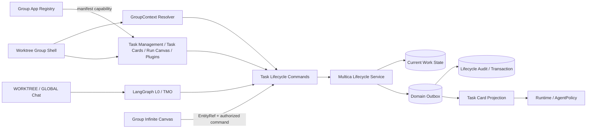
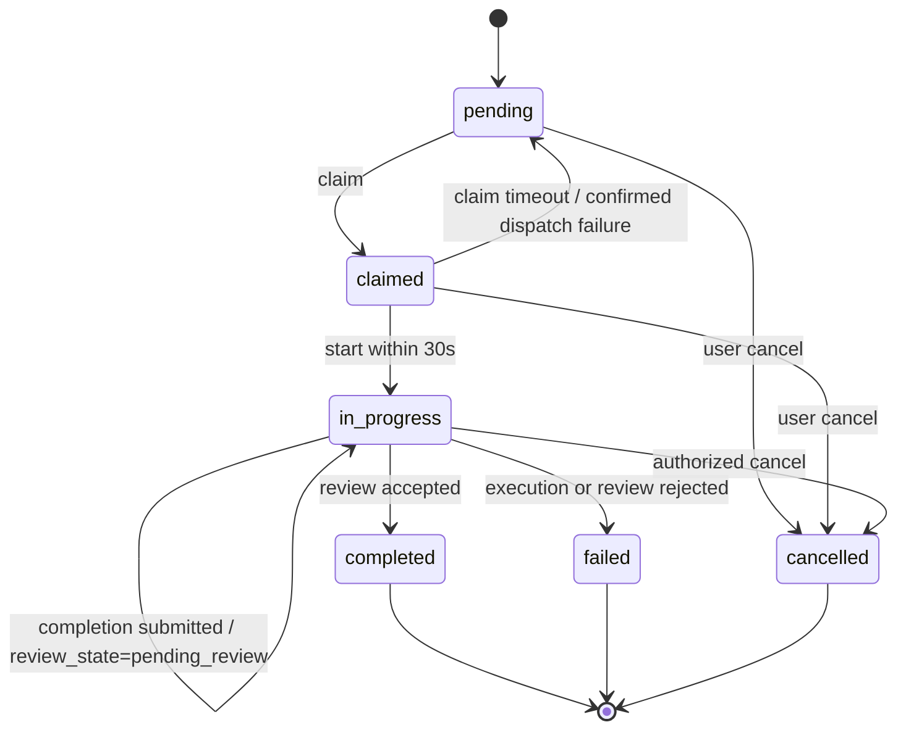

# BD-MULTICA-TASK-001

> **9F4H 当前增量**：Run BI 只读界面、客户端和错误/分页/取消处理已实现，前端 11/11 与 typecheck 通过；Rust 1.99.0 API all-target check、BI runtime 12/12 通过。此前章节的未运行记录仅描述当时切片；本次结果与生产缺口以 `PHASE-9F4H-BI-READ-UI-REPORT.md` 为准，生产 BI 与全部 phases 仍未完成。

> **Task Lifecycle 基本設計書 v0.18**
>
> - 状态: 🟡 Draft v0.18
> - 日期: 2026-10-02 JST
> - 上游需求: [docs/requirements/SRS-MULTICA-TASK-001.md](../requirements/SRS-MULTICA-TASK-001.md) v0.25
> - 渡口共享基线: [`docs/requirements.md`](../requirements.md) §50; [`docs/basic-design.md`](../basic-design.md) §16
> - Multica 状态来源: [`docs/adr/0026-multica-patterns-borrow.md`](../adr/0026-multica-patterns-borrow.md) v0.2 §2.1 模式 2
> - 下游詳細設計: [`docs/design/DD-MULTICA-TASK-001.md`](DD-MULTICA-TASK-001.md)
> - 修订人: Ulysses（一人公司 12 角色 per DEC-008）— Mavis 接手审核
> - 审批: Draft，未形成正式评审结论

---

## §0 目的与范围

本文档为 Multica Task Lifecycle 定义组件边界、状态控制、数据归属、跨应用接口和权限流。它落实 SRS 的任务 claim、review gate、session poison、404 标记与 WBS schema 需求，并把这些能力放入渡口 Worktree 群组。

Multica 负责任务生命周期命令和状态规则；Worktree Group Shell 负责导航、当前群组上下文和共享聊天入口；Task Card 是共同的执行工作面；CLI/Agent Session 由 Runtime/AgentPolicy 管理。它们共用任务身份，但不复制彼此的状态机。

---

## §1 渡口产品层级与领域边界

### 1.1 产品树

| 层级 | 节点 | 设计约束 |
|---|---|---|
| 左侧一级 | Project | 项目根与管理入口；跨 Run 索引是汇总视图，不取代主树 |
| Project 下 | Engineering Run | Run owner、协作授权和 Task/Canvas/Inbox/Workflow/BI/Plugin App 范围，不依赖宿主 Branch |
| Run 下 | Worktree | Run 管理的本地 checkout；选中后显示该 Run 的右侧 App tabs，并设置 checkout focus |
| Worktree 下 | Branch | 本地 checkout 分支投影与状态叶；远端分支仅是可选 SCM metadata |
| Run 同级 Apps | 任务管理、Task Cards、Run Canvas、Inbox、Workflow、BI/Benchmark、已授权插件 | 同一 RunContext 和 typed entity references；Task Cards 与 Canvas 同级 |
| Task Card 内 | CLI、Agent Session、输出、checkpoint、review、审计 | 绑定 Run/Task 和显式 Worktree focus；Runtime/security gates 未验收前禁用执行 |
| 固定底栏 | Chat Bar | 支持 WORKTREE 与 GLOBAL scope |

### 1.2 事实源与投影

| 对象 | 事实源/所有者 | 其他视图如何使用 |
|---|---|---|
| Task Lifecycle | Run-scoped Task Lifecycle owner | Task Cards、任务视图与聊天命令读取同一任务状态 |
| WorkItem 身份 | WorkItem Domain | Multica `work_item_id`、Task Card 和 Canvas `EntityRef` 统一引用 |
| Task Card UI | Group Shell / Task Card Manager | 投影 WorkItem 与 Agent Session 状态，不维护平行状态机 |
| CLI/Agent Session | Runtime / AgentPolicy | Task Card 提供启动入口与绑定上下文；Runtime 决定执行、恢复和权限 |
| Canvas 元素 | Canvas Domain | 仅持有对象引用、关系、布局和可视化状态；任务变更走领域命令 |
| 插件清单/入口 | Group App Registry | 热插拔群组导航及声明 capability；插件不持有 Multica 任务事实 |

---

## §2 组件与依赖



| 组件 | 职责 | 不拥有的职责 |
|---|---|---|
| GroupContext Resolver | 校验 actor、tenant、`worktree_id`、scope 与目标对象 | 不授予比当前用户更大的权限 |
| Task Lifecycle Service | claim/start/complete/fail/cancel/review 的唯一命令入口 | 不执行 CLI、不直接编辑 Canvas 布局 |
| WBS Adapter | 映射现有 WBS 行与生命周期当前态字段，执行兼容迁移 | 不把外部 RPC 的成功回执当作任务完成证据 |
| Review Gate | 校验输出、提交及 artifact，接受或拒绝完成申请 | 不修改执行产物或隐藏失败原因 |
| Session Health Handler | 记录 poison 类型，阻止坏 session 恢复并启动 fresh session | 不把 poison 标记当作 Task Lifecycle 状态 |
| Task Card Manager | 按事件更新卡片投影，提供卡内 Runtime 面板 | 不生成第二个 `work_item_id` |
| Event Outbox / Audit Writer | 保证领域事件与事务审计可靠落档 | 不将可清理 Work 状态长期 append-only 保存 |
| Group App Registry | 根据启用 manifest 显示或撤销插件同级入口 | 不注册 Multica 状态机或覆盖领域 ACL |

依赖方向为 UI/编排 → 领域命令 → Lifecycle Service → 持久化与 Outbox；跨应用状态推送消费领域事件，不由应用之间直接写彼此数据库。

---

## §3 生命周期命令与状态

### 3.1 当前态与 Review Gate

当前态使用 SRS 定义的 `pending`、`claimed`、`in_progress`、`completed`、`failed`、`cancelled`。Review Gate 使用独立的 `review_state` (`none` / `pending_review` / `accepted` / `rejected`)，避免把 review 和 Runtime 执行状态混成另一套 Agent 状态机。



| 命令 | 前置条件 | 结果 | 必须记录 |
|---|---|---|---|
| `claim_task` | 当前态 `pending`，授权通过 | `claimed` + lease/claim 时间 | actor、worktree、task、claim correlation |
| `start_task` | 当前态 `claimed` 且 claim 未超时 | `in_progress` | runtime/session 引用、started_at |
| `submit_completion` | 当前态 `in_progress` | 仍为 `in_progress`，`review_state=pending_review` | commit、output、artifact 引用 |
| `review_accept` | 三项证据验证通过 | `completed`，`review_state=accepted` | reviewer、证据摘要、时间 |
| `review_reject` | review 未通过 | `failed`，写明原因 | reviewer、拒绝原因、证据摘要 |
| `mark_failed` / `cancel_task` | 状态允许且权限通过 | `failed` / `cancelled` | actor、原因、时间 |

重复命令使用 `idempotency_key`；非法状态转换返回领域错误，不直接覆盖当前态。claim 过期回退必须先核实 dispatcher/RPC 的真实结果，不能仅凭客户端 `succeeded` 标识重新派发。

### 3.2 Session Poison 与 404 事件

- `session_poisoned` 和 `session_poison_reason` 是执行会话健康数据；它们不改变任务身份。坏 session 不 resume，由 Runtime 创建新 session 并保留关联。
- Workspace/task/runtime 404 分别记录类型和观测时间。404 记录通知 Lifecycle Service 和 Task Card projection，不由 UI 直接删除任务。
- `stale_dispatch=true` 代表派发结果需复核；verify/collect_output 完成后才允许重试、恢复或转失败。

---

## §4 数据模型与 W/T/M 分类

所有当前态查询都按 `worktree_id`、`tenant_id` 和 actor 权限过滤。逻辑表最终字段在详细设计中映射到现有 WBS / 数据库结构。

| 逻辑数据集 | 分类 | 内容 | 保留/删除规则 |
|---|---|---|---|
| `task_lifecycle_current` | **Work** | `worktree_id`、`work_item_id`、`task_card_id`、当前 status、claim lease、session 当前引用、stale_dispatch | 明确 `retention_period`；过期可物理清理或重建投影 |
| `task_lifecycle_audit` | **Transaction** | 状态转换、review 决策、派发验证、404 观测和 actor/correlation 事实 | append-only，不物理删除；按 Transaction 规则携带审计和 RLS |
| `task_metadata` | **Master** | 人工维护的名称、优先级、标签、执行策略引用 | SCD Type 2；按 Master 规则携带 RLS |
| `task_session_health` | **Transaction** | session poison 原因、fresh-session 决定及 Runtime 关联事实 | append-only 审计记录；可查询当前有效标记，但不覆盖历史事实 |
| `automation.schedule_rule_revision` | **Master** | Automation owner 的版本化 schedule expression/timezone/parser+tzdb version、DST/overlap/misfire/pause/retry/deadline 与 canonical Run target/Profile/HookSet identity | SCD2，只允许关闭当前 revision；不得原位改写或物理删除；tenant FORCE RLS |
| `automation.schedule_rule_audit` | **Transaction** | schedule rule 创建/替代的 actor、revision、correlation 与有界 metadata | append-only；tenant FORCE RLS |
| `automation.occurrence` | **Transaction** | rule revision + UTC slot 幂等身份、local time/offset、parser/tzdb 与不可变 target snapshot | append-only；tenant FORCE RLS；unique (tenant, rule, revision, scheduled UTC) |
| `automation.occurrence_dispatch` | **Work** | bounded attempt/next-attempt、lease owner/expiry、单调 fencing generation、deadline 与终态清理时间 | 显式 30 天 TTL/retention；租约到期可重新 claim，generation 必须递增；tenant FORCE RLS |
| `automation.occurrence_event` | **Transaction** | occurrence materialization、lease、retry、Run admission/link 与 terminal outcome | append-only，携带 occurrence/run/correlation/fence identity；tenant FORCE RLS |

WBS row 可保留兼容字段和便于读取的 audit JSON projection；权威 Transaction 记录写入 `task_lifecycle_audit`。projection 可重建，不替代审计事实。混合字段到物理表的拆分属于详细设计确认项。

Schedule rule/occurrence 的实体所有权在 `domain-automation`，迁移位于 `automation` schema；Run admission 仍由 Multica Run writer 在同一短事务重授权 target，并消费当前 generation。occurrence 不因 rule successor 改写；重复 materialization 由 tenant/rule/version/UTC slot 唯一约束收敛。Dispatch Work 表只表示可重建的当前派发状态，所有可审计转换写入 Transaction event。Phase 9F3 已实现版本固定的 cron/timezone materializer 与 PostgreSQL rule reader、occurrence persistence、bounded claim/reclaim、heartbeat/retry、deadline/exhaustion terminalization 和 TTL purge；候选槽与 DST transition 探测分别有 32,768 步上限；disabled Rule 在 materializer 与 adapter 两层 fail closed，lease-expired event 保留被回收的旧 attempt 与旧 fencing generation。该 slice 在 PostgreSQL 18.6 disposable cluster 中重复应用 migration 并通过 FORCE RLS/4 个 DB 场景、`domain-automation` release tests 26/26；它没有生产 Rule 写 API、常驻 clock/worker、Run/reservation/Outbox atomic admission、BI consumer 或目标 DB/Auth grants，Schedule producer capability 仍不可用。

---

## §5 群组上下文、CLI 与插件接口

### 5.1 GroupContext 和聊天范围

每个领域命令带 `GroupContext(worktree_id, tenant_id, actor_id, permissions, correlation_id)`。`WORKTREE` 只能触达当前 Worktree；`GLOBAL` 可跨多个获权 Worktree，但每个写操作先解析成明确的 `target_worktree_ids`，逐目标授权并记录结果。Global 不继承隐式“全仓管理员”权限。

### 5.2 Task Card 内 CLI

从 Multica、Jira 等价视图或 Canvas 打开卡片时都通过相同 `work_item_id` 定位同一 Task Card。Runtime 启动参数由卡片绑定上下文产生并校验：

```text
TaskExecutionContext = {
  worktree_id,
  work_item_id,
  task_card_id,
  actor_id,
  scope_kind,
  runtime_profile,
  permission_snapshot,
  correlation_id
}
```

CLI/Agent Session 出现在 Task Card 内。Shell 仅提供启动、输出和状态展示；Runtime/AgentPolicy 检查可执行目录、工具 capability、凭据访问和中止规则。浏览器当前路径不能替代 `worktree_id` 校验。

### 5.3 Canvas 与插件

- Group Infinite Canvas 使用 `EntityRef(type, id, worktree_id)`，通过 Lifecycle Command 修改任务；Canvas 本地保存布局、关系边和视图偏好。
- 内置应用和插件都通过领域 API/Outbox 读写。插件 `manifest` 至少声明 `plugin_id`、版本、scope、capabilities、所需权限和入口；启用/卸载即时刷新 Worktree 群组入口。
- 卸载插件不会删除 WorkItem、Task Card、审计或 Canvas 中的引用；缺失插件时保留可读的 disabled reference。
- Group App Registry 与 LangGraph `SubAgentRegistry` 分开。前者注册应用入口，后者注册可执行的 Agent 图；任何 capability bridge 都执行 scope 和权限校验。

---

## §6 接口与事件

接口以命令为边界，不让 UI、Canvas 或插件直写 Lifecycle 表。

| 命令/事件 | 生产方 | 消费方 | 核心字段 |
|---|---|---|---|
| `TaskClaimRequested` / `TaskClaimed` | Task Card / L0 | Lifecycle Service / Card Projection | Worktree、WorkItem、actor、idempotency key |
| `TaskStarted` | Runtime | Lifecycle Service / Card Projection | task_card_id、session_id、started_at |
| `TaskCompletionSubmitted` | Runtime | Review Gate | commit、output、artifact refs |
| `TaskReviewAccepted` / `TaskReviewRejected` | Review Gate | Lifecycle Service / Audit | reviewer、decision、reason |
| `TaskFailed` / `TaskCancelled` | Runtime / authorized user | Lifecycle Service / Audit | actor、failure/cancel reason |
| `TaskSessionPoisoned` | Session Health Handler | Runtime / Audit / Card | reason enum、session ref、fresh-start flag |
| `TaskLifecycleChanged` | Outbox | Multica / Jira view / Task Card / Canvas projection | canonical IDs、new status、version、correlation_id |
| TaskCardCreateRequested (POST /api/v1/engineering-runs/{engineering_run_id}/work-items) | Run Task Cards UI | Work Item owner API | Project/Run identity、可选 focus_worktree_id、bounded task payload、Idempotency-Key 与 correlation_id；服务端验证 Project/Run grants 和可选 focus binding |

事件消费者以 `event_id` 去重；Outbox 发布失败时可重放。投影版本小于事件版本时拒绝旧事件覆盖新状态。

---

### 6.1 Task Outbox delivery and consumer boundary

The Task owner writes immutable lifecycle source facts; the Task delivery owner manages owner-local delivery work. Migration source `2026-10-16-task-run-outbox-route-pin.sql` now defines a persisted route pin keyed by tenant/event and linked to the permanent source event, with a fixed function that rechecks the current worker/attempt/schema lease before insert or replay. It binds sender/receiver identities, provider/version, Profile ID/revision/digest, endpoint/destination generation, schema version and exact-wire digest; it stores no payload, endpoint URI, or credential. A retry may not resolve a new route or re-serialize different bytes. A disposable PostgreSQL 18 synthetic-Outbox fixture replayed both delivery migrations twice and passed selected schema, role/grant, FORCE RLS/tenant isolation, WORM, lease/schema fence, exact-retry/digest rejection and pin-transaction rollback assertions. Target DB deployment, migration downgrade/rollback, concurrency and production identity remain unverified. The new Rust owner store calls this function for source-level route/wire preparation, but no network dispatcher is wired. The receiver must commit an owner-local Inbox receipt before responding; a trusted Rust dispatcher must verify identity and receipt binding to the source event, route pin, digest and active lease before any accepted settlement. The existing settlement remains closed.

Each consumer, including Run Apps, subscribed Schedule/Loop, and BI/Benchmark, has its own Inbox deduplication and commits the Inbox receipt with its projection/outcome in one local transaction. Version gaps, poison conflicts, lag and freshness are observable per consumer. No cross-owner table writes or distributed transaction are allowed. Route-pin PostgreSQL apply/replay and effective RLS/grants/WORM are not yet verified; receiver and consumer schemas/APIs, target grants/RLS, dispatcher, and crash/replay verification remain implementation and activation gates.

The current Rust store slice now binds a bounded database claim to a deterministic wire and immutable route pin. Route construction requires a currently authorized Transport Profile revision with the independent `event` message kind, derives sender/receiver identities from an authenticated transport context, and cross-checks deployment, tenant, profile revision/digest and endpoint. Retry is lease-fenced. A dead disposition can be submitted only with a private proof obtained from source-envelope validation failure. The source Outbox's existing `octet_length(payload::text) <= 8192` check bounds payload bytes before PostgreSQL returns JSONB rows; claims are capped at eight. No network send, accepted settlement, receiver Inbox writer, consumer store or Run-fair scheduler is present. Rust compilation/formatting, target DB, concurrency and production identity remain unverified.

Delivery Work has a hard expiry at `created_at + 7 days`, measured from enqueue and never reset by a terminal transition. A terminal settlement appends the permanent receipt before deleting Work in the same transaction. A still-unsettled row reaching expiry is recorded as `dead/retention_elapsed` before Work deletion. The receipt is a permanent Transaction fact; only the bounded delivery Work expires.

### 6.2 Phase 9F4E BI owner Task-event Inbox

The first downstream business subscriber is BI. `bi-owner-runtime` bounds exact wire to 16 KiB and validates supported Task schemas and owner scope before opening its transaction. `bi.commit_task_event_v1` writes `bi.task_event_inbox` and immutable `bi.task_event_fact` together; exact replay returns the original receipt. Reused event identity with changed scope, route, wire, actor/correlation/time, or payload records a payload-free `bi.task_event_integrity_incident` and returns no receipt.

The three BI tables are Transaction facts with tenant FORCE RLS and WORM. The runtime role has only schema USAGE and EXECUTE on the fixed function, with no direct table DML or schema CREATE. A PostgreSQL 18.6 disposable runner double-applied the migration and passed exact replay, conflict, cross-tenant identity, least privilege, RLS and WORM cases. This does not verify target DB roles or production rollout.

`AuthenticatedTaskEventPrincipal` has crate-private fields so a caller outside the crate cannot manufacture authenticated IDs. The crate currently has no trusted transport adapter that creates it; this store is not yet a network receiver or production authentication proof. The 9F4F follow-on supersedes the raw-payload storage semantics of this initial slice; see §6.3. Dispatcher send, receiver response/receipt signature, accepted settlement, fan-out to Benchmark/Run Apps/Schedule/Canvas, target DB, Rust 1.99 build/fmt, concurrency/crash recovery and backup/WAL retention remain open; all consumers and execution remain fail closed.

### 6.3 Phase 9F4F BI Task payload minimization

The BI owner database now converts bounded source payloads into a strict versioned allowlist projection before persistence. Runtime calls `bi.commit_task_event_v2`; it cannot execute the legacy `bi.commit_task_event_v1` raw-persistence function or call the projection helper directly. The database validates schema/event/scope and lifecycle/review values, rejects missing required status fields, and drops all unrecognized or free-form fields. Metadata projection retains only IDs, version, event type and owner-change state. Lifecycle projection retains only IDs, version, event type, lifecycle/review state and nullable from/to states.

Migration `2026-10-16-bi-task-event-projection.sql` backfills existing facts through the same database projector inside one transaction, preserving stable event, Inbox receipt, route and wire identity. The replacement table is swapped in and the old live raw-payload table is dropped only after the backfill succeeds; any unsupported fact aborts and rolls back the migration. The disposable PostgreSQL 18.6 runner passed repeated apply, legacy sentinel removal, v2 commit/replay, missing-state rejection, effective runtime grants, FORCE RLS and WORM. This does not verify deployment or clean bytes already present in backups/WAL; source Task Outbox retention remains separately owned.

The immutable fact is now a safe event projection source, not a BI query API or materialized analytics interface. Rust 1.99.0 `bi-owner-runtime` rustfmt, all-target tests (4/4) and strict all-target Clippy `-D warnings` passed; workspace-wide Rust gates remain open. Trusted receiver identity/factory, network dispatch, accepted settlement, production BI UI/query deployment (source API is in §6.5), target DB/RLS grants, backup/WAL retention and concurrent/crash recovery remain open. Keep BI ingestion and all task execution fail closed until these gates pass.

## §7 安全、失败与可观测性

- 每次读、写、CLI 启动和插件 capability 调用都按 tenant、Worktree、actor、WorkItem 做授权；GLOBAL 目标逐个记录允许/拒绝结果。
- 任务状态变更、review、取消、派发验证与 session poison 写 Transaction 审计；Work 数据不得因审计策略变成永久保留。
- Runtime 中断、Lease 过期、RPC 不确定、Outbox 延迟和插件卸载都提供可见状态；不把未知结果自动解释为成功。
- 关键指标包括 claim→start 延迟、review 等待时长、stale dispatch 数、poison session 数、事件 outbox lag、CLI 启动拒绝数及跨 Worktree 授权拒绝数。
- trace/correlation 链贯穿 Group Shell → L0 → Lifecycle Command → Runtime → Task Card/Canvas 投影。

---

## §8 验收映射

| SRS AC | 基本设计验收 |
|---|---|
| AC-1 / AC-5 | `task_lifecycle_current`、`task_lifecycle_audit`、`task_metadata` 和 `task_session_health` 完成 W/T/M 分类与保留策略；迁移前后身份不变 |
| AC-2 / AC-6 / AC-8 | 未经 Review Gate 不进入 `completed`；claim timeout、审计记录和 console 状态按定义呈现 |
| AC-3 / AC-4 / AC-7 | poison 原因完整；stale dispatch 有 verify/collect_output；四类 404 类型独立可见 |
| AC-9 | 任务管理视图、计划管理视图、Task Card 与 Canvas 对同一 `work_item_id` 显示一致状态 |
| AC-10 | Task Card 启动 CLI 时 `worktree_id`、`work_item_id`、`task_card_id` 校验一致；Lifecycle enum 不因 CLI 扩展 |
| AC-11 | Task Card Index 与 Group Infinite Canvas 是 Worktree 群组同级入口，任务写入经领域命令和 ACL |
| AC-12 | 插件热插拔只改变入口/capability 暴露，不删除任务、审计和实体引用 |
| AC-18 | Automation schedule revisions 与 occurrence/dispatch/event 五表按 Master/Transaction/Work 分类；UTC slot 幂等、目标/Profile/HookSet 固定、候选槽与 DST 探测各限 32,768 步、disabled Rule 拒绝物化、lease-expired event 记录旧 attempt/generation、TTL/fencing/RLS 约束可验证；9F3 parser/materializer/adapter 与 domain release 26/26 已通过隔离 PostgreSQL 验收；Rule 写 API、持续 worker、Run admission/Auth/Outbox/BI 与目标 DB 未验收时不开放 Schedule execution |
| AC-19 | Run Task Card 的 canonical owner 为 tenant/Project/Engineering Run；无 host Branch、无 Worktree focus 时仍支持受授权 list/create。POST 复验 Project/Run grants 与非归档 Run，focus_worktree_id 可选且必须绑定同一 Project/Run，repository/Branch 只作可选 context。单个 owner transaction 写 metadata/lifecycle/optional association/audit/idempotency/Outbox v2；客户端保留精确 body/key、32 条上限、29 天门控和人工恢复确认。目标 DB migration、app-role grants、RLS 和 Rust/HTTP/frontend 验证尚未完成；生命周期编辑、Schedule、CLI 仍关闭 |
| AC-20 | 首发前保存 immutable route pin 并绑定 exact-wire digest；retry 不得漂移 endpoint/Profile/provider；delivery Work expiry 为 enqueue `created_at + 7 days` 且终态不重置；terminal receipt 先追加再删除 Work，未终态到期时记录 `retention_elapsed` 再删除；receiver 在本地提交 Inbox receipt 后才回复；可信 dispatcher 验证 receiver/source/route/digest/lease 后才可 settlement；每个 Run App、订阅事件的 Schedule/Loop 与 BI/Benchmark consumer 在本地事务提交独立 Inbox receipt 与 projection/outcome。route-pin migration 与 bounded Rust claim/route/wire store 已有源码；Profile 必须授权 `event` 且路由身份来自 authenticated context。当前没有网络发送、accepted、receiver auth/API 或除 BI Inbox/fact source 外的 consumer stores/projections，也无 fair scheduler；Rust/target DB 未验收，生产 delivery 保持关闭 |
| AC-21 | BI owner 在自身事务内原子提交 Task event Inbox 与 immutable fact；exact replay 稳定回执，scope/route/wire/content 冲突只写 payload-free incident 且无回执；16 KiB wire/8 KiB payload、tenant FORCE RLS、WORM、runtime 无直接表/CREATE 权限和双次 migration 在 disposable PostgreSQL 18.6 通过。crate 内 principal 无认证 transport factory，故未接生产 receiver；BI projection、其他 consumer/fan-out、dispatcher/accepted、target DB、Rust build/fmt 与无 TTL raw payload 的 retention/privacy policy 仍未关闭 |

---

### 6.4 Phase 9F4G BI Task event receiver core

BI owner runtime exposes a static-dispatch, caller-driven `TaskEventReceiver`. It accepts one `TaskEventReceiveRoute` with an immutable `TaskEventRoutePin`, one delivery transport, one trusted authorization verifier, one BI owner Inbox commit port, and one durable metadata-only quarantine port. No constructor starts a worker. Each receiver has a single permit; concurrent `receive_one` calls fail as Busy instead of queueing. The call owns a cancellation token and absolute deadline across pull, authorization, commit, and disposition.

The core limits exact wire to 16 KiB and requires the transport to reject oversized frames before buffering. After validating provider/source identity, route and exact event ID, it calls the BI owner transaction. ACK occurs only after the transaction returns a stable committed/replay receipt and a second current-origin authorization check. Cancellation may race commit or ACK; transport redelivery and Inbox exact replay resolve uncertainty. Malformed envelopes, tenant/message mismatch, and content conflicts go to a quarantine port that stores only bounded route/origin/cursor, digest, length and fault metadata. The port must deduplicate `(route, provider_identity, log_generation, log_id, sequence)` and reject changed digest/fault; terminal disposition requires a committed non-nil receipt plus reauthorization.

The new `TaskEventQuarantineStore` writes through the fixed `bi.record_task_event_quarantine_v1` owner function. `bi.task_event_quarantine` is an append-only Transaction table containing route/source cursor metadata, message ID, exact-wire SHA-256/length and a fixed fault code only. Its unique key includes the full immutable route identity and source cursor. Exact replay returns the original receipt only when message ID, digest, length and fault match; otherwise the function returns a conflict without a receipt. The runtime has no direct privileges on this table; this migration grants EXECUTE on the fixed quarantine function. The fixture also checks NOINHERIT role attributes and rejects membership that would permit runtime `SET ROLE` to the owner. Tenant FORCE RLS and WORM are enforced. The isolated PostgreSQL 18 runner passed double application, invalid-input/tenant-scope, scoped privileges/RLS/WORM, exact-replay and deterministic unique-key lock-wait races across two sessions.

The function does not prove that its route parameters came from the authoritative pin registry or authenticate a transport principal; a trusted Rust adapter must supply those facts. `app.tenant_id` rejects missing or mismatched call scope but is not a security boundary against a compromised runtime role able to set the GUC. No concrete production transport, identity verifier, receiver composition, target DB grants/RLS deployment, downstream consumers or accepted settlement is delivered. The query API source is described in §6.5; its Rust and production deployment gates remain open. Rust 1.99.0 focused gates remain unrun because cargo/rustfmt are unavailable; production BI ingress, delivery acceptance and Task/Run execution remain fail closed.

### 6.5 Phase 9F4G Run-scoped BI Task-event query API

The Run App exposes `GET /api/v1/engineering-runs/{engineering_run_id}/bi/task-events` through a read-only query port. The API validates the current actor and `project:read`, resolves Project/Run authorization through the existing host-independent owner transaction, and retains that transaction until the separate BI page query completes. Revocation therefore cannot race an already authorized page read. An optional `BI_DATABASE_URL` configures a dedicated pool capped at two connections; missing provider returns 503, while empty or invalid configuration prevents startup. A six-second wall-clock timeout bounds the provider read and releases the authorization transaction on expiry.

The BI query uses a fixed `SECURITY DEFINER` owner function and the database role receives only EXECUTE on that function, without direct fact-table SELECT. Scope includes tenant, Project, Engineering Run and the fixed BI consumer. Pages default to 50 and cap at 100; cursor fields must be paired and use `(occurred_at DESC, event_id ASC)`. The response contains only allowlisted event/work-item IDs, versions, event type/time and lifecycle/review transitions/owner-change state. It omits payload, actor/correlation, route and wire metadata. Coverage and freshness remain unknown because there is no authoritative delivery checkpoint yet.

The isolated PostgreSQL 18 runner passed migration double-apply, grants, tenant/project scope, equal-timestamp keyset paging, partial cursor, page bound and payload-exclusion checks. This verifies the SQL fixture, not target DB role membership or production rollout. Rust 1.99.0 gates for the query source were unavailable; the API does not provide dashboard UI, aggregate/Benchmark projection, receiver authentication, fan-out, recovery or execution.


## §9 已知缺口

| 编号 | 缺口 | 处理阶段 |
|---|---|---|
| GAP-1 | WBS 兼容行中的 JSON audit projection 与权威 Transaction audit table 的物理映射未定 | 詳細設計 |
| GAP-2 | Task Card 与 WorkItem ID 的现存 schema 是否一对一，以及旧 WBS task_id 的迁移映射 | 詳細設計 / migration rehearsal |
| GAP-3 | Runtime profile 对 Claude Code、Codex、OpenCode、Multica CLI 的 capability 映射 | Runtime 詳細設計 |
| GAP-4 | Global 批量操作的部分成功 UI 与补偿策略 | LangGraph/TMO 詳細設計 |
| GAP-5 | 9F3 的 pinned cron/tzdb parser、due materializer 与 PostgreSQL lease adapter 已在隔离 PG 验收；disabled Rule 双层 fail closed，lease-expired 审计包含旧 attempt/fence；parser/tzdb registry、Rule 写 API、常驻 worker、同事务 Run/resource reservation/RunEvent/Outbox、BI 与目标 DB/Auth/RLS/grants 尚缺 | Phase 9F4+ / production integration |
| GAP-6 | Run-owned Task list/create 有源码切片；migration 未应用，app-role grants/RLS 与独立 DB/API 验收未完成。IndexedDB 只提供本机 pending request 恢复，数据未加密且可能清理；Run-level lifecycle/edit、宿主认证/Run capability、其他 Run Apps 与卡内 CLI 执行仍未闭环 | Run Apps 后续阶段 |

---

GAP-7: Task route pin and bounded Rust claim/route/wire source store exist, but the Rust toolchain is unavailable and compilation/formatting are unverified. A network dispatcher, per-send Profile/endpoint re-resolution, receiver owner Inbox writer, per-consumer Inbox/projection stores, accepted-settlement function, Run-fair scheduling, target database grants/RLS and crash/replay acceptance remain open; no delivery or BI projection capability may be marked production-ready.

## §10 修订历史

| 版本 | 日期 | 修订人 | 修订内容 | 触发 |
|---|---|---|---|---|
| v0.1 | 2026-09-28 JST | Ulysses（一人公司 12 角色 per DEC-008）— Mavis 接手审核 | 初版；定义 Worktree 群组入口、生命周期所有权、Task Card 内 CLI、Canvas/插件交互、scope 授权及 W/T/M 数据分类 | 用户要求将渡口 Worktree 顶层树同步至 Multica 与相关基本设计 |
| v0.2 | 2026-10-02 | Ulysses（一人公司 12 角色 per DEC-008）— Mavis 接手审核 | 补齐 Phase 9F2 Schedule/Occurrence 的 Automation owner、五表 W/T/M、immutable rule/target snapshot、UTC-slot idempotency、lease generation fencing 与未开放 production gates；同步 SRS v0.9、DD v1.22 和根设计 v5.50 | Phase 9F2 持久化 occurrence substrate 实现 |
| v0.3 | 2026-10-02 | Ulysses（一人公司 12 角色 per DEC-008）— Mavis 接手审核 | 精确 occurrence tenant/rule/version/UTC-slot 复合身份；补充 active-lease 防抢占、单调 fencing/attempt、terminal-based TTL 与 migration trigger 不变量；上游同步 SRS v0.10 | Phase 9F2 实现与设计约束逐项对账 |
| v0.4 | 2026-10-02 | Ulysses（一人公司 12 角色 per DEC-008）— Mavis 接手审核 | 对账 9F3 parser/materializer、PostgreSQL occurrence/lease adapter 与一次性 PG18.6 migration/FORCE RLS/4 场景实测；将未完成的 Rule API、常驻 worker、Run admission/Auth/Outbox/BI 与目标 DB 归为 9F4+ production blockers | Phase 9F3 实现和隔离 DB 验证完成 |
| v0.5 | 2026-10-03 | Ulysses（一人公司 12 角色 per DEC-008）— Mavis 接手审核 | 明确候选槽与 DST transition 各 32,768 步硬上限、disabled Rule 双层 fail closed、lease-expired event 固定旧 attempt/fencing generation，并对齐 domain release 26/26；保留生产 Rule API/worker/Run admission/Auth/Outbox/BI/目标 DB 门禁 | Phase 9F3 最终自审补强 bounded scan、安全与审计事件语义 |
| v0.6 | 2026-10-09 | Ulysses（一人公司 12 角色 per DEC-008）— Mavis 接手审核 | 将产品树更正为 Project → Cloud Branch → Engineering Run → Run Worktree；Run Apps 归属 Run，Worktree 仅作为 checkout/focus；定义条件式 Task Card create API、授权/同目标幂等重试/事务 Outbox，并记录 pending recovery 仅存面板内存、跨 remount/reload 尚未实现及当前未验收的宿主/DB/RLS 门 | 用户要求将本对话架构方针落实到基本设计，并收紧创建重试目标 |
| v0.17 | 2026-10-17 | Ulysses（一人公司 12 角色 per DEC-008）— Mavis 接手审核 | 对齐 Task SRS v0.24、requirements v6.84/basic v6.83、Task DD v1.38 与 Data Design v2.30；新增 §6.5 Run-scoped BI query API、持锁授权、最多两连接、function-only access、有界 keyset page 与 unknown coverage/freshness；记录隔离 PG18 gates 通过及 production/Rust blockers | Phase 9F4G BI Task-event read API 源码与查询 fixture |
| v0.16 | 2026-10-17 | Ulysses（一人公司 12 角色 per DEC-008）— Mavis 接手审核 | 对齐 Task SRS v0.23、requirements v6.83/basic v6.82、Task DD v1.37 与 Data Design v2.29；将 §6.4 更新为包括固定 BI owner durable quarantine adapter、完整 route/cursor 幂等、metadata-only T 表、exactness 与隔离 PG18 并发验证；明确 trusted adapter/GUC 边界及生产/Rust gates | Phase 9F4G durable quarantine persistence slice |
| v0.15 | 2026-10-17 | Ulysses（一人公司 12 角色 per DEC-008）— Mavis 接手审核 | 对齐 Task SRS v0.22、requirements v6.82/basic v6.81、Task DD v1.36；新增 §6.4 定义 provider-neutral receiver ports、单条 bounded receive、cancel/deadline、commit-before-ACK、exact replay 与 metadata-only quarantine；明确无生产 transport/auth/quarantine/target DB/query 且 Rust gates 未运行 | Phase 9F4G receiver core source slice |
| v0.14 | 2026-10-16 | Ulysses（一人公司 12 角色 per DEC-008）— Mavis 接手审核 | 对齐 Task SRS v0.21、requirements v6.81/basic v6.80、Task DD v1.35/Group DD v5.08 与 Data Design v2.28；新增 §6.3 说明 DB-side projection、历史 raw fact 原子回填/替换、严格状态验证及隔离 PG18.6 通过；Rust 1.99.0 `bi-owner-runtime` rustfmt/all-target tests (4/4)/strict Clippy 通过；保留备份/WAL、target DB、认证 receiver、BI API 与 workspace-wide gates | 9F4F 最小化 BI durable fact 中的自由文本和未受控字段 |
| v0.13 | 2026-10-16 | Ulysses（一人公司 12 角色 per DEC-008）— Mavis 接手审核 | 对齐 Task SRS v0.20、总需求 v6.80/basic v6.79、Task DD v1.34 与 Data Design v2.27；新增首个 BI owner Inbox + immutable fact / payload-free conflict incident、exact replay 与 bounded schema；记录 PostgreSQL 18.6 双次 apply/夹具通过及无 auth adapter/projection/fan-out/target DB/Rust build/retention policy | Phase 9F4E 首个业务消费者持久化边界实现 |
| v0.12 | 2026-10-16 | Ulysses（一人公司 12 角色 per DEC-008）— Mavis 接手审核 | 对齐 Task SRS v0.19 与总需求 v6.79/basic v6.78；记录 Rust bounded claim、authenticated-context/Transport Profile `event` route 授权、exact-wire pin、lease-fenced retry 与 proof dead-letter；确认源表 8 KiB payload check；明确未编译且未接 send/accepted/receiver/consumer/fair scheduler | ERUN-P3.3 Rust delivery substrate 源码和门禁对账 |
| v0.11 | 2026-10-16 | Ulysses（一人公司 12 角色 per DEC-008）— Mavis 接手审核 | 对齐 Task SRS v0.18、requirements v6.78/basic v6.77 与 data design v2.25；记录 Task route-pin migration source 与当前 lease-fenced pin function，记录 disposable PostgreSQL fixture 的双次回放及选定 schema/RLS/grant/WORM/lease/idempotency assertions 通过，保持 target DB/runtime/concurrency/dispatcher/receiver/consumer gates open | ERUN-P3.3 新增不可变 route-pin schema source，但尚无运行验收 |
| v0.10 | 2026-10-16 | Ulysses（一人公司 12 角色 per DEC-008）— Mavis 接手审核 | 对齐 Task SRS v0.17、Group DD v5.05、requirements v6.77/basic v6.76 与 data design v2.24；固定 delivery Work 的 enqueue-based 7 天 expiry、永久终态回执与删除顺序；保留 migration/API/DB/RLS 和消费闭环未实现状态 | 对照 delivery migration 的 `created_at + 7 days` 约束，纠正 terminal-based TTL 表述 |
| v0.9 | 2026-10-16 | Ulysses（一人公司 12 角色 per DEC-008）— Mavis 接手审核 | 同步 Task SRS v0.16、Group DD v5.04、requirements v6.76、basic v6.75 与 data design v2.23；增加 route-pin、receiver Inbox receipt、dispatcher verify 与 per-consumer commit 边界；明确 migration/API/DB/RLS 和消费闭环仍未实现 | Outbox delivery source migration 审查补充不可变首发路由及 consumer-specific durable completion |
| v0.8 | 2026-10-15 | Ulysses（一人公司 12 角色 per DEC-008）— Mavis 接手审核 | 将产品树固定为 Project → Engineering Run → Worktree → Branch；Run 不依赖宿主 Branch；Task canonical owner 为 Project/Run，Worktree focus 可选；定义 Run list/create、schema v2 Outbox 与未验证 migration/RLS 及仍关闭的 lifecycle/Schedule/CLI gates | ERUN-P3.2 Task owner 源码切片对照与导航纠正 |
| v0.7 | 2026-10-09 | Ulysses（一人公司 12 角色 per DEC-008）— Mavis 接手审核 | 将 Task Card pending request 改为 POST 前异步写入有界 IndexedDB；定义 tenant/actor/Run 隔离、精确授权/binding snapshot、32 条与 29 天重试边界、过期/不匹配人工对账和显式清除；记录本地数据未加密、浏览器清理风险与非 exactly-once/跨设备边界，保留生产 DB/RLS/host/CLI 阻断 | 实现 Task Card remount/reload recovery，并对齐 SRS v0.14 |


## 6.6 Run BI read UI

Run 内选定 Worktree 后启用 BI App；BI 数据与授权仍归属当前 Project/Engineering Run，Worktree 仅决定焦点，不改变事实查询范围。`RunBiPanel` 通过 `RunDirectoryApiClient.listRunTaskEvents` 读取已授权的真实 API；不注入 seed 或 mock。验收映射：AC-RUN-OUTBOX-11 / Task AC-25 / BD §6.6 / DD §14.13.8。

客户端固定每页 50 条，沿用最多 2 个并发请求、16 个等待请求、15 秒请求超时与 512 KiB 响应上限；只保留当前页和最多 100 个游标，不轮询或累积历史页。检查响应 Project/Run、白名单字段、重复 event ID、稳定排序和游标进展；时间比较保留亚毫秒精度。切换 scope、翻页和卸载时取消旧请求，加载状态按 scope/cursor/client/retry 隔离，防止旧 scope 闪现。BI 专属 503 提示不暴露后端配置；Tab 与 `tabpanel` 关联。

`coverage.completeness` / `freshness` 继续显示 unknown；空结果仅表示尚未观察到事件，不能解释为完整零值。界面与客户端现有测试 11/11、完整 TypeScript 检查通过；这不是生产数据链路验收。Rust 1.99.0 已通过绝对路径定位，此前报告中的不可用是当时 PATH 探测局限；本次正式编译暴露并修复 receiver 公开 rustdoc 缺口，最终编译结果见阶段报告。生产身份/receiver 接线、target DB/grants、可靠消费 checkpoint、aggregate/Benchmark、恢复与资源性能验收仍开放，执行继续 fail closed。

本次修订：v0.18，2026-10-17，Ulysses（一人公司 12 角色 per DEC-008）— Mavis 接手审核。触发：9F4H 客户端/界面实现与并行审查。证据与缺口：`docs/reports/PHASE-9F4H-BI-READ-UI-REPORT.md`。
