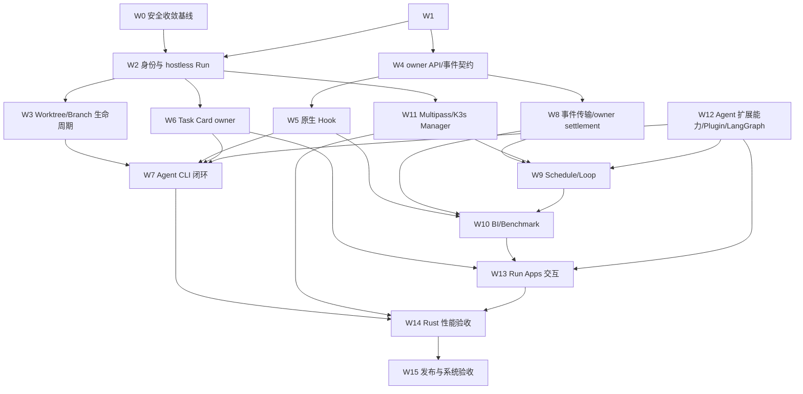

# WORKTREE-GROUP-NEXT-WBS-2026-10-18

> **渡口 Worktree-first 产品未完成设计与交付 WBS 更新稿**
>
> 历史远端比较基线（2026-10-18 JST）：当日通过 rtk git fetch origin main dev 刷新 refs 后核对；origin/dev=6f8d5b8f2d00b1515928c9a25e0762a45cf30e4e，origin/main=8dcb65f7cc5602d4f7c6b681c368d5097bc12a22。git rev-list --left-right --count origin/dev...origin/main 为 121 0。该结果仅代表当日远端快照。
> 对照基线更新于 2026-10-23：需求 v6.92、基本设计 v6.95、DD-WORKTREE-GROUP-001 v5.17；远端 refs 沿用历史快照，不代表本轮 fetch。
> 文档集成前快照（2026-10-24）：dev checkout C:\Users\leo19\orca\workspaces\Star\dev-converge-20261007 @ 28a000959abc74702a7ecd92545b0ec9debe9403；D:\Star main @ 94fdc837d19bbeb2d91b85042c06074b174fcb97。dev 跟踪文件干净并保留三份用户 reviewer briefs；main 含用户所有的 dirty/untracked 内容，未触碰。rtk git rev-list --left-right --count refs/heads/dev...refs/heads/main = 79 2。main-only 的 62605314 与 94fdc837 只含 Vercel SRS v0.2，已被 dev 的 v0.4 取代，不 cherry-pick。dev 比本地 origin/dev ahead 19；本轮未 fetch，远端新鲜度未知。执行快照与限制见 §10。
> 状态：🟡 计划稿 v0.69。§13 保留 Project owner、0..N Repository association 与 Neon/Multipass 部署决策；§14–§22 记录既有 W8/W14/W16/WLD1、UI、VCD-0 与 WLD-7 证据；§17 纳入 W14 UI-1 独立复核和静态原型修正；§23 更新 W11/PR-2 的 Multipass/K3s 生产差距、本机 Rust 服务复用盘点、W11-A hostless 设计同步状态、W16 事件唤醒代码集成、payload readiness 审计、身份/KMS 研究及安全设计增量、集成快照和实施顺序。W11/PR-2、W8、W14、VCD-0、WLD-7 与 W16 均未关闭；报告或静态审查不代表产品验收完成。

## 0. 目的与计划边界

本 WBS 将现有设计与已验证切片接到可交付的多 Agent Worktree 管理闭环。优先解决 Project 下 Run/Worktree 归属、并行 Agent 生命周期、任务卡内 CLI、安全合并与可控清理；任务管理、Canvas、Workflow/LangGraph、BI/Benchmark、Hooks 和插件均围绕同一 Run 授权与数据所有权协作。

固定产品树：

```text
Project
└─ Engineering Run
   └─ Worktree
      └─ Branch（该 Worktree 的本地 checkout 分支状态叶）
```

远端 SCM/宿主连接是可选 metadata，不改变树层级。点击 Worktree 后才打开该 Run 的 App tabs；Task Card 内打开 CLI；Canvas 与 Task Card 同级并通过 owner API / canonical EntityRef 交互。底栏 Chat 支持 WORKTREE / GLOBAL scope。Hooks 位于“高级设置 → Hooks”，作为可视化强约束设置，不是树节点。

本计划保持 fail-closed：源码、隔离数据库夹具、UI 或测试 fixture 单独存在，都不等于真实身份、目标数据库、provider、执行 runtime 或商业产品闭环已验收。

## 1. 未完成设计清单

| ID | 未完成设计/决策 | 当前文档证据 | 收口要求 |
|---|---|---|---|
| D-01 | Hostless Run 到 Worktree 的完整授权与绑定模型 | WLD-0 已有 hostless directory 与 bind/reassign/detach 源码；本轮 fresh disposable PostgreSQL authenticated HTTP runner 55/55 通过，验证 hostless create/exact replay/list/context、无 Run grant 不可见、binding race/rollback/detach，并加上 Run identity/revision/creator-grant 最小 owner INSERT grants。目标 DB/deployment membership、完整 Worktree binding、历史归属对账仍未闭合 | 定义并保留唯一 owner、版本与 Project/Run grants；把 disposable API 证据与目标库/生产身份验收分开；跨域、撤权、并发与线上 reconciliation fail closed |
| D-02 | 多 Agent Worktree 生命周期和安全收敛 | 有 Index、lock observer、部分 create/import/archive 条件式切片；生产 Host Runtime observer、drain、checkout 清理和 owner 信号未闭合 | 定义 Agent/terminal owner、锁、reservation、冲突、归档/删除、恢复、用户数据保全与 merge receipt 状态机 |
| D-03 | Run Apps 的 owner API 与事件契约 | Task、Canvas、Hook、BI 等各有局部 owner/Outbox/Inbox 切片；端到端 delivery、consumer projection 与应用拆分边界不齐 | 固化 API、存储过程/owner transaction、Outbox/Inbox、idempotency、版本、撤权、重放、失败和审计契约；禁止跨 owner 直接写表 |
| D-04 | Task Card 到安全 Agent CLI 的完整运行设计 | bounded list/create、审查/生命周期与恢复局部实现；真实 provisioner、OS sandbox、工具调用控制、独立验证和结果回写仍开放 | 设计并实现分配、启动、流输出、取消/恢复、预算、权限再验、证据、独立验证、结果回写与 PR/合并衔接 |
| D-05 | Schedule / Loop 的无人值守 admission 和恢复 | Rule API、run-as 身份与多段 admission contract 已形成切片；完整 worker、occurrence、执行和生产 consumers 未闭合 | 规则创建者固定为 run-as；每次触发/重试/恢复实时复验授权、profile、Hook、预算与基础设施；checkpoint、租约、取消、补偿均可审计 |
| D-06 | 原生 Hook 强制链与可视化运营 | Hook evaluator、策略存储/API、archive gate 和事件统计有局部实现 | 可视化编辑/预演/发布/回滚；Project→Worktree 继承与 Run 快照；合并、任务执行、Schedule、插件入口都经 Rust 原生 fail-closed 门；事件与 BI 联动 |
| D-07 | BI/Benchmark 的可信、完整、可恢复数据面 | 9F4E–9F4I 已提供 Inbox、最小投影、接收/查询/UI 与原生 event 授权基础 | BI 身份/transport adapter、Route-pin、sender、owner commit-before-ACK、accepted settlement、checkpoint、fan-out、聚合/Benchmark、保留/恢复与准确性验收 |
| D-08 | Multipass 管理的多 K3s 基础设施 owner | Contract、迁移、容量原语、部分 provider/观察切片存在；W11 审计确认当前 Rust adapter 只读、Manager/provider 与 readiness producer 未验收；Run binding 仍有 Cloud Branch 必填冲突 | 仅在 Run 选择基础设施 placement 时，由版本化 profile 固定 cluster ID/generation；hostless Run 不要求远端 Branch 或 infrastructure binding；分别核算 Host 与 cluster 容量；Multipass 测试 inventory 最多 2 条记录（含 Stopped/Deleted）；Rust Manager 独占 adapter；VM/K3s 不替代 Agent sandbox |
| D-09 | Agent 扩展能力、插件热插拔与 LangGraph/App 隔离 | Agent、Memory、Skill、Context、Validation、Loop 的扩展方向与 App manifest/capability 已有设计；Rust 小核心、provider 固定、Run profile/version/digest、事件生命周期、可分支历史、上下文压缩、证据链与生产运行/撤权链未整体验收 | 定义可替换的版本化 Agent/Memory/Skill/Context/Validation/Loop contracts；Run 固定 profile/version/digest/预算；事件、可分支历史、压缩边界、权限、上下文来源与验证证据可追溯；插件使用隔离进程和 capability broker，安装/升级/回滚/卸载先停新准入再 drain；LangGraph resume 重新检查身份、scope、Hook 与 budget；一期可用受控 Rust CLI adapter，后续保留 Rust-native provider/core 路径，Star 始终控制授权、上下文、事件和独立验证 |
| D-10 | Rust 桌面低内存与并行服务等级 | 已有分页、懒加载、有界请求和部分数据上限；没有覆盖目标设备和并行规模的完整 RSS/延迟基线 | 明确队列/缓存/日志/IPC 上限与背压、公平调度、取消/drain；并发档位由版本化 Profile 与目标 workload 确定，1/2/4/8/16 Agent 仅是资源允许时的候选扫描值，不是容量基线；记录 RSS、p95、队列等待、启动/取消和长时漂移，实测前性能阈值标 TBD-MEASURE |
| D-11 | 商业分发、升级和运行验收 | 开源商业使用边界与 Rust 服务替换方向已记录；完整 provider/安装包/SBOM/运维闭环未完成 | 核验完整发行依赖/SBOM/NOTICE、安装和升级路径、备份/恢复、数据库权限、两个测试 VM 上限与升级/回滚证据 |

## 2. WBS 与依赖顺序

优先级采用 P0（解除推进门）、P1（主链必需）、P2（产品闭环）、P3（强化与发布）。每项必须先有设计/验收条件，再标实现；不得以文档状态替代运行证据。

| WBS | 优先级 | 工作包与主要产物 | 依赖 | 当前状态 | 完成门 |
|---|---|---|---|---|---|
| W0 | P0 | **安全收敛基线**：复核 dev/head、main/dev 独有提交、合并来源、PR、全部 worktree owner/dirty/ignored；如 main 有领先提交，先按依赖顺序 cherry-pick 到 dev；再选择性收敛其他 lane；归档保留快照；只在安全完成后保留本地 main/dev | 无 | 2026-10-24 本地快照：dev@d4f26ee，main@5a051bfd；`main...dev=0 52`，main 无本地独有提交；`D:\Star` 用户未跟踪文件保持原样。WLD5 已从 Git worktree 清单移除且提交已在 dev，但磁盘残留、Codex 活动附件与本地分支仍在，清理未完成。WLD1 remediation 正在进行且未集成，必须保留。未 fetch，远端新鲜度未知。 | 每次集成重新核对 main/dev 和 HEAD；如 main 出现适用领先提交，先 cherry-pick 并验证；目标 dev 干净且无活动 writer；逐来源审阅 diff/依赖/验证并核对有无遗漏；仅在内容已合入或有可恢复归档且 owner/ignored 数据门通过后清理；不 push/删除远端 refs |
| W1 | P1 | **设计基线对账**：需求、基本、详细设计、方向文档、实施计划建立逐条追踪矩阵；统一层级、名词、owner 和状态；历史冲突标为废止/历史记录 | 可基于已读取的远端 dev 文档并行开展；任何 dev 写入/代码集成仍依赖 W0 | 主架构方向已写；仍需全链路一致性核验 | Project→Run→Worktree→Branch、hostless Run、同级 Run Apps、Hook 设置位置、Task Card CLI、WORKTREE/GLOBAL、Multipass 与两实例上限在各活跃文档一致；未实现项保留开放状态 |
| W2 | P1 | **Project/Run 身份与 hostless 目录**：认证 session、membership/grant provisioning、可信来源写入、Run schema migration、应用 DB role/RLS 与历史数据 reconciliation | W1 | 源码/迁移候选与局部验证；真实身份/目标 DB 未验收 | 无远端宿主也可创建/授权/列出 Run；真实 actor 权限逐请求复验；越权/撤权 fail closed；迁移可重复且目标 role/RLS 有实证 |
| W3 | P1 | **Worktree/Branch 生命周期**：Run↔Worktree writer、可信 Host/Repository observation、branch 状态叶、lock/lease、create/import/archive/recovery/cleanup 与 merge receipt | W2 | 目录/observer/UI 局部切片；生产 Host Runtime、绑定和物理清理未闭合 | 每个 checkout 唯一有效 Run 归属；Branch 只由可信 observation 投影；过期/未知状态关闭写操作；取消/drain/锁/用户数据/恢复与合并清理均有审计和集成证据 |
| W4 | P1 | **跨 App owner 契约**：Task、Canvas、Workflow、Inbox、Hooks、BI、Plugins 的 API/存储过程/Outbox/Inbox schema 与 RunContext 版本化 | W1、W2 | 多个 owner 切片已存在；跨 owner 端到端未关闭 | 同一事务仅改本 owner 事实；跨 owner 使用幂等命令/事件；精确 actor、Project、Run、Worktree scope；重复、乱序、撤权和部分失败可恢复 |
| W5 | P1 | **原生 Hook 与策略 UI**：Advanced Settings → Hooks typed editor、策略继承/快照/发布/回滚、Rust evaluator 接入所有写入和执行门、BI evidence | W2、W3、W4 | evaluator、policy API、archive gate、source-only metrics 有局部实现 | 无代码配置可预演/解释；所有强制入口执行同一版本化 HookSet；缺失/过期/无法解释时拒绝；事件可追溯到 Worktree/Run/BI |
| W6 | P1 | **任务管理和 Task Card 生命周期**：Run owner list/create/transition/review、幂等回执、migration/grants、Canvas EntityRef 组合命令、事件发布 | W2、W4 | bounded API/UI 和 owner source 已有；目标 DB/RLS、dispatcher/consumer 未完成 | 真实 Run 读写、状态/audit/outbox 一致；Canvas 双向互动不绕过 owner；无 seed/mock 回退；撤权/并发/CAS/replay 有测试 |
| W7 | P1 | **Agent CLI 执行闭环**：卡内 CLI、Agent 自动分配、Runtime provisioner、隔离 sandbox、工具调用和文件 claim、流输出、取消/恢复、独立验证及结果回写 | W3、W5、W6、W8、W12 | CLI UI 明确禁用；只存在 admission/fence/helper 等源切片 | 从真实 Task Card 到授权 Agent、版本化能力 profile、受限执行、Hook 检查、budget admission、取消恢复、独立验证与结果 evidence 全链路通过；无任意 host shell 或未经授权 mount |
| W8 | P1 | **事件传输与 owner settlement**：BI/Task 原生 adapter、immutable route pin、sender、receiver Inbox、事务提交后 ACK、accepted/retry/dead-letter、recovery/checkpoint；保持 NATS 可替换 adapter | W4 | 9F4I 原生 event 授权基础完成；真实 BI network chain 未完成 | 接收 owner commit 前不 ACK；重放幂等、身份冲突不误确认、租约 fencing 有效；profile/identity/target DB grants/RLS/recovery 有实证；传输切换/回滚不改业务 owner 契约 |
| W9 | P1 | **Schedule / Loop Worker**：occurrence 生成、run-as 复验、规则 version/profile pin、Run admission、预算/容量预留、checkpoint、暂停/取消/补偿与结果确认 | W2、W5、W8、W11、W12 | Schedule API/owner contract 部分完成；无人值守执行链未闭合 | 每次 trigger/retry/resume 实时复验权限与能力；只有 Run profile 选择基础设施 placement 时才解析并固定当前 cluster binding，hostless 模式不因缺少远端 Branch/集群绑定而失效；按固定的 Memory/Skill/Context/Validation/Loop capability profile 运行；撤权、所需容量未知或 Hook 缺失则拒绝；重复副作用受幂等键和 owner receipt 控制 |
| W10 | P2 | **BI/Benchmark 产品闭环**：可信事件投影、消费 checkpoint、指标定义/版本/数据集、质量/性能分析、Benchmark evidence、留存/恢复 | W5、W8、W9 | 9F4E–9F4I 源码切片完成到 native event authorization；9F4J 之后的可信适配与 E2E 尚待开始/核实 | BI 只读 owner projection；显示完整性/新鲜度 unknown/partial/complete 的依据；Benchmark 可重放、可比较、不可篡改；并发/恢复/长期留存和目标 DB 通过 |
| W11 | P1 | **Multipass/K3s Infrastructure Manager**：trusted resolver/profile、跨租户物理 Host/cluster ledger、独立 reservations、delivery consumers、VM provider、K3s readiness、workspace bridge | W2、W4、W8 | W11 审计报告已合入；PowerShell bootstrap 路径有两记录限制与锁，但 Rust adapter 仅只读，原生 Manager/provider、target DB/readiness/sandbox/bridge 尚未验收；hostless Run 与必填 Cloud Branch 语义冲突待先修 | 只由 Rust Manager 调 Multipass；所有测试 inventory 入口合计不超过 2 条且含 Stopped/Deleted、不自动 purge；仅选择基础设施 placement 的 Run 固定 cluster ID+generation，hostless Run 无需远端 Branch 或该 binding；Host 与 cluster 双预约可对账；sandbox/权限/资源限制满足后才启动 Agent |
| W12 | P1 | **Agent 扩展能力、插件热插拔与 Workflow/LangGraph**：Rust-native 小核心和可替换的 Memory/Skill/Context/Validation/Loop provider contracts、profile/version/digest 固定、一期受控 Rust CLI adapter、capability broker、隔离 worker、事件生命周期、可分支 history、上下文压缩、插件安装/升级/卸载/drain、图版本与 checkpoint | W4、W5、W8 | 设计有方向；生产 provider composition、权限与证据链尚未验收 | 每个 Run 固定兼容的能力 profile/version/digest 与资源预算；上下文来源/裁剪、skill 版本、Memory 读写、事件生命周期/分支历史/压缩、独立 Validation evidence、Loop stop reason 可审计；压缩不破坏审计/验证证据；provider 替换不变更授权/owner 契约；插件不能加载进主进程；热卸载先停止新准入再 drain；LangGraph resume 重新授权并复验 Hook、profile、budget；全链路可重放 |
| W13 | P2 | **跨 App 导航与交互**：Inbox、Task、Canvas、Workflow、BI/Benchmark、Plugins 同级 tabs；CLI 只从卡内启动；深链、错误态、无焦点/未绑定态统一 | W2、W3、W5、W6、W10、W12、W16 | Task/BI 部分 UI；其余 Run Apps 与真实数据链路不完整 | 同 Run 切换 Worktree 不改变 App owner；跨 Run/Project/tenant 引用拒绝；直接深链重新授权；UI 无虚假连接器、mock 事实或过期 scope 闪现；跨 App 内容更新由授权资源事件触发 |
| W14 | P2 | Rust 桌面内存/并行验收：缓存、虚拟化、日志、IPC、Tokio 队列、公平调度、背压、取消/drain、RSS 与 p95 benchmark | W3、W7、W11、W13、W16 | UI-0/UI-1 文档与静态原型已集成；UI-2 设备/数据/workload/采样协议审查已完成，但设备、真实 provider、数据 manifest、并发档位和预算仍未冻结。当前 Tauri+React 是待测基线；egui/eframe 与 Slint 仍为对比候选 | 下一步由产品/工程 owner 确认目标 Windows 设备、真实授权 workload、build、profile 与预算责任人；先对当前产品路径执行 pilot 并保存原始进程/资源/交互证据，再完成 UI-2 可复现测量。UI-3 才能用同一 manifest 比较 Rust-native，UI-4 再按证据决定迁移或维持。候选 Agent 档位不构成容量承诺；W14 继续 OPEN，测量前不宣称低内存或并行容量达标 |
| W15 | P3 | **商业发布与系统验收**：Windows 桌面打包、目标 DB 部署、身份/RLS、升级/回滚、故障恢复、SBOM/NOTICE、support diagnostics、跨 App E2E | W2–W14、W16 | 未启动完整验收 | 一条可重复商业使用链覆盖创建 Project/Run→绑定 Worktree→分配 Agent→卡内 CLI→验证→合并/安全清理→BI 证据；部署、升级、备份恢复、权限和性能全部有可追溯证据 |
| W16 | P1 | **低消耗实时协作、草稿与冲突闭环**：资源 scoped push、owner revision/CAS、双方草稿、冲突可读/显式解决、跨实例 Outbox fan-out、cursor recovery、离线 conflict inbox | W2、W4、W6、W8 | Rust transactional Outbox wake trigger、每进程单一 `PgListener`/有界 Worktree SSE hub 与前端每 Worktree 单连接、授权 Outbox catch-up 已合入本地 `dev@95732e7c`；star-api-rest 全目标编译和唤醒单测通过。PostgreSQL 事务触发 fixture 因缺隔离数据库/Worktree 被忽略；durable draft/conflict、双边持久提醒、Resolve/CAS、真实多实例与性能验收仍未完成 | 客户端常态无固定轮询，Outbox 正常发布由 owner commit wake-up 驱动；冲突按 base revision + 重叠范围判定（1 秒不是轮询/冲突窗口）；同字段冲突保留双方精确 draft revision 并向双方推送同一 `conflict_id` 的持久未读提醒，从冲突 commit 到双方显示提醒并可读首个有界 base/current/mine/theirs 差异页的 p99 ≤1s；用户查看前提醒不清除，各自草稿可恢复；离线/gap 可恢复。每窗口单 multiplexed connection；订阅数及发送队列限额由版本化 Collaboration Profile 固定（100 subscriptions、64 events/128 KiB 仅候选初始值，须目标环境测量）；patch/frame ≤16 KiB 是协议上限。resource fence 竞态测试、RLS/retention、背压、RSS/CPU 与跨实例恢复验收通过 |

### 2.1 端到端未完成设计里程碑

以下 WLD 里程碑用于收拢分散的源码切片和设计要求；它们不另建平行 owner 或重复实现已完成的 API/UI。每个里程碑只有在运行身份、目标 DB、授权、恢复与独立验收证据满足时才关闭。

| ID / 依赖 | 未关闭的设计与实现边界 | 完成门 | 映射 WBS / 权威设计基线 |
|---|---|---|---|
| **WLD-0 Project/Run/Worktree canonical binding** / 无 | Hostless authenticated Run create/list/context 与无 Run grant 不可见已通过本地 disposable HTTP/PG acceptance；本轮额外验证了 Directory owner role 的三张 INSERT facts grants。完整 Worktree attach/reassign/detach 的目标库/生产身份、历史归属 reconciliation 与 UI/Task/CLI 多域一致性仍开放。 | 本地 Run create/exact replay/list/context 与权限隔离已验证；完整门仍需目标 DB、实际 deployment membership、FORCE RLS、跨域/stale binding、撤权/并发/replay 以及 Task/CLI/REST 同一绑定事实通过；执行保持 fail closed。 | W1/W2/W3；requirements §50、§50.3.1–§50.3.2；basic §16.2；Group DD §3.1、§3.5、§4 |
| **WLD-1 Safe Worktree lifecycle, merge and cleanup** / WLD-0 | 创建/导入/归档/恢复/重绑定/清理的设计已有；生产 owner command 原子复验、真实 provider 幂等副作用，以及 Agent/Run/PTY/进程 drain 与用户数据保护仍未验收。 | 对 stale version、重复/replay、provider timeout、活动 lease/file claim/PTY/process、dirty/untracked、retention lock 和 unknown state 做并发/恢复验证；不确定时禁止破坏性操作；成功操作产生 owner transaction audit/Outbox receipt 并支持 reconciliation；disposable checkout 与目标 DB/RLS 通过。 | W3/W5/W13；requirements §22.2、§22.6–§22.7、§50.3.1、§50.8D；Group DD §6、§8.6；basic §16.17 |
| **WLD-2 Run Task Card lifecycle + in-card CLI** / WLD-0；checkout teardown 另依赖 WLD-1 | Task owner、列表/创建、claim/lease、CLI identity、ticket/PTy 有局部切片；生产 session provisioner、独立 OS sandbox、工具控制、取消/drain、恢复、独立验证和结果回写未闭环。 | Task Card 绑定同 Run Worktree；实时复验 claimant/lease/Profile/HookSet/budget；仅 allowlisted argv/env 和 scoped cwd 在独立 sandbox 执行；有界 PTY 背压；撤权、取消、超时、重启、reattach、子进程 drain 幂等可审计；独立 validator 回写 criterion-linked evidence；依赖缺失时不可执行。 | W6/W7/W12/W13；requirements §50.4、§50.8AN–§50.8AO；basic §16.6、§16.20；Group DD §7.1、§8.5；plan §6.141、§6.144–§6.150 |
| **WLD-3 Schedule occurrence → Run owner saga / Engineering Loop** / WLD-0；共享 WLD-2 的执行身份和预算契约 | Rule API、固定 run-as、schema/lease/admission primitives 部分存在；生产 worker、每次 trigger/retry/resume 的现时授权复验、Run↔Schedule 双方 Inbox/Outbox saga、补偿/恢复未闭环。Loop controller 不等于持久 checkpoint 或执行器。 | occurrence 幂等地产生至多一个 non-executing Run；每次重试按不可变 `run_as_actor_id` 重验当前 ACL、profile、HookSet、Task、binding 与 quota；过期 fencing token 不可写入；DST/misfire/overlap/catch-up/deadline/queue-full 遵循固定策略；owner 各自提交并支持撤权/故障补偿；Loop 固定 acceptance snapshot、预算及 stall/oscillation stop reason。只有 WLD-4 readiness 回执后才允许进入执行态。 | W9/W12；requirements §50.8B、AC-LOOP-001–010；basic §16.16、§16.24–§16.27；Group DD §8.7、§8.10–§8.12；plan §6.77–§6.82、§6.109–§6.140 |
| **WLD-4 Multipass/K3s admission and readiness** / WLD-3 的 non-executing admission receipt | Binding/readiness contract、schema/grants/Inbox/admission 与容量台账 primitives 有局部实现；W11 审计见 `docs/reviews/WBS-W11-INFRASTRUCTURE-GAP-AUDIT-20261026.md`，确认可信 resolver、owner consumers、受限 Manager/provider、release/reaper、readiness producer、Agent sandbox 和 workspace bridge 未形成生产闭环。 | 对选择基础设施 placement 的 Run 固定 cluster ID+generation；hostless Run 可无 infrastructure binding 且不依赖远端 Branch；owner 事务分别幂等预留 Host 与精确 cluster 容量；核实 Manager receipt、owned guest、K3s API/node/CRI、独立 Runtime sandbox 和限路径 workspace bridge 都新鲜匹配；未知容量/身份、stale generation、撤权/取消时保持 non-executing 并可释放/恢复；测试 inventory 总数不超过 2（含 Stopped/Deleted），不自动 purge，无跨 owner 写事务。 | W11/W9/W14；requirements §50.8H、§50.8B/AC-LOOP-010；basic §16.27–§16.28、§16.30–§16.54、§16.61–§16.64；Group DD §8.12–§8.21；plan §6.89–§6.108、§6.134 |
| **WLD-5 Native Hook enforcement + visual policy operation** / WLD-1；Task/Schedule producers 分别依赖 WLD-2/WLD-3 契约 | Advanced Settings → Hooks、typed Builder、Rust evaluator 与部分 admission/archive producer 已有切片；生产身份/DB、全生命周期 producer、Runtime enforcement 和 BI linkage 未验收。 | 可视化编辑/继承/预演/diff/审批/回滚；Run 固定 HookSet digest/version；Rust 核心覆盖 Run、tool、validation/review 与破坏性 Worktree 命令；Plugin 不可覆盖强制规则；evaluator/audit 失败 fail closed；清理重验 ACL/version/lease/claim/drain/retention；目标身份/DB/RLS/runtime 与脱敏 BI 事件通过验收。 | W5/W7/W9/W13；requirements §50.8D；basic §16.17、§16.20；Group DD §8.6；plan §6.45–§6.53、§6.68 |
| **WLD-6 Durable App events, BI/Benchmark and release closure** / WLD-2/WLD-3/WLD-5 事件源；基础设施事实依赖 WLD-4 | Task delivery、BI Inbox/receiver/query/UI 和 native `event` authorization 有不同程度源码/隔离 DB 证据；生产 transport/identity、commit-before-ACK、每 consumer 独立 Inbox/projection、gap recovery、Benchmark、备份/WAL 和性能仍未闭环；9F4I 明确 ingress 与执行 fail closed。 | owner event 经认证有界 transport 到 receiver owner Inbox/projection 并 durable commit 后才 ACK；exact replay 稳定回执、冲突隔离；验证 crash、撤权、取消、stale lease、gap rebuild；BI/Benchmark 使用版本化 cohort/formula，覆盖/新鲜度未知时明确报告；目标 DB/RLS、生产身份、Rust 1.99、backup/WAL/PITR、队列/RSS/fairness/latency 与 requirements-to-runtime traceability 独立验收后，才解除对应 fail-closed 门。 | W8/W10/W14/W15；requirements §50.8A、§50.8B、§50.8D；basic §16.71–§16.75；Group DD §8.25–§8.26；plan §6.149–§6.156；9F4I report §2–§3 |
| **WLD-7 Durable resource-scoped collaboration** / WLD-2 Task/Canvas owner APIs + WLD-6 durable event delivery | Canvas Worktree 路径已集成 PostgreSQL Outbox wake trigger、Rust per-process PgListener/有界 SSE hub 与前端单 Worktree 连接；wake 后通过授权 Outbox REST catch-up。BFF Canvas WSS 仍是单进程 bounded broadcast，未作为持久 relay；Document CAS/cursor REST 仍不提供多用户 draft/conflict。持久双边草稿/冲突事实、participant read access、目标 DB 跨实例 Outbox delivery、durable conflict inbox 与性能验收未完成；WLD-7 运行时保持 OPEN/PARTIAL/NOT_RUN。 | 每个 resource owner 原子执行 auth + base-revision overlap + revision/draft/conflict + Audit/Outbox；常态 delta coalesce 更新 draft head，不逐 patch 追加 immutable checkpoint；完整重叠 head 在同一 resource-fence transaction 自动 seal/pin 双方精确版本，无需最终 Save；revision CAS 与 conflict/resolve 共用短时 fence。Owner commit 用有界可合并 wake-up 立即驱动 durable Outbox relay，正常路径不做客户端固定轮询或服务端周期扫表；cursor catch-up 只用于 bootstrap/reconnect/gap/recovery。结构化不重叠 path 自动合并，文本使用版本化有界 server-authoritative OT，不能安全变换的重叠产生冲突。只有双方 proposal complete、digest-verified、sealed 且可读后才提交可见 conflict；partial upload 只显示作者自己的 `sync_pending`。同一资源和排序 proposal pair 幂等生成 stable `conflict_id`；两位参与者均收到持久未读提醒，从 conflict commit 到双方显示提醒并可读取首个有界 base/current/mine/theirs diff page 的 p99 ≤1s；完整重叠提案即使在服务端 ≤1000 ms 到达也不得等待一秒窗口（E2E-COLLAB-09），任意到达间隔的语义重叠均需检测；双方 draft 恢复/差异读取与该实时目标均未实施，离线/迟到恢复也未验收。每窗口单 multiplexed connection；订阅数/发送队列由版本化 Collaboration Profile 固定（100 subscriptions、64 events/128 KiB 仅候选值，目标环境测量前不得宣称容量）；每 draft 单在途写入加一个有界 pending delta；patch/frame ≤16 KiB 是协议上限。PT-09 未取得通过前必须绑定版本化 Collaboration Profile ID/revision/digest，并记录实际 workload/并发规模及目标 host、PostgreSQL、gateway 配置/实例基线；本门尚未批准数值且未测量，不得推定 PT-09 已通过。保留草稿、RLS/撤权、并发 resolve、跨 gateway 重启、延迟、RSS/CPU 验收。 | W16；requirements v7.07 §50.8AW / AC-COLLAB-01–08；Group DD v5.32 §8.27；basic v7.11 §16.78；collaboration spec v1.1 §13；owner-local W/T/M 数据设计 v0.3；测试设计 v1.6 §4.8/§5.2/§6.2.5 |

**WLD 依赖顺序**：WLD-0 → WLD-1 → WLD-2；冻结接口后 WLD-1 与 WLD-5 的部分策略配置工作可分隔离 worktree 并行。WLD-0 + WLD-2 → WLD-3 → WLD-4。WLD-2 + WLD-3 + WLD-5，并结合 WLD-4 的基础设施事实 → WLD-6；WLD-2 + WLD-6 → WLD-7；WLD-6 + WLD-7 → W13 跨 App 交互与发布闭环。分散的 WBS 子项属于输入/实现，不代替这些端到端完成门。

## 3. 关键依赖图



## 4. 建议的下一步执行批次

> 本节及其中 2026-10-19 执行记录保留为历史计划/证据；当前实施顺序由 §10 的最新快照和工作序列决定，不能继续把 9F4J 当作当前唯一下一步。

### 批次 0：下一实施切片（建议 9F4J）

现有 dev 实施计划在 9F4I 之后明确要求 BI 原生 adapter 与 owner commit-before-ACK 真实联测。先完成可信事件链路；这不会启用 Schedule/Agent 执行，也不代表目标生产环境已验收。

1. 固定 BI transport adapter 的身份来源、tenant/provider/endpoint、active Profile revision/digest、event kind 授权和 immutable route pin。
2. 将 9F4I 的 native `event` 能力接到 BI sender/receiver composition；禁止用 admission-only request/result adapter 代替 Task event。
3. BI owner 在单一事务中写 Inbox、fact/conflict 与 durable receipt；只有事务提交后 transport 才 ACK。
4. 验证 exact replay、same identity/different wire conflict、错误 tenant/Run/Project、profile 撤销、lease 过期、consumer 重启，以及“提交后、ACK 前”崩溃恢复。
5. 在隔离目标 PostgreSQL 验证 migration、app role grants、RLS/FORCE RLS、WORM、并发和恢复；运行 Rust 1.99.0 owned-crate tests/fmt/Clippy，再做针对性端到端联测。
6. 输出阶段报告并同步需求、基本设计、BI/Transport 详细设计与本 WBS。缺少可信身份或目标 DB 时继续 fail closed，不将 fixture 通过写成生产验收。

#### Phase 9F4J 子工作包与退出门

| 子项 / owner | 交付与验收 | 设计/实施引用 | 未关闭边界 |
|---|---|---|---|
| **9F4J.1 BI Event native adapter** / Platform Messaging transport owner | 通过 Star authenticated gRPC wrapper 实现 bounded `PullOne` / `VerifyOrigin` / `AcknowledgeOne`；校验 tenant、sender/receiver、Event kind、log ID/generation、sequence、message/lease/attempt 与 exact wire digest；wire ≤16 KiB、protobuf frame ≤32 KiB、有限 deadline、不 prefetch；BI core 不依赖 transport crate。 | requirements §50.8AU、Task SRS AC-26、Task BD §6.7、Task DD §14.13.9、basic §16.76、plan §6.156 | 目标部署身份/证书轮换、生产 Profile loader/composition、目标 DB/grants 与完整 receiver 联测未完成；opt-in adapter 不代表 production ready。 |
| **9F4J.2 immutable route pin + current Profile verifier** / Task Delivery + Platform authorization owners | 首发前 pin provider/version/Profile revision+digest/endpoint、双方 identity、logical destination/log generation、schema 与 exact-wire SHA；retry 复用 pin 和 bytes。每次 receive/verify/ACK 从可信 mTLS session 验证 active Profile、tenant、direction、service identity、Event 授权与 destination generation；不信任 caller 身份或过期缓存。 | requirements §50.8AR、AC-RUN-OUTBOX-01、Task SRS AC-20、Task BD §§6.2/6.7、Task DD §14.13.9、basic §§16.70–16.72/§16.76、plan §§6.151/6.156 | route/wire source 尚未有目标 DB/网络 send 验证；禁止重定向、双发或 native↔JetStream fallback；revoke、profile drift、identity mismatch fail closed。 |
| **9F4J.3 trusted composition** / application composition owner（BI 与 Platform 联审） | 独立 composition 将 current-Profile verifier、BI Event adapter、`TaskEventReceiver`、BI Inbox writer、quarantine capability 接通；架构断言 `bi-owner-runtime` 不依赖 `platform-messaging-runtime`；Event scope/transport/delivery 独立，不复用 Admission Request/Result/Resolution。首期可由 app composition host 接线；HTTP BI query 路由不持有 worker/client。 | requirements §§50.8AS/50.8AU、Task SRS AC-23/AC-26、Task BD §§6.4/6.7、Task DD §§14.13.6/14.13.9、basic §§16.73/16.76、plan §§6.153/6.156 | 审计确认 `star-api-rest/Cargo.toml` 只有 `bi-owner-runtime`、未依赖 Platform transport；`main.rs` 只建立 `BI_DATABASE_URL` query store 并运行 Axum，没有 consumer lifecycle/shutdown drain；`GroupApiState` 只暴露 query port。需新增独立 composition module、隔离 BI write pool、current-Profile resolver、startup capability probe、ingest-only readiness 与有界 cancel/drain；真实 service identity 未验收。源码证据：`crates/star-api-rest/Cargo.toml:87-93`、`src/main.rs:32-93`、`src/group_api.rs:307-338,390-396`、`src/group_api/bi_analytics.rs:122-152`。 |
| **9F4J.4 owner commit-before-ACK network proof** / BI owner | 用真实 native gRPC+mTLS、Event client、`TaskEventReceiver`、`TaskEventInboxStore.commit_exact_wire` 与 disposable PostgreSQL 联测。pre-ACK latch 暂停 ACK；独立 DB observer 确认 Inbox receipt 与 fact 已提交、delivery 仍 leased/unacked 且无 ACK receipt；释放 latch 后出现 ACK receipt，Inbox/fact 各唯一一份。exact replay 返回同 receipt。 | requirements §50.8AS、Task SRS AC-23、Task BD §6.4、Task DD §14.13.6、basic §16.73、plan §6.153；建议将验收增量落在 plan §6.157 | BI Inbox 持久化 PostgreSQL 测试只证明 owner transaction/replay/conflict，不能替代 network commit-before-ACK。必须待 Event API 与 trusted composition 稳定后留真实 SQLx/PG commit、独立 observer 和 ACK receipt 证据。 |
| **9F4J.5 failure / exact replay / recovery** / BI + Platform owners | 注入 Inbox commit fault/unknown outcome、commit 后 ACK RPC failure/timeout、cancel、revoke、Profile/route/generation drift、redelivery 与 exact duplicate；未确认结果保持 source unacked/redeliverable；同 identity+wire 返回原 receipt 且仅一条 fact；identity/content conflict 不 ACK；poison 仅在 metadata-only quarantine receipt durable 且来源再次授权后 terminal disposition。 | requirements §50.8AS、Task SRS AC-23、Task BD §6.4、Task DD §14.13.6、basic §16.73、plan §6.153、DD-RUST-SERVER-REUSE §12 | disposable test 不代表进程重启/PITR、备份/WAL、生产 checkpoint 或运维恢复策略；未具备 crash/recovery、quarantine retention/capacity 与可信 terminal capability 时维持 fail closed；本切片不打开 accepted settlement、fan-out 或 execution。 |
| **9F4J.6 target PostgreSQL/RLS/grants** / Platform + BI（分别验收各自 DB/role） | 用 DDL owner、受限 Platform runtime、BI runtime、独立只读 observer 验证 migrations；BI runtime 仅调用固定 BI function，无直接表 DML/跨 owner 权限；Platform runtime 只调用 authenticated native wrappers；验证 FORCE RLS/WORM、PUBLIC execute revoke、固定 search_path/timeout、NOINHERIT/SET ROLE denial、tenant mismatch 与 rollback 负向情况，并区分 disposable grants 和 target grants。 | requirements §§50.8AS/50.8AU、Task BD §§6.3–6.4/6.7、Task DD §§14.13.5–14.13.6/14.13.9、data design 9F4I、plan §§6.153/6.156、9F4I report | Target database 与登录角色 membership/grants 尚未部署/审计；fixture role 不能冒充生产 role。迁移升级/回滚、owner boundary、RLS 负向和独立 commit/ACK observer 缺一不可。 |

**9F4J exit gate**：9F4J.1–9F4J.6 的适用 Rust 1.99.0 fmt/check/test/Clippy、真实 mTLS gRPC + disposable PostgreSQL commit-before-ACK latch，以及各 owner 最小权限/RLS/grants 负向断言都有可复核证据，才关闭本切片。生产身份/control plane/target grants、crash/PITR、durable checkpoint/恢复、quarantine retention/capacity、RSS/p95/p99/fairness、BI/Benchmark fan-out、accepted settlement 与 Schedule/Run execution 是独立门；本切片退出不得解除这些门，BI ingress 与执行继续 fail closed。建议的文档追踪增量为 9F4J 使用新验收 ID `AC-27`、Task BD §6.8、Task DD §14.13.10、basic §16.77、plan §6.157；先检查文档编号后再写入，保留 9F4I `AC-26` 历史不变。

### 批次 A：先恢复可安全集成的工作面

1. 恢复可读取 Orca owner/runtime 状态的执行路径；核对 dev checkout 当前 owner、HEAD、dirty/ignored、终端活动情况。
2. 比较 main 与 dev 的当前提交图，列出 main 独有的领先提交及依赖；本轮远端比较结果为 main `ahead_by=0`、落后 dev 121 个提交，因此当前无 main 内容需要 cherry-pick。
3. 若之后发现 main 有领先提交，先逐个审阅差异、依赖和验证，再按依赖顺序 cherry-pick 到 dev；在 cherry-pick 结果复核完成前，不 rebase 或 merge 其他 lane。
4. 在更新后的 dev 基线上重新生成分支/PR/worktree 清单；对其他未合并来源只审阅与本 WBS 兼容的提交，不整分支盲合。
5. 每个已完成候选先形成差异与验证摘要，再 rebase 到最新 dev 并串行 merge；逐项确认 dev 中没有遗漏后保存归档快照。
6. 保留 main 和 dev；只有已合并且可恢复的托管 worktree 才归档/清理。此批次未完成前不开始共享 dev 上的后续写入。

### 批次 B：锁定产品契约并拆分可并行实现

1. 将本 WBS 的 D-01–D-11 映射到 requirements §50、basic design §16、Group DD、Hook/Task/Schedule/Infrastructure/BI 详细设计及验收矩阵。
2. 纠正旧章节、历史摘要和产品文案中的层级/名词漂移；保留历史报告原状并注明历史基线，避免重写已签署事实。
3. 并行设计/实现可隔离的 W2（身份与 Run）、W5（Hook UI/执行门）、W8（可信 transport/BI adapter）、W11（Infrastructure Manager）；共享 API/DB 边界先由 W4 固定。
4. W3/W6 完成后串联 W7 的 Task Card CLI；W8/W11/W5 完成后再打开 W9 Schedule worker；W10 BI/Benchmark 在可信事件和 checkpoint 可验证后启动。

### 批次 C：可用闭环与发布门

1. 在受控环境完成真实认证、目标 PostgreSQL 迁移/grants/RLS、受限 Multipass/K3s provider 和独立 Agent sandbox 联测。
2. 用一条任务验证：Project→Run→Worktree→Branch → Run App → Task Card → Agent 分配/CLI 执行 → Native Hook → 取消/恢复 → 独立验证 → 结果回写 → merge receipt/安全清理 → BI/Benchmark evidence。
3. 进行重复投递、进程崩溃、撤权、过期 reservation、runtime unhealthy、Worktree 锁冲突、插件升级/卸载、数据库故障/恢复测试。
4. 对比需求、基本设计、详细设计、WBS、API/DB 与运行事实；只在所有所需环境证据齐全后关闭对应 phase。

### 批次 D：下一步可执行顺序与并行边界

| 顺序 | 工作 | 执行方式 | 前置/完成条件 |
|---|---|---|---|
| D0 | 恢复本地 Git/Orca 可观测性；更新 owner、HEAD、dirty/ignored、活动终端、分支与 PR 清单；对保留的未合并内容建可恢复归档 | 单一集成负责人串行；不动活动 checkout | RTK 与 Orca owner 查询可用；dev checkout 无活动 writer 且 HEAD 已记录。当前会话尚未满足此门 |
| D1 | 将本 WBS 与两条审阅线发现逐项对账，形成唯一可审阅版本；核准每项设计状态、文件来源、依赖、验收与 blocking status | 文档线可基于远端 dev 快照继续；不得在共享 dev 写入 | 远端文档章节和 WBS 每行一一对应；不将 source/fixture/UI 误标生产完成 |
| D2 | Phase 9F4J：先并行交付 9F4J.1 Event adapter 与 9F4J.6 BI Inbox 持久化/RLS 用例；再冻结 API 后串行完成 9F4J.2 current-Profile/route verifier、9F4J.3 app composition；真实身份和 disposable DB 就绪后执行 9F4J.4 commit-before-ACK 网络 latch，再完成 9F4J.5 故障/重放/恢复矩阵 | 两个现有隔离 lane 可先并行；adapter API 冻结与组合接线由单一 integrator 串行；DB persistence-only 证明不得替代网络证明 | 目标 DB 身份/grants/RLS 可用；receiver 事务提交后才 ACK；重复与身份冲突行为、lease fence、crash-after-commit-before-ACK 均有证据；ingest readiness/drain 独立；执行仍 fail closed |
| D3 | 补齐 hostless Run/Worktree binding、Worktree lifecycle 与 Task Card owner/CLI 前置设计 | Run/Worktree 与 Task owner 可并行设计；合并由 integrator 串行 | binding、Branch observation、Run grants 与 owner API 定版；Task 执行仅在 runtime/sandbox/Hook/验证门满足后开放 |
| D4 | 完成 Multipass/K3s owner reservations、精确 cluster generation、可信 Manager/provider/readiness、独立 sandbox 接入设计 | Infrastructure owner 和受限 provider adapter 可并行；VM 测试串行并受 inventory lock 限制 | 两条 Multipass inventory 记录上限持续有效；容量未知时拒绝；Host 与 cluster reservation 由各 owner 自己事务写入 |
| D5 | 完成原生 Hook 设置/执行链、插件隔离热插拔与 LangGraph 恢复授权设计 | Hook UI/策略 API 与 plugin manifest/runtime contract 可并行；执行门统一集成 | 高级设置 → Hooks 可视化；Rust 强制 Hook 不可绕过；撤权后拒绝新调用并 drain；恢复需重验 Run、profile、Hook 与预算 |
| D6 | BI/Benchmark、Rust 桌面 RSS/延迟、公平调度/背压、商业分发/SBOM 与系统发布验收 | 必须等可信事件链、执行链和基础设施状态源稳定后开始；可按测量/发行/恢复分离 | 有可复现设备与负载数据、owner-sourced BI 投影、backup/restore 证据、全发行闭包 SPDX/SBOM/NOTICE 与升级/回滚门 |
| D7 | 每轮先比较 main/dev；如 main 有领先内容则先 cherry-pick 到 dev，再把通过审阅和验证的文档/代码 lane rebase 到最新 dev 并逐项 merge；核对已合并与归档保留内容，清理已明确完成且无人使用的 lane | 单一集成负责人串行；不得全分支盲合 | main/dev 提交图和 cherry-pick 决策有记录；有领先提交时先完成 cherry-pick 并验证；每次 lane 集成前复核 lane HEAD 与 dev HEAD；owner/dirty/untracked/ignored 和验证门通过；无活动 owner 的证明可用；只保留 main/dev 的目标须在不丢失用户数据前提下完成 |

**执行更新（2026-10-19）**：WLD-0 API 与 requirements/basic/DD/WBS/阶段报告已合入本地 dev；首次 fast-forward 从 6f8d5b8f 到 cb0acdda 成功，无冲突。候选基于 dev 并已 rebase（无需改写提交）；最终 star-api-rest --all-targets check 通过，全目标测试 261 passed、0 failed、2 ignored。变更 Rust rustfmt、CGG、whitespace 检查通过。最新 origin/dev...origin/main=121 0，无 main-only 提交；本轮未 push。合并后将再提交一条 WBS/报告状态记录并 fast-forward 到 dev，随后核验最终 HEAD/clean。目标 PostgreSQL/RLS/grants/rollback/durable replay/concurrency/history reconciliation 未验收，执行保持关闭；下一阶段按 WLD-1 生命周期与安全清理 WBS 推进。

## 5. 验收与报告规则

- 每个 WBS 条目必须有：owner、输入/依赖、变更路径、迁移与授权影响、正/反向验收、Rust/frontend/DB/运行证据、文档回写和已知缺口。
- 生产身份、目标 DB/RLS、宿主 provider、Runtime sandbox、消息消费或实际执行不可用时，保持功能关闭；隔离 fixture 只证明 fixture 覆盖项。
- Rust 工具链以 1.99.0 为基线；所有 Rust 门使用 `-j 4`，明确区分 crate 级与 workspace 级、lib 与 all-targets。
- 测试阶段 Multipass inventory 不超过 2 条记录（Stopped/Deleted 也计入）；创建经过跨进程锁；达到上限或 inventory 不可核验时 fail closed，不自动 purge。
- 桌面资源预算必须由实测冻结。测量前标 `TBD-MEASURE`，不得把局部分页/缓存上限写成 RSS 达标。
- 每阶段对照需求、基本设计、详细设计与实际实现；实现更优时同步更新文档、验收标准、版本与修订履历。
- 用户产品文案只用中性能力名称；真实启用连接器可显示真实 provider 名。不得使用第三方产品名称做对标/仿制文案。
- 商业开源验收不得按行业、用途、席位、用量或付费档限制商业使用；对复制、链接、捆绑和分发义务逐项履行，并随完整发行闭包核验 SBOM/NOTICE。

## 6. 现状与阻塞

| 项目 | 现状 |
|---|---|
| 远端 dev 设计基线 | 2026-10-19 本轮 `git fetch origin dev main` 成功；确认 `origin/dev=6f8d5b8f...`、`origin/main=8dcb65f7...`；`origin/dev...origin/main` 为 `121 0`，`origin/dev..origin/main` 为空。main 当前没有需要先 cherry-pick 的领先提交；每次实际集成前仍须重查 |
| 本地 refs 与 checkout | `D:\Star` 仍在 `main@8dcb65f7...`；用户的 `AGENTS.md` 修改及两份未跟踪 WBS 原件均保留。Orca 的 `dev` checkout 上次只读状态为 clean、HEAD=`6f8d5b8f...`，但当前仍无法确认活动 writer。隔离候选 `codex/wbs-dev-integration` 已保存此前 9F4J.6 与 WBS 更新提交；WLD-0 API worktree 现有 `group_api.rs`、新 binding module、route test、forward migration 与 brief，Rust all-targets check、变更文件格式及 CGG 已通过，全目标测试仍在运行；worker 因用量上限退出，协调者负责最终审查和提交。其他 worktree 与其数据保持不动 |
| Orca runtime | 本轮 `rtk proxy orca worktree ps --json` 仍返回 `runtime_access_denied (EPERM)`。即使 dev checkout 的 Git 状态 clean，也无法确认 Orca 活动 writer/terminal owner；D0 仍未通过，不在该 checkout rebase、merge、fast-forward、删除或清理 |
| RTK 命令代理 | 本轮通过完整路径复核 `rtk 0.50.0`；`rtk init --show --codex` 显示 Global RTK.md、Codex global hook 和 Global AGENTS.md reference 均已配置。用户 PATH 已含 WinGet 安装目录，但当前任务的 PowerShell 子进程 `Get-Command rtk` 未解析，因此本轮继续用绝对路径；通用 `rtk init --show` 的 hook 状态检查不代表 Codex hook 缺失。cargo/rustfmt 也通过 rustup 输出的绝对工具链路径运行 |
| Rust 工具链 | `E:\DevCache\cargo\bin\rustup.exe toolchain list` 显示 `1.99.0-x86_64-pc-windows-msvc (active, default)`；Rust MSRV 工具链就绪 |
| WBS 集成状态 | 根 `main` 中的 `AGENTS.md` 与两份 WBS 原件保留未动；WBS 副本和执行闭环增量已复制到隔离候选，待 review/提交。WLD-0 API 与 9F4J.6 P2 修正均在隔离 lane 推进；未对共享 dev 写入 |
| 9F4J.6 BI Inbox persistence | 独立 review 的 P2 已由候选测试源修复：认证 `session_user` 不能 `SET ROLE star_bi_owner`，并验证 owner role 锁定属性；第二次只读独立复核 PASS。Rust 1.99.0 `cargo check -p bi-owner-runtime --all-targets -j 4`、`cargo test -p bi-owner-runtime --all-targets -j 4`（12 passed/0 failed/1 ignored）及变更文件 rustfmt PASS；ignored PostgreSQL test 未执行，专用 DB、target grants/RLS 与 network commit-before-ACK 仍无 live 证据，执行保持 fail-closed |
| 9F4J.1 与后续工作 | 候选包含原生 Event adapter commit `4ed8e6f8`，先前 worker 报告的 focused 验证尚未在本轮重跑；trusted app composition/current-profile verifier、9F4J.4/5 真实身份下的 mTLS commit-before-ACK 与恢复矩阵、D20 operator/recovery、Schedule/Run、Infrastructure Manager、BI/Benchmark 和桌面资源实测仍开放。不得据当前切片开放生产 ingress 或执行 |

## 7. 修订历史

| 版本 | 日期 | 修订人 | 内容 | 触发 |
|---|---|---|---|---|
| v0.1 | 2026-10-18 | Ulysses（一人公司 12 角色 per DEC-008）— Mavis 接手审核 | 基于远端 dev 设计版本与 9F4I 报告新增未完成设计清单、依赖式 WBS、建议批次、完成门和当前阻塞；不宣称本地合并或生产完成 | 用户要求列出未完成设计、更新 WBS 并安排下一步 |
| v0.2 | 2026-10-18 | Ulysses（一人公司 12 角色 per DEC-008）— Mavis 接手审核 | 更正远端 dev SHA 的证据范围；允许设计对账与本地 Git 集成分开推进；加入 9F4J 后端的可执行顺序、并行边界、owner/环境前置与重新集成门 | 两条并行 WBS 审阅线及最新 dev 实施计划对账 |
| v0.3 | 2026-10-18 | Ulysses（一人公司 12 角色 per DEC-008）— Mavis 接手审核 | 加入 main→dev 领先提交优先 cherry-pick 的门禁和当前 compare 结果；修正 Schedule 对 Infrastructure Manager 的依赖；允许设计对账独立于本地 Git 收敛推进 | 用户要求优先处理 main 领先内容；复核发现 W9 依赖不一致 |
| v0.4 | 2026-10-18 | Ulysses（一人公司 12 角色 per DEC-008）— Mavis 接手审核 | 加入 WLD-0–WLD-6 跨设计端到端验收里程碑；把 9F4J 拆为 6 个 owner 子项，补齐 route pin、commit-before-ACK、故障恢复、目标 DB/RLS 与明确退出门；把 Agent/Memory/Skill/Context/Validation/Loop、可分支历史、上下文压缩及 Rust-native 替换路径纳入 W12，完善 W7/W9 依赖；区分本切片与后续生产/性能/Benchmark 门 | 两条并行审阅线完成并提供可核验差异 |
| v0.5 | 2026-10-18 | Ulysses（一人公司 12 角色 per DEC-008）— Mavis 接手审核 | 更新本地 main/dev refs 与两条既有 lane 的 HEAD 证据；订正 RTK/源码检查状态；记录 WBS 尚未进入远端 dev；启动 9F4J.1 与 9F4J.6 两条隔离实施线及 trusted-composition 审计 | 重新读取当前 refs、worktree 元数据并开始按 WBS 并行实施 |
| v0.6 | 2026-10-18 | Ulysses（一人公司 12 角色 per DEC-008）— Mavis 接手审核 | 补入 trusted composition 源码审计：现有 BI 接线仅覆盖查询，生产 receiver composition、隔离写库、worker lifecycle/readiness/drain 仍缺；区分 9F4J.6 owner persistence 测试与 9F4J.4 网络 commit-before-ACK 证明；记录 9F4J.1 隔离 lane 有未审查代码、所有 Rust/Git 门尚未实跑 | Platform、BI 并行 lane 进展及 app composition 只读审计 |
| v0.7 | 2026-10-18 | Ulysses（一人公司 12 角色 per DEC-008）— Mavis 接手审核 | 明确 9F4J 执行顺序：adapter 与 BI persistence-only 可在已核实基线的隔离 worktree 并行；D0 继续阻止共享 dev 写入和 Git 收敛；API 冻结后串行完成 current-Profile verifier/composition，再做网络 commit-before-ACK 与恢复验证；每轮仍先 main/dev compare，main 若领先先 cherry-pick 并验证 | 并行实现进展、composition 审计及用户 main-first 集成要求 |
| v0.8 | 2026-10-18 | Ulysses（一人公司 12 角色 per DEC-008）— Mavis 接手审核 | 刷新远端 main/dev compare 证据并确认当前 main 无独有领先提交；将两个 9F4J lane 的实际文件、canonical Cypher hash 核验、PG 用例缺失及 worker 终止状态写入阻塞表，明确源码摘要通过不等于构建/测试通过，保留 worktree 不作清理 | 用户要求 main 领先内容先 cherry-pick；按当前托管 lane 文件与 worker 状态复核 WBS |
| v0.9 | 2026-10-18 | Ulysses（一人公司 12 角色 per DEC-008）— Mavis 接手审核 | 接手既有 `wbs-run-lifecycle` 隔离 lane，新增受限 BI runtime role 的 PostgreSQL persistence-only 用例；记录实际覆盖和未运行的格式/编译/数据库验证，继续区分它与网络 commit-before-ACK 验收 | 9F4J.6 原 worker 终止且 PostgreSQL 用例缺失；继续推进可独立完成的隔离工作 |
| v0.10 | 2026-10-18 | Ulysses（一人公司 12 角色 per DEC-008）— Mavis 接手审核 | 用本轮真实 RTK、Git fetch、worktree、Rustup 与 Orca 输出刷新状态；更正 RTK 已安装/当前进程 PATH 过期、main/dev `121 0`、dev checkout clean 但 Orca owner 查询 EPERM；记录 9F4J.6 已提交及测试门状态、9F4J.1 实际验证结果与未提交状态，并启动 WLD-0 与 9F4J.6 独立审计 | 用户要求恢复 RTK 并继续完整 WBS；本轮现状复核与并行工作启动 |
| v0.11 | 2026-10-19 | Ulysses（一人公司 12 角色 per DEC-008）— Mavis 接手审核 | 刷新远端 refs 并再次确认 main 无领先提交；记录 Orca EPERM 持续阻塞共享 dev；把 9F4J.6 P2 源码修复、独立复核、Rust check/test/fmt 结果和未运行的 DB 门更新到报告；将用户 WBS 原件复制到候选并记录 WLD-0 binding API lane 状态 | Codex 重启后继续推进，按最新工具输出更新实现与 WBS 状态 |
| v0.12 | 2026-10-19 | Ulysses（一人公司 12 角色 per DEC-008）— Mavis 接手审核 | 复核 RTK 0.50.0、用户 PATH 条目和 Codex global hook 配置；更正通用 `init --show` 与 Codex 专用集成状态的区别，并记录当前任务 PowerShell 仍以完整路径调用 RTK | 完成 RTK 安装/集成状态核验 |
| v0.13 | 2026-10-19 | Ulysses（一人公司 12 角色 per DEC-008）— Mavis 接手审核 | 将 WLD-0 API lane 从准备状态更新为源码实施中；记录独立 worktree 的当前文件状态和未完成验证，不把任务提前标记为完成 | 轮询 WLD-0 API lane 后发现开始修改 `group_api.rs` |
| v0.14 | 2026-10-19 | Ulysses（一人公司 12 角色 per DEC-008）— Mavis 接手审核 | 刷新 WLD-0 API 实施证据、hostless Run 与本地 Worktree repo 的区分、Rust check/rustfmt/CGG 状态及 worker 用量上限后由协调者接手的事实；全目标测试、PostgreSQL 验证和共享 dev 收敛仍开放 | worker 停止前已报告实现和测试，协调者复核当前 worktree 并接手最终验证 |
| v0.15 | 2026-10-19 | Ulysses（一人公司 12 角色 per DEC-008）— Mavis 接手审核 | 记录 Orca worktree 已由用户确认结束、dev checkout 清洁状态与 HEAD；更新 WLD-0 source/test/审查证据和 requirements/basic/DD 版本对账，明确目标 DB/RLS/并发门仍开放并安排 dev 集成复核 | 用户确认 Orca 工作已结束并要求先整合已完成结果 |
| v0.16 | 2026-10-19 | Ulysses（一人公司 12 角色 per DEC-008）— Mavis 接手审核 | 记录 API 与文档候选提交、rebase 基线、post-fix Rust 1.99.0 all-targets check/test 结果及两项 fixture-based ignored tests；共享 dev 尚待最终复核和 fast-forward | 候选 branch 整合回归完成 |
| v0.17 | 2026-10-19 | Ulysses（一人公司 12 角色 per DEC-008）— Mavis 接手审核 | 记录 WLD-0 与设计/WBS 在本地 dev 的首次 fast-forward（cb0acdda）和最终集成测试；注明未 push、目标数据库门仍开放及下一阶段 WLD-1 | 用户要求合并已完成结果到 dev，且确认 Orca worktree 无活动写入者 |
| v0.18 | 2026-10-20 | Ulysses（一人公司 12 角色 per DEC-008）— Mavis 接手审核 | 复核当前本地 main/dev ancestry、RTK PATH/proxy、Orca writer 状态、已合入分支和剩余 archive；将下一批明确为 WLD-1 provider/lifecycle 与 WLD-5 Hook session/authentication 两条隔离审阅线，并记录确切 source gaps | 用户确认 Orca 工作结束、要求安装 RTK 并继续 WBS |
| v0.19 | 2026-10-20 | Ulysses（一人公司 12 角色 per DEC-008）— Mavis 接手审核 | 合入 WLD-1/WLD-5 source-only 审计报告；将已完成审计与尚未具备可信 provider、宿主认证来源、目标数据库及运行时验收的实现门区分，并重排下一步工作 | 两份隔离审计报告已 rebase 并快进到 dev |
| v0.21 | 2026-10-23 | Ulysses（一人公司 12 角色 per DEC-008）— Mavis 接手审核 | 记录 WLD-0 hostless Run HTTP/PG acceptance 55/55、owner 三事实 INSERT grants 与需求/基本/详细设计同步；本地 dev integration 和 worktree cleanup 为下一道 Git 门。目标 DB、deployment login membership、历史 reconciliation、Task/CLI/runtime 仍开放 | 完成 WLD-0 hostless Run API disposable acceptance，进入选择性集成与归档 |
| v0.20 | 2026-10-20 | Ulysses（一人公司 12 角色 per DEC-008）— Mavis 接手审核 | 记录八条已合入 lane 的 worktree/branch 清理和 42 个 untracked/ignored 文件的外部 hash 校验归档；注明 Codex 归档接口仍返回 queued，需单独核对其附件登记状态 | 用户此前要求仅保留 main/dev 并归档后清理；清理前再次确认 Orca writer 已结束 |

| v0.22 | 2026-10-23 | Ulysses（一人公司 12 角色 per DEC-008）— Mavis 接手审核 | 记录 WLD-0 快进至 dev `8945bb28`、当前 `dev...main=39 0`、只保留 main/dev 本地分支和 worktree；WLD-0 `.cache` 证据已在 Orca 删除 checkout 前复制并校验 SHA-256。目标 DB、部署身份、历史 reconciliation 与执行闭环仍开放 | WLD-0 lane 通过 disposable HTTP/PG acceptance 并完成选择性集成和工作区清理 |
| v0.23 | 2026-10-23 | Ulysses（一人公司 12 角色 per DEC-008）— Mavis 接手审核 | 记录 WLD-1 repository-directory 与 WLD-5 host-auth 两条审计 lane 的 fail-closed 结论、选择性 rebase/fast-forward 集成、claim 释放及两条已完成 worktree/branch 清理；没有 Rust 实现改动或测试声称 | 用户要求清理已完成开发 worktree；两条 lane 均完成证据审阅并集成到 dev |
| v0.24 | 2026-10-24 | Ulysses（一人公司 12 角色 per DEC-008）— Mavis 接手审核 | 以当前本地 Git、Orca、Codex attachment registry 和 dev 报告证据刷新执行快照；订正 origin tracking refs 的新鲜度限制及两条临时 WBS lane 的状态；将下一步重排为 Repository master、Project 授权 link、Host root registry、只读 provider 与其后的 Run/Worktree 写入闭环；保留 WLD-5 与生产/性能门开放 | 从 dev@5059508e 启动非重叠的 Repository master 与 WBS 状态对账 lane |
| v0.25 | 2026-10-24 | Ulysses（一人公司 12 角色 per DEC-008）— Mavis 接手审核 | 更正当前 WBS lane 的 Codex attachment 统计为父任务会话范围（93 项：57 active、36 archived；两条当前 lane 均无附件），并把 Orca 终端状态限定为逐 checkout 的 path-scoped 查询结果；不再声称 PTY 或 Orca agent 状态 | 父任务重新查询 artifact/terminal registry 并要求修正不同会话范围及 dev 终端可观测性 |
| v0.26 | 2026-10-24 | Ulysses（一人公司 12 角色 per DEC-008）— Mavis 接手审核 | 记录 WBS 状态 lane 已快进至 dev@27dec9e0 并完成 worktree/branch 清理；刷新 dev...main=49 0 与当前三条 Git/Orca checkout；Repository master lane 仍有未提交工作而保留；核实没有其他可安全清理的已完成 Git worktree，并保留两个无 Git 元数据的 Codex 残留目录 | 用户要求清理完成开发的 worktree，并继续按 WBS 推进 |
| v0.27 | 2026-10-24 | Ulysses（一人公司 12 角色 per DEC-008）— Mavis 接手审核 | 刷新本地 dev@d4f26ee、main@5a051bfd 及 `main...dev=0 52`；将 WLD1 标为 remediation 中且未到集成门，加入 Cargo.lock 狭义审查、独立 review、可用验证、rebase/fast-forward 与归档清理次序；将 WLD5 归档/磁盘清理明确记录为部分完成 | WLD1 review 发现 P1/P2 修复项并启动并行 remediation/lock review；WLD5 Codex archive 与磁盘残留仍未解决 |
| v0.28 | 2026-10-24 | Ulysses（一人公司 12 角色 per DEC-008）— Mavis 接手审核 | 将 WLD1 lock-review 与 independent-review 报告分别 rebase/fast-forward 到 dev 的 `40f25f3`、`ef0b0b7`，并在无 ignored 内容/保留 pycache 副本后清理两条 lane；代码实现仍未集成。WLD5 归档被 Codex ownership guard 拒绝（owned by another task），残留目录和分支保留 | 完成审查结果复核、dev 无活动写入者及归档清理门检查 |

| v0.30 | 2026-10-24 | Ulysses（一人公司 12 角色 per DEC-008）— Mavis 接手审核 | 明确冲突按 base revision/重叠范围判定，双方以同一 conflict ID 收到持久未读提醒；在线 p99 ≤1s 是送达 SLO，不是轮询/判定时间窗，传输 ACK 不清未读；同步 requirements v7.03、basic v7.06、Group DD v5.28 与 collaboration spec v0.3。实现与跨实例/性能验收仍未完成 | 用户强调冲突双方一秒内都应获知、保存草稿并查看对方修改 |
| v0.31 | 2026-10-24 | Ulysses（一人公司 12 角色 per DEC-008）— Mavis 接手审核 | 明确实时 Group 路径当前仍轮询；目标改为 owner transaction notification + bounded coalescing latch 驱动 durable relay，断连重连先 catch-up、单事件失败走 due retry；客户端仅按需 cursor catch-up。冲突只在双方提案完整校验/seal 后可见，1s p99 覆盖持久提醒及首个有界差异页读取；增加版本化 bounded OT 与 stale-base 保稿规则，并同步 requirements v7.04、basic v7.07、Group DD v5.29、collaboration spec v0.6。WLD-7 仍 OPEN，尚未实施或通过跨实例/性能验收 | 用户要求正常更新不轮询，并要求冲突双方迅速看到且能读到对方草稿 |
| v0.32 | 2026-10-24 | Ulysses（一人公司 12 角色 per DEC-008）— Mavis 接手审核 | 完成 WLD-7 目标 owner-local W/T/M 逻辑记录、复合约束/索引/RLS/retention/加密正文映射及双 actor/双 gateway/PostgreSQL 验收计划；明确常态 patch coalesce 到 draft head、每 draft 单在途写入与一个有界 pending delta，重叠时 owner 自动 seal/pin 双方完整 revision 而无需最终 Save；修正测试设计章节顺序和引用。同步 requirements v7.05、basic v7.08、Group DD v5.30、collaboration spec v0.7、数据设计 v0.1 与测试设计 v1.3。代码仍为轮询/进程内广播基线，WLD-7 实施、目标 DB 与性能验收保持 OPEN | 用户要求低消耗事件推送、双方草稿恢复/查看冲突并完善文档 |
| v0.33 | 2026-10-24 | Ulysses（一人公司 12 角色 per DEC-008）— Mavis 接手审核 | 修复 Basic Design 实时协作章节与 Schedule D5 的重复编号：将 WLD-7 协作章节改为唯一 §16.78，更新 requirements v7.06、Basic Design v7.09、Group DD v5.31、collaboration spec v0.8、数据设计 v0.2 与测试设计 v1.4 的引用；刷新文档集成前 dev/main 快照，确认 main-only 的 Vercel SRS v0.2 已被 dev v0.4 取代，不需 cherry-pick。WLD-7 运行时仍 OPEN。 | 跨文档审查发现编号冲突，并按当前分支证据重新核对 main-first 集成门。 |
| v0.34 | 2026-10-24 | Ulysses（一人公司 12 角色 per DEC-008）— Mavis 接手审核 | 记录 WLD-7 协作章节编号与跨文档引用修订 commit 539cc90f 已通过 fast-forward 合入本地 dev（28a00095 → 539cc90f）；三份用户 reviewer briefs 保留，D:\Star main 用户数据未触碰，未 push。WLD-7 运行时、目标 DB 与性能验收仍 OPEN；本轮仅文档检查，未运行代码测试。 | 文档差异审阅完成并通过 Git whitespace check，本地 dev 目标快照未变且无活动 terminal。 |
| v0.35 | 2026-10-24 | Ulysses（一人公司 12 角色 per DEC-008）— Mavis 接手审核 | 修正协作规范 INV-CB-07 指向的 Basic Design 章节为 §16.78（§16.56 保留给 Schedule D5），并确认实现仍以 1 秒 `CanvasOutboxPoller` 轮询为基线；推送、双边草稿/冲突读取、持久 Outbox 恢复与 ≤1 秒 p99 仍为 WLD-7 目标，未宣称已实现。 | 用户要求明确当前轮询实现与目标事件推送设计的差别，并确保双方冲突草稿可读可恢复。 |
| v0.36 | 2026-10-24 | Ulysses（一人公司 12 角色 per DEC-008）— Mavis 接手审核 | 同步当前 WLD-7 活跃引用至 collaboration spec v1.0、owner-local 数据设计 v0.2、测试设计 v1.5；将 PT-09 的 Collaboration Profile ID/revision/digest 与 workload/并发、host/DB/gateway 测量记录列为通过前置门；将测试设计中的历史任务来源和 adapter 文案改为中性名称。当前 Group 仍轮询/进程内广播，WLD-7 与 PT-09 仍 OPEN/NOT_RUN，未引入或声称任何性能数值。 | WLD-7 协作规范版本对账、名称清理及 PT-09 可复现性能验收门补齐。 |

| v0.37 | 2026-10-25 | Ulysses（一人公司 12 角色 per DEC-008）— Mavis 接手审核 | 复核协作设计已覆盖授权资源级事件推送、双方持久冲突提醒、p99 ≤1 秒首个有界差异可读、双方草稿保全与撤权/断线恢复；明确“全局”仅指同一资源授权参与者，禁止将私有草稿广播给无权用户。更正 §10 中过期的 WLD1 集成状态：Repository master 已在 `ab2a69c` 合入 dev，选定包 Rust 1.99 测试通过；目标 PostgreSQL、workspace/Clippy/lock resolution 与完整 WTG-026 仍开放。记录本地 dev/main 与 Vercel VCD-0 状态；要求对齐 FR-VC-013/T-049 长连接计数并独立 R3 复核 DD/TD 的 R2 finding 闭环。Group 实时运行时仍轮询/进程内广播，WLD-7 OPEN/NOT_RUN。 | 用户再次确认多人协作必须由变更触发推送、冲突双方收到提示并保存/查看彼此内容。 |
| v0.38 | 2026-10-25 | Ulysses（一人公司 12 角色 per DEC-008）— Mavis 接手审核 | 同步 Basic Design v7.10、Group DD v5.32 与上游 requirements v7.06；将每连接订阅/队列数字标为由版本化 Collaboration Profile 固定并经目标 workload 测量的候选预算（16 KiB patch/frame 保持协议上限），修订 W14 防止把候选并发档位误当产品容量承诺；WLD-7 明确双方提醒和首个有界差异页的端到端 p99 ≤1 秒，并保持当前轮询/单进程广播及全部运行时门为 OPEN/NOT_RUN。 | 用户要求低消耗、变更触发推送、双方冲突提醒/草稿保全，并由 reviewer 指出资源预算需版本化与实测。 |
| v0.39 | 2026-10-25 | Ulysses（一人公司 12 角色 per DEC-008）— Mavis 接手审核 | 同步 requirements v7.07、Basic Design v7.11、collaboration spec v1.1、owner-local data design v0.3 与测试设计 v1.6；明确完整重叠提案即使在服务端 ≤1000 ms 到达也立即进入 resource-fence 冲突事务，不等待仲裁时间窗；增加 E2E-COLLAB-09 覆盖无 holdback 与双方同一 conflict_id/双边草稿可读；PT-09 单独测量提交到双方提醒及首个有界差异页可读的 p99 ≤1s。当前 Group 运行时仍轮询/进程内广播，WLD-7 和 PT-09 保持 OPEN/NOT_RUN。 | 用户要求同秒冲突双方都收到提示、保留双方草稿并可读对方修改；设计必须低消耗且不能引入时间窗延迟。 |
| v0.40 | 2026-10-25 | Ulysses（一人公司 12 角色 per DEC-008）— Mavis 接手审核 | 同步 parent WBS v4.22 的 VCD-0 R3 复审结论：DD/TD 审查交付已完成但不代表设计获批；细化 FR-VC-013/T-049 与 repository inventory/remote file-browser/noVNC/Canvas 通道分类、已认证无 Run/capability 用户零数据隔离、真实 Gateway/session/Origin/撤权与生命周期契约、chat SSE 路由与恢复、Star Owner/provider/RLS/迁移身份及陈旧 SRS 引用的未决门。两份 R3 报告当前仍在隔离 review worktree，尚未集成；VCD-0 仍 OPEN，VCD-1..VCD-4 未开始，测试/部署/数据库/runtime 均 NOT_RUN。 | DD 与 TD 独立 R3 复审报告完成并发现仍阻断 VCD-0 的跨文档和安全契约缺口。 |
| v0.41 | 2026-10-25 | Ulysses（一人公司 12 角色 per DEC-008）— Mavis 接手审核 | 强化 WLD-7 的有界交付门：持续连接使用 owner-commit-triggered push 而非轮询，relay/reconnect 有持久 replay；完整重叠提案同秒/≤1000 ms 到达时立即进入冲突处理、不设一秒 holdback；双方不可变草稿均被 seal/pin、收到同一冲突提醒并可读取对方的有界 diff。E2E-COLLAB-09 验冲突进入，PT-09 独立验提交后两边提醒与首个 diff 可读的 p99 ≤1 秒；WLD-2/WLD-6 依赖和运行时状态保持 OPEN/NOT_RUN。 | 用户再次明确低开销事件推送、同秒冲突提示、双边草稿保存及互读要求。 |
| v0.42 | 2026-10-25 | Ulysses（一人公司 12 角色 per DEC-008）— Mavis 接手审核 | 纳入 WLD1 与 W8 两份独立审查报告并细化 OPEN 门：WLD1 仍缺 Project→Repository 规范授权关系、Run→Repository owner command、Host-owned 持久可信根目录、独立只读 Worktree provider 与目标 PostgreSQL/RLS/应用角色证据；W8 候选发现 `pull_one` runtime grant 被撤销且 legacy quarantine 同 source sequence / 不同 message ID 可绕过冲突检测。保留两份报告为只读审查证据；不合入 W8 脏候选、不开放 Worktree 写入、不声称 PostgreSQL/mTLS/runtime 验收。 | 并行 WLD1 边界审查与 W8 候选集成审查完成；修复与运行验收仍待后续 lane。 |
| v0.43 | 2026-10-25 | Ulysses（一人公司 12 角色 per DEC-008）— Mavis 接手审核 | Correct the current VCD-0 checkpoint: DD/TD R3 reports are already committed in dev as static evidence, with findings still open; record the current local dev/main comparison (673e698d / 02e0cbd8, 99/5, all five main-only commits patch-equivalent) and keep no-fetch/no-push and remote-unknown limits. Preserve VCD-0 OPEN, VCD-1..VCD-4 unstarted, and deployment/database/runtime/test evidence NOT_RUN. Reaffirm the collaboration acceptance split: immediate conflict entry without a one-second holdback; p99 <=1s is measured from conflict-owner commit to both alerts and bounded diff readability. | Independent VCD-0 DD/TD R3 review audit and WBS/document-state reconciliation. |
| v0.44 | 2026-10-25 | Ulysses（一人公司 12 角色 per DEC-008）— Mavis 接手审核 | Record the post-integration local checkpoint: reviewed WBS/VCD0 commit ee620d9a0b39c3d8bc91166c6c33aa3ad48fe9fd fast-forwarded into inactive Orca dev; dev=ee620d9a0b39c3d8bc91166c6c33aa3ad48fe9fd, main=02e0cbd8f87a8422100d4fdd83d54e7838ab1fff, dev...main=100/5; no fetch/push and remote freshness unknown. Confirm the existing requirements §50.8AW and Basic Design §16.78 scope fan-out to all authorized subscribers of the same canonical resource, not tenant-wide; connected updates are push-triggered, complete overlaps have no one-second holdback, and WLD-7/PT-09 remain OPEN/NOT_RUN. The three user reviewer briefs were restored and D:\Star was preserved. | User reiterated event-triggered collaboration, same-resource visibility, draft preservation and low resource use; WBS integration completed. |
| v0.45 | 2026-10-25 | Ulysses（一人公司 12 角色 per DEC-008）— Mavis 接手审核 | 记录用户确认的 Project Repository 0..N、retiring/migrate-before-unlink 与多 owner 幂等回执/零引用关闭门；修订 WLD-7 规则为语义重叠总是持久冲突，OT 仅为用户显式解决预览；新增 WLD1-R0..R2 与 WLD7-C1..C2 分阶段工作包。仅更新计划，不声称代码/数据库/运行时已完成 | 2026-10-25 design decision follow-up |
| v0.46 | 2026-10-25 | Ulysses（一人公司 12 角色 per DEC-008）— Mavis 接手审核 | 记录 WLD1-R0 bounded owner/source audit：当前没有持久 Project identity / ProjectRepository writer；建议 Project bounded context 持有关联，但需先决定并建立 Project 身份与授权 authority。拆分 WLD1-R0a owner/source decision 与 R0b relation foundation，并引用 `docs/reviews/WBS-WLD1-R0-OWNER-AUDIT-20261025.md`。未实现关联/API/迁移，也未运行 PostgreSQL/RLS/故障验收。 | WLD1-R0 static source audit complete; user owner decision pending |
| v0.47 | 2026-10-25 | Ulysses（一人公司 12 角色 per DEC-008）— Mavis 接手审核 | 落档已确认的 Project↔Repository 0..N 关系，以及活跃 Run/Worktree 引用迁移必须验证同 Project 的 active destination binding、Host checkout identity/root，并以 owner-local 原子 audit/Outbox 和 durable receipt 留证；所有 owner 新鲜回执与零引用对账后，再以 expected-revision CAS 并发安全解绑。Project identity/authorization authority 仍 OPEN；R0b/R1/R2 的源码、schema/API 与 PostgreSQL/RLS 验收均未实现/验证。 | 用户确认多仓关联和迁移、核验后才允许解绑；同步至 WBS 与 owner audit |
| v0.48 | 2026-10-25 | Ulysses（一人公司 12 角色 per DEC-008）— Mavis 接手审核 | 记录 WLD1 docs-only lane `e603b638` 在基于最新本地 dev rebase 后 fast-forward 集成；审计与分阶段 WBS 已在 dev，WLD1-R0a identity/authorization authority、schema/API/DB/RLS 仍 OPEN。记录 W8 source-position lane `fd0472ff` 保持隔离：Rust fmt/check/no-run 编译通过，独立复审进行中，PostgreSQL/RLS/并发实跑未运行，不得标 READY。刷新本地 refs：dev=`e603b638`、main=`02e0cbd8`、`dev...main=114 5`；五个 main-only commits 均为 patch-equivalent，不需 cherry-pick。未 fetch/push，origin/dev 新鲜度未知；D:\Star 用户脏状态未触碰；三份 VCD0 briefs 已逐个 hash 校验归档后从 dev checkout 移除。 | WLD1 docs lane fast-forward integration and W8 source-level remediation review checkpoint |
| v0.49 | 2026-10-25 | Ulysses（一人公司 12 角色 per DEC-008）— Mavis 接手审核 | 记录 W8 `824c76d0` 的独立源码复审 `99d85cb5`：双向新 claim 屏障源码级通过；exact replay P2 是门禁范围文案与实际无新写回执路径不符，W8 报告以 `cd89b894` 修正；真实 PostgreSQL/RLS/并发/exact replay/ACK 仍未验证，W8 不可标 READY 或集成。用户再次确认 Project↔Repository 解除关系前须先迁移并验证活动引用；该规则已存在于项目 `AGENTS.md` 和 v0.47，不重复扩张。 | W8 independent source review completion and exact-replay contract reconciliation |
| v0.50 | 2026-10-25 | Ulysses（一人公司 12 角色 per DEC-008）— Mavis 接手审核 | 更新 W8 的真实 PostgreSQL 证据：一次性 PostgreSQL 18.6 依赖 migration 链成功；首次 receiver integration 失败，SQLx SELECT 漏选 `source_sequence`。登记该源文件扩展 MAGOS manifest 的冲突指纹与下一步用户端解除条件；W8 保持 OPEN，未集成。 | W8 disposable PostgreSQL integration attempt and manifest conflict |
| v0.52 | 2026-10-26 | Ulysses（一人公司 12 角色 per DEC-008）— Mavis 接手审核 | 明确活动 Run/Worktree 引用只迁至同一 Project 内已授权的 active Repository association，或由 Project owner 显式退役不再需要 checkout 的引用；同步 AGENTS、WLD1 审计报告，迁移目标选择、权威引用清点及事务/evidence 边界仍 OPEN。 | 用户确认 Project owner/部署拓扑后，按仓库架构约束修正文档范围并消除跨文档矛盾 |
| v0.53 | 2026-10-26 | Ulysses（一人公司 12 角色 per DEC-008）— Mavis 接手审核 | 增加 WLD1 SRS/BD/DD/TD v0.2 设计基线：由 Star 原生 Project owner 维护 Project 身份、成员授权与 0..N Repository association；将 default repository preference 与授权分离；明确 retiring fence、同 Project 迁移或显式退役、Neon/Multipass VM 数据库 profile。所有实现、目标 PostgreSQL/RLS、部署接线和测试仍 OPEN/NOT_RUN；不关闭 VCD-0。 | 落实用户确认的 owner、部署拓扑和解绑规则，并将已完成设计稿反映到 WBS |
| v0.54 | 2026-10-26 | Ulysses（一人公司 12 角色 per DEC-008）— Mavis 接手审核 | 集成 W14 桌面 UI 方向研究：保留现有 Tauri+React 作为测量基线，先完成信息架构与流程规划，再在相同数据契约下比较 egui/eframe 与 Slint；未作框架迁移决定。真实 provider、虚拟化、可访问性、取消/背压、目标设备资源指标与 benchmark 均保持 OPEN/NOT_RUN。 | 完成 W14 lane 研究并将分阶段 UI 规划写入 dev WBS，避免将候选框架或源码审计误标为已验收 |
| v0.55 | 2026-10-26 | Ulysses（一人公司 12 角色 per DEC-008）— Mavis 接手审核 | 记录 W14 UI-0 导航信息架构审查 `1a8bbb5a` 已快进集成；冻结 Project→Engineering Run→Worktree→Branch、Project Worktree Index、Worktree 焦点后显示同级 Run Apps、Task Card 内 CLI 与 WORKTREE/GLOBAL 聊天 scope。实施仅是两份文档，无代码/运行/性能验证；将 UI-1 可点击流程原型列为下一步，W14 仍 OPEN。同步本地 main/dev 对比：dev 比 main 多 133 个提交，main 多 5 个提交且均为 patch-equivalent；未 fetch/push。 | W14 UI-0 lane review 通过并合入 dev；按已确认设计方向更新 WBS，明确规划完成不代表产品能力验收 |
| v0.56 | 2026-10-26 | Ulysses（一人公司 12 角色 per DEC-008）— Mavis 接手审核 | 增加 W14 UI-1 可点击静态原型和审查报告；比较 A/B/C 三种布局并保留冻结层级。复核修正撤权后旧 Branch 可见、跨 Worktree 草稿混用、重新选择绕过授权确认、切换 scope 后草稿未恢复及未授权 scope 状态读取问题；源 commit `265edcd9` 已快进到本地 `dev`，该 lane branch/worktree 已移除，其 ignored `.pyc` SHA-256 校验后保存在用户 Codex 归档目录。任务/Worktree 数据仅为演示数据，CLI 与未连接 App 禁用。浏览器、产品服务、同伴复核与性能测量未运行，W14 仍 OPEN。 | 按 UI-0 验收标准交付 UI-1 原型；复核明确标记自审，避免将未做的独立审查或运行验证记为通过 |
| v0.57 | 2026-10-26 | Ulysses（一人公司 12 角色 per DEC-008）— Mavis 接手审核 | 合入 W0 VCD-0 分支收敛审计 f15a1d2f：六个来源分支无须再摘取设计文件，VCD-0 仍 OPEN；六个 Orca Worktree 仍为 in-progress 且 owner 未知，故保留，不清理 branch/worktree/claim。同步 W14 UI-2 协议审查报告：设备与 workload 未冻结，桌面实测 NOT_RUN，W14 仍 OPEN。未 fetch/push，未运行测试或桌面基准。 | W0 审计报告与 W14 UI-2 证据报告已集成到 dev，按事实更新 WBS，不把文档审查误标为功能/性能验收 |
| v0.58 | 2026-10-26 | Ulysses（一人公司 12 角色 per DEC-008）— Mavis 接手审核 | 更新 W8 PostgreSQL 解码失败后的当前修复状态与 MAGOS 文件冲突门；记录 W14 UI-2 本机设备候选快照。修复代码尚未通过编译或 PostgreSQL 回归，设备未批准且未做桌面性能测量；W8/W14 均保持 OPEN。 | 继续推进 WBS，并将最新实测/门禁状态与计划同步。 |
| v0.59 | 2026-10-26 | Ulysses（一人公司 12 角色 per DEC-008）— Mavis 接手审核 | 集成 VCD-0 详细设计与测试设计候选分支的独立对比报告：当前 dev DD v0.3 与 TD v0.4 已包含或超越候选内容，无需 cherry-pick；VCD-0 继续 OPEN，T-049、部署、账号、数据库及运行时验证均 NOT_RUN。记录两条审查 lane rebase 与 fast-forward 集成。 | 两项并行 VCD-0 branch comparison 完成并已合入 dev。 |
| v0.60 | 2026-10-26 | Ulysses（一人公司 12 角色 per DEC-008）— Mavis 接手审核 | 记录 main/dev 领先内容复核：五个 main-only 提交均与 dev patch-equivalent，main 的旧 Vercel SRS v0.1/v0.2 被 dev v0.4 超越，无需 cherry-pick；合入 WLD-7 Canvas 兼容审计与 VCD-0 合同缺口审计。Canvas 候选只部分兼容，AC-COLLAB-09/E2E-COLLAB-10/11、≤1000 ms arrival stimulus 与 commit 后 p99 ≤1 s 必须分开处理；VCD-0 的 Neon/Star Owner/session/Gateway/协作差距及 NOT_RUN 门保持开放。未 fetch/push，remote freshness 未知；保留 D:\Star 既有 dirty/untracked 内容。 | 两份只读审计报告已合入本地 dev；更新 WBS 与后续设计/验收顺序，不把静态审查标成实现完成。 |
| v0.61 | 2026-10-26 | Ulysses（一人公司 12 角色 per DEC-008）— Mavis 接手审核 | 加入 Neon/Vercel 官方平台事实的准备性只读核验报告链接；保持 canonical Vercel 设计、GAP-04/GAP-06、VCD-0 与运行/部署验收门开放，明确 WLD-7 Canvas 设计同步仍先于 Vercel 设计同步。 | VCD-0 GAP-06 官方平台来源待核验；按 §22.4 顺序完成准备性研究。 |
| v0.62 | 2026-10-26 | Ulysses（一人公司 12 角色 per DEC-008）— Mavis 接手审核 | 纳入 W11/PR-2 差距审计与本机 Rust 服务复用盘点；明确当前 Cloud Branch 必填与 hostless Run 冲突、两记录限制仅在宿主 bootstrap 路径得到证据、原生 Manager/readiness/目标 DB/sandbox/bridge 未验收；将 W11 binding 改为仅基础设施 placement 的 Run 必须固定 cluster ID+generation，并记录 hostless Run 无远端 Branch/infrastructure binding 的设计前置。RustGameServer Outbox 仅作为隔离适配研究候选，未复制代码；AGPL/依赖闭包按义务继续审查。更新本地 main/dev 快照与 W11-A→E 后续顺序；W11/PR-2 保持 OPEN。 | W11 与本机 Rust server 只读审计报告已复核并快进集成到本地 dev；需要把审计发现转成明确设计和实施顺序。 |
| v0.63 | 2026-10-27 | Ulysses（一人公司 12 角色 per DEC-008）— Mavis 接手审核 | 补入 W14 UI-1 独立静态复核 I-1–I-4 与原型修正；明确 Index 列表授权与 Worktree 焦点授权独立：列表授权失效隐藏列表行，但不撤销仍有效的单 Worktree 焦点；Index 复验的取消/拒绝/撤权恢复有效 Worktree 页面，检查中提供返回焦点入口；焦点撤权时清理 Branch/Apps/WORKTREE chat；变体 B 不重复显示 Index；Task Card 归 Run。保持 W14 OPEN，浏览器/产品/辅助技术/性能验证 NOT_RUN。 | 独立复核报告识别出冷启动授权绕过、Index 行状态、重复索引与任务/执行上下文文案歧义；实现自审发现 Index 状态切换会暂时困住有效焦点，补充返回/恢复路径。 |
| v0.64 | 2026-10-27 | Ulysses（一人公司 12 角色 per DEC-008）— Mavis 接手审核 | 记录 W11-A hostless binding 文档同步已部分合入：SRS/BD/DD 与 Run/Infrastructure owner 的 W-T-M 增量加入 V3 设计目标，支持无远端 Branch 的 Run、可选 infrastructure placement 与 Schedule/Manual tagged trigger；明确当前 API/schema 仍为 V2（Cloud Branch 必填、Schedule-only），DD-LOCAL、TD、API/schema/migration/digest/replay 完整契约和运行验收仍未闭合。新增 W14/W11 本地 dev 集成快照，main-only 提交复核为 patch-equivalent；保留 D:\Star dirty/untracked 内容，未 push。W11-A/W14/WLD-7 均保持 PARTIAL/OPEN，测试、数据库与运行验收未运行。 | W14 UI-1 原型修正与 W11-A 设计切片已经 rebase/fast-forward 到本地 dev；继续按证据拆分“设计同步完成”与“产品/运行验收完成”，规划后续 WLD-7 文档同步。 |

| v0.65 | 2026-10-27 | Ulysses（一人公司 12 角色 per DEC-008）— Mavis 接手审核 | 记录 W11-A TD v0.3 与 W16 有界事件推送审计已随本地集成目标 9494e842 合入 dev；W11-A 保持 PARTIAL/OPEN，W16 保持 OPEN，相关 API/schema、DD-LOCAL、持久推送/草稿/冲突、目标数据库与运行验收仍未完成。明确本轮未 fetch/push，remote-tracking refs 新鲜度未知，并保留旧 WLD-7 与 D:\Star 用户状态；新增有依赖顺序的后续工作。 | 两条审阅 lane 已合入本地 dev，需把 TD 与协作事件审计证据同步到 WBS，并明确未完成门。 |
| v0.66 | 2026-10-27 | Ulysses（一人公司 12 角色 per DEC-008）— Mavis 接手审核 | 同步 Canvas 当前 Run/Worktree 协作契约至 SRS v1.4、BD v0.2、DD v0.2；将 owner-local revision/audit/outbox、逐操作授权、双方草稿与冲突、显式 Resolve/CAS 写入需求、设计和验收追踪。明确第二份完整 proposal 在 owner ≤1000 ms 抵达是测试刺激，PT-09 p99 ≤1s 从 conflict commit 起算；WLD-7、PT-09、W16 均保持 OPEN/NOT_RUN。 | WLD-7 候选审计确认仅选择性吸收 Keep/Adapt 内容并与当前协作测试设计对齐；容量值和运行效果仍待实现及验证。 |
| v0.67 | 2026-10-27 | Ulysses（一人公司 12 角色 per DEC-008）— Mavis 接手审核 | 记录 W16 Rust Outbox wake/SSE 后端与前端单 Worktree 连接已集成到本地 dev；全目标编译与 3 个唤醒单测通过，PG fixture 为 2 passed/1 ignored。同步 §23.7 阶段报告及 W16/WLD-7 当前实现状态；持久草稿/冲突、Resolve、目标 DB、多实例和 PT-09 仍 OPEN/NOT_RUN，未 fetch/push。 | W16 事件唤醒代码已快进到本地 dev，需要对照实际行为更新 WBS 并保留未验收门。 |
| v0.68 | 2026-10-28 | Ulysses（一人公司 12 角色 per DEC-008）— Mavis 接手审核 | 记录 authenticated device identity、生产持久 KMS/envelope-encryption protector 的实现前置门；只读审计 E:\AssetsLake 的 dirty 状态、AGPL-3.0 声明及相关文件 hash；调整 W16 依赖顺序，保持 fail-closed 与 OPEN/PARTIAL/NOT_RUN。 | W16 事件推送已集成，但 owner-local durable draft/conflict 尚无可信 device identity 与生产正文保护实现。 |

## 8. Execution state snapshot (2026-10-23)

This is a historical 2026-10-23 snapshot. Later scoped W0 and W14 state is recorded in §§18–19; do not use this table to infer current branch or measurement status.

| Area | Verified current state | Next gate |
|---|---|---|
| WLD-0 hostless Run HTTP | Fresh PostgreSQL 18 disposable runner completed 55/55 steps with `target_database_touched=false`; authenticated HTTP create/exact replay/Project list/RunContext and no-Run-grant invisibility passed. Binding race, rollback injection, detach, owner-role catalog/grants and migration fingerprints also passed. | Fast-forwarded into local `dev` at `8945bb28c7e4ada07e4a2963ffb208854fba2c0f`; the completed Orca worktree was removed. Target DB/deployment membership, historical reconciliation, full UI/Task/CLI consistency and production execution remain open. |
| Local main/dev ordering | At 2026-10-23 integration, local `main` was an ancestor of `dev`; `git rev-list --left-right --count dev...main` returned `39 0`, so no main-only commit required cherry-picking. This is a local-ref comparison, not a new remote fetch. | Recheck local refs before each integration; cherry-pick and validate any newly found main-only commit first. |
| Dev ownership | The shared Orca `dev` checkout was clean at `ad56a413cf87b55587f6b2c7b15a271e13e8945f` before integration and had no live terminal. It was fast-forwarded to `8945bb28c7e4ada07e4a2963ffb208854fba2c0f`; no push was performed. | Preserve the branch/worktree audit and final clean/HEAD check for every fast-forward. |
| RTK | WinGet lists `rtk-ai.rtk` 0.50.0; the current PowerShell resolves the user-PATH executable, `rtk --version`, `rtk gain`, `rtk proxy --help`, and `rtk proxy git status` work. The “no hook installed” message is an optional auto-rewrite notice; manual proxy use is available. | Use `rtk proxy` for Git/Cargo/dispatcher commands. Do not run global hook setup unless a later task specifically needs automatic rewriting. |
| Source branches | The eight previously selected branches remain integrated; this cleanup also removed the merged WLD-0 lane ref and four other local refs after ancestry verification. Only `main` and `dev` remain in local branch refs; all accepted commits remain reachable from `dev`. | Keep remote refs unchanged. Re-audit any future local source before deletion. |
| Archive/cleanup | Orca now lists only `D:\Star` (`main`) and `C:\Users\leo19\orca\workspaces\Star\dev-converge-20261007` (`dev`); Git lists the same two linked worktrees. WLD-0's `.cache` was copied and SHA-256 verified before Orca removed the completed checkout; evidence remains at `C:\Users\leo19\.codex\worktree-evidence\Star\wld0-hostless-run-api-20261023` (8,385 files, 310,133,914 bytes). The older 2026-10-20 archive and its pending Codex attachment state remain separate and were not reclassified by this cleanup. | Retain both external evidence archives. Reconcile stale Codex attachment records separately; do not infer app-level archive completion from Git/Orca removal. |
| WBS originals | The dirty `D:\Star` checkout remains untouched. Its WLD summary is superseded by the newer dev execution-closure WBS; its next-WBS source is older than the v0.17 copy already in dev. | Preserve the originals on main; use the newer dev documents as the integration baseline. |
| WLD-1 source gap | Source audit complete: [WLD1-LIFECYCLE-AUDIT-20261020.md](../reports/WLD1-LIFECYCLE-AUDIT-20261020.md). The router is mounted, but startup installs no `ProjectWorktreeLifecycleProvider`; no concrete implementation was found. Existing archive confirmation applies logical archive/retention projection behind readiness/lock/Hook checks but does not remove the Git checkout. | Resolve the canonical Project-to-Repository identity and trusted local-root registry, plus the creator/owner rule. Then implement a read-only PostgreSQL repository-list provider. Keep create/import unavailable until atomic idempotency, binding, Audit/Outbox, trusted host dispatch and recovery exist. Reuse the existing archive gate for future physical cleanup. |
| WLD-5 source gap | Source audit complete: [WLD5-HOOK-SESSION-AUDIT-20261020.md](../reports/WLD5-HOOK-SESSION-AUDIT-20261020.md). The Hooks UI is mounted and fails closed; the app root supplies no host session, the Group API provider is not mounted, and no in-repo client token issuer/provider was found. The Group client uses a token callback and omits cookies; the server proxy is the only observed cookie reader. | The embedding auth owner must provide the real session contract or explicitly choose a same-origin server-side BFF path. Then share the non-secret session generation across Run/Group clients, add Group 401 invalidation while keeping 403 scoped, and test expiry/revocation and stale-result clearing. No demo/seed credential path. |

### Next work sequence

1. **WLD-1 identity and provider slice:** resolve the authoritative Project-to-Repository relation, server-owned local repository-root source, and creator-versus-owner policy. Implement only repository listing through the trusted PostgreSQL provider after those facts are confirmed. Keep create/import disabled; subsequent write-side work needs the same-transaction operation/binding/Audit/Outbox record, idempotent recovery, host-side verification, and an independent archive cleanup dispatch.
2. **WLD-5 host authentication bridge:** identify the embedding host's actual session owner and select either its live token callback or an explicit same-origin BFF design. Wire shared generation/expiry semantics to Run and Group clients; invalidate Group state on 401/revocation, preserve scoped 403 handling, and verify that stale responses cannot repopulate policy state. If the host session contract is not available, keep Hooks read/write disabled and record that integration dependency.
3. **Independent product gates:** apply and verify target PostgreSQL migrations, runtime grants, FORCE RLS/cross-tenant tests, Linux Runtime build/session tests, durable Outbox delivery/restart recovery, and the constrained Multipass/K3s runtime path. Source audits and Windows checks do not close these gates.
4. Work on WLD-1 identity/provider and WLD-5 host-auth preparation may proceed in disjoint manifests/worktrees. Rebase each code slice onto current `dev`, review the precise diff, run the relevant focused gates, then integrate serially. Preserve fail-closed behavior whenever canonical identity, authorization, storage, runtime, or session evidence is unavailable.
5. Reconcile the stale Codex worktree attachment entries against the external archive and Git inventory. Keep the archive until the Codex UI either marks the worktrees archived or confirms that no recoverable task state remains attached.

## 9. Current execution update after WLD-1/WLD-5 audits (2026-10-23)

This update superseded §8 WLD-1/WLD-5 lane and local cleanup state at the time it was written. The reports close only the source-audit slices; neither end-to-end WBS item is complete. The current local execution state and work sequence are superseded by §10.

| Area | Verified result | Remaining gate |
|---|---|---|
| WLD-1 repository directory | [PHASE-WLD1-REPOSITORY-DIRECTORY-20261023.md](../reports/PHASE-WLD1-REPOSITORY-DIRECTORY-20261023.md) found no canonical PostgreSQL Repository master or trusted persistent host-owned repository-root registry. Existing Run authorization reads are current, but `repository_id` is nullable and does not authorize inferring repositories for an unbound Run. Lifecycle provider remains uninstalled and its route returns 503. | Define and implement canonical Project→Repository master, trusted root registry, least-privilege reads, creator/owner policy, and `NULL` Run binding semantics before attempting provider wiring. Keep create/import/archive and physical cleanup closed until their owner transaction, Outbox, host dispatch, drain, recovery and data-preservation gates pass. |
| WLD-5 host authentication | [PHASE-WLD5-HOST-AUTH-BRIDGE-20261023.md](../reports/PHASE-WLD5-HOST-AUTH-BRIDGE-20261023.md) found no production host session owner/provider. The Group cookie route lacks an in-repo issuer/refresh owner; Rust OAuth scaffold has incomplete human consent/client-secret/introspection and no production router wiring. | Keep Hooks, Run Directory and Group live API unavailable until the embedding host supplies a verifiable session contract or a complete BFF owner. Then wire the existing token callback/generation boundary and verify expiry, revocation, stale callbacks and scoped 403 behavior. |
| Lane integration | WLD-1 `fbb4431d` fast-forwarded first. WLD-5 was rebased on that updated dev tip and fast-forwarded as `d93588c0`; both reports are reachable from local `dev`. The lane claims were released after integration. No source changes were made, so no Rust build or test result is claimed. | Continue with one reviewed lane at a time; sync requirements/basic/detailed design only when a verified implementation changes their contract. |
| Local branches and worktrees | After verifying both lanes clean, without ignored files, special index flags, in-progress Git operations or submodules, their worktrees and branches were removed. Local `main` remains an ancestor of `dev`; local refs now retain only `main` and `dev`. No remote branch was pushed or deleted. | Keep the dirty `D:\Star` main checkout and its user-provided AR-ATLAS files untouched. Preserve ignored build/index data in `dev`. |
| Stale Codex artifact records | A prior UI-0 sampler artifact points to a directory that is already absent. Codex archive rejected the request because the worktree belongs to another task. Git no longer lists it as a linked worktree. | Reconcile that attachment with its owning task; do not remove another task's artifact record or claim all historical Codex attachments are cleaned. |

### Next work sequence

1. **WLD-1 identity source contract:** establish the owner of Project→Repository master data, host-owned root registry, grants, lifecycle, and the unbound-Run response rule. Only then implement the read-only listing provider and target PostgreSQL/RLS acceptance.
2. **WLD-5 session owner handoff:** obtain the embedding host's real session owner and contract. Until then keep authentication-dependent live surfaces disabled; do not add a local token issuer or treat the cookie proxy/OAuth scaffold as production identity.
3. **Continue independent product gates:** target DB deployment grants/RLS, Linux Runtime/sandbox, durable Outbox recovery, Multipass/K3s two-instance budget, and WBS-wide acceptance remain open. The two source-audit reports do not close these gates.

## 10. Documentation integration preflight and next WBS order (2026-10-24)

This section supersedes earlier local lane and cleanup snapshots above. The facts below are the coordinator-verified local state immediately before this documentation lane was integrated. No fetch or push was performed; tracking refs may be stale. Rust/Cargo, PostgreSQL, and production acceptance gates were not run for this documentation-only update.

| Area | Verified current state | Next gate |
|---|---|---|
| Local branch graph | Pre-integration dev checkout C:\Users\leo19\orca\workspaces\Star\dev-converge-20261007 at 28a000959abc74702a7ecd92545b0ec9debe9403; tracked files clean and three user-owned untracked reviewer briefs preserved. D:\Star main at 94fdc837d19bbeb2d91b85042c06074b174fcb97 has user-owned dirty/untracked content and was not touched. refs/heads/dev...refs/heads/main = 79 2; main-only commits 62605314 and 94fdc837 carry Vercel SRS v0.2, superseded by dev v0.4, so no cherry-pick. dev was 19 commits ahead of local origin/dev; no fetch, remote freshness unknown. | Recheck dev/main and exact HEAD before each integration; review any newly applicable main-only commit and cherry-pick it before other lane integration. |
| Main checkout data | `D:\Star` contains user-owned untracked `CROSS_REVIEW.md`, `docs/briefs/AR-ATLAS-*`, and `docs/gemarc-5d-atlas/`; none were touched. | Preserve these files and verify ownership/copy before any later cleanup. |
| WLD5 cleanup | Commit `08ce3139467af4af0be0ae032c0289c41b0ab5a4` is an ancestor of dev. Its Git worktree registration is absent, but the on-disk residue and local branch remain. The current Codex archive call returned `This worktree is owned by another task`; no archive or disk deletion occurred. Cleanup is partial. | The owning task must archive/release this worktree. Preserve the residue until the ownership guard permits recoverable cleanup; do not bypass it with shell deletion or mark WLD5 fully archived. |
| WLD1 implementation | Branch `codex/wbs-repository-master-20261023` remains at `5059508e5dcea98cd5a7a3aceb99e85ada60da10` with 15 dirty paths at the last check; it is uncommitted and not integrated. Remediation is in progress and the lane is not integration-ready. Independent review identified P1 current-revision orphan-close and owner-role non-SCM grant-drift issues, plus a P2 PostgreSQL test target-identity ordering issue. | Preserve the lane; finish and report remediation, then resolve its narrow Cargo.lock dependency edge, complete independent review, and run available gates before rebase/integration. |
| WLD1 independent review | The read-only review report is integrated in dev at `ef0b0b771dd7ef144cdf6b95d6b33a648e546a00`; it records two P1 findings and one P2 finding against the implementation snapshot and recommends no code integration until remediation and re-review. Its worktree and fully integrated local branch were removed. Two ignored Python bytecode files were SHA-256 copied to `C:\Users\leo19\.codex\preserved-worktree-ignored\wbs-wld1-review-20261024` before worktree removal. | Re-review the repaired implementation before accepting source changes. The report integration preserves findings; it does not close them. |
| WLD1 lock review | The read-only lock review report is integrated in dev at `40f25f37059c79b492ed57e7b6bb1520c89d7489`; it identifies the missing `star-pg-adapter → domain-scm` lock edge and estimates a one-entry delta from static comparison only. Cargo 1.99.0 did not generate or validate the lockfile. Its clean worktree and fully integrated branch were removed. | Do not import the grouped dependency-upgrade candidate. Generate the narrow lock update with Cargo 1.99.0 and verify it once available; otherwise keep this gate open. |
| Runtime and product gates | Rust/Cargo and PostgreSQL gates have not run. Target DB/deployment grants/RLS, durable Outbox delivery/restart recovery, Linux runtime/sandbox, Multipass/K3s execution path (test inventory <=2), native Hook enforcement, Task Card CLI, BI/Benchmark, UI authorization/accessibility, and Rust desktop RSS/latency/fairness remain open. | Continue fail-closed. Source code, fixtures, local Windows checks, UI affordances or schema presence alone do not close runtime/product gates. |

### Next work sequence

1. **Complete WLD1 remediation and report.** Close the current-revision integrity, owner-role grant-drift, and PostgreSQL test-target-identity findings in the existing implementation lane. Preserve its user work and keep it out of dev until re-reviewed.
2. **Resolve Cargo.lock narrowly.** Use the completed lock review to guide a Cargo 1.99.0-generated update of only the required dependency edge. If the toolchain remains unavailable, preserve the explicit blocker rather than claiming `--locked` readiness.
3. **Re-review and run available gates.** Review the remediated migration, adapter, test, authorization/RLS and W/T/M obligations against the lane manifest; run available checks and record unavailable Rust/MSRV/PostgreSQL gates accurately.
4. **Integrate WLD1 serially.** Commit only after remediation, re-review, lockfile resolution and applicable gates; rebase onto current dev, inspect the resulting diff, and fast-forward only if dev remains clean and has no active writer. Preserve main user data and do not push.
5. **Archive and cleanup.** Remove completed implementation worktrees only after merge/recoverable archive, ignored-data review, owner/active-writer checks, and final clean/HEAD confirmation. WLD5 cleanup remains blocked by the other task's ownership guard.
6. **Continue the remaining WBS.** Project→Repository authorization, trusted Host root registry, read-only listing, Run binding/Worktree lifecycle, WLD5 host identity, and W2–W16 system/product gates remain open according to their dependencies and acceptance evidence above.

This snapshot records WLD1 remediation as active and not integration-ready. It does not close the overall WBS, WLD5 cleanup, or any runtime/product acceptance gate.

## 11. Integration preflight and design update (2026-10-25)

This snapshot supersedes §10 for the 2026-10-25 integration preflight. The branch refs below describe the candidate base before this WBS update is integrated, not the resulting `dev` HEAD. No fetch or push was performed, so tracking refs may be stale. The three user-owned reviewer briefs in the Orca `dev` checkout and all dirty/untracked data in `D:\Star` are preserved.

| Area | Verified current state | Next gate |
|---|---|---|
| Integration preflight refs | At this candidate base, Orca local dev is 673e698d8ffcc4745b5f14c154639fccdc04ebf0; local main is 02e0cbd8f87a8422100d4fdd83d54e7838ab1fff; dev...main = 99 5. git cherry dev main shows all five main-only commits as patch-equivalent (-), so no main-only content needs cherry-picking into dev. No fetch/push was performed; remote freshness remains unknown. The three user-owned reviewer briefs in the Orca dev checkout and the dirty/untracked data in D:\Star remain outside this lane and untouched. | Before integrating this WBS lane, recheck exact dev/main HEADs, source reviews and target ownership/cleanliness. Cherry-pick any newly applicable main-only content first; preserve user-owned files and do not infer remote freshness. |
| WLD1 Repository master | Implementation/remediation commit `ab2a69cce74be0c0ea5bc25a66cc4ffbf655873c` is an ancestor of `dev`. Its report records the independent review fixes and Rust 1.99 selected-package all-target tests (35 `domain-scm` + 35 `star-pg-adapter` passed; post-rebase test rerun used `-j 1` after MSVC `LNK1104` at `-j 4`). | PostgreSQL runtime was not run; full workspace, Clippy, independent lock resolution and target DB/RLS/grants remain open. This source slice does not implement Project→Repository authorization, trusted Host root registry, read-only listing provider, Run binding or Worktree lifecycle. Continue fail-closed. |
| Multi-user collaboration | The browser Group projection still calls interval-driven `CanvasOutboxPoller.pollOnce`; BFF `CollaborationWssHub` remains process-local and can report lagged dropped frames. A one-second detection/holdback window is prohibited; the one-second target applies only after the conflict owner commits. The target design in requirements v7.07, Basic Design v7.11, Group DD v5.32, collaboration spec v1.1, data design v0.3 and test design v1.6 specifies owner-commit-triggered resource-scoped event push (no connected periodic polling), bounded coalescing, durable relay/replay/reconnect, participant-only diff reads and both-party p99 ≤1 s conflict readability. | WLD-7 remains OPEN/NOT_RUN. WLD-2 owner APIs and WLD-6 durable cross-instance delivery are prerequisites; implement and verify durable owner-event delivery before replacing connected polling. Accept complete overlapping proposals immediately—even when both arrive within the same second—with no one-second holdback; atomically seal and preserve each immutable draft, alert both authorized participants under one conflict ID, and let each read the other proposal's bounded diff. E2E-COLLAB-09 verifies conflict detection/entry when the second complete proposal reaches the owner within ≤1000 ms; PT-09 separately measures p99 ≤1 s from conflict commit to both alerts and first readable diff on the measured Collaboration Profile. Prove authorization, reconnect/replay and recovery. Do not send draft bodies to tenant-wide/global subscribers. |
| Vercel deployment | Parent WBS v4.24 contains VCD-0..VCD-4. VCD-0 remains OPEN. The DD/TD R3 reports are already committed in dev as static review evidence: docs/reviews/VCD0-DD-COMPATIBILITY-20261024.md (89c25f55) and docs/reviews/VCD0-TD-COMPATIBILITY-20261024.md (d0cc2942); this is not approval. OPEN findings: (1) FR-VC-009..012 must use the existing Star Owner/provider path; no Vercel-owned database or migrator, and actual provider/role/pool/migration identity remains UNKNOWN; (2) reconcile the SRS repository inventory, including remote file-browser, with proposed/tested terminal/PTy, noVNC, Canvas WSS, ARG and chat SSE, classifying each as existing/proposed/excluded/unavailable without inferring file authorization; (3) real Gateway/session credentials, Origin, fresh authorization/revocation, lifecycle, streaming/backpressure and reconnect/replay contracts are unknown, so the chat SSE route remains unselected and disabled; (4) T-049 must prove an authenticated principal lacking the target Run/capability receives zero protected data; (5) refresh stale SRS downstream-document and ADR/BD WBS-version references. ADR/BD/DD/TD remain drafts; tests, deployment, database and runtime evidence are NOT_RUN. | Keep VCD-0 OPEN and VCD-1..VCD-4 unstarted until canonical docs, Owner/storage, channel inventory, Gateway/session/Origin/revocation and chat SSE route/recovery contracts are reconciled and accepted. Keep undefined routes unavailable/fail-closed; require T-049 positive/negative isolation and route-specific recovery evidence only after contract freeze. Do not move Star Owner, event persistence, Worktree/VM/Agent execution or Schedule authority to the optional presentation/BFF plane. |

### Next work sequence

1. Continue WLD1 only through the missing Project→Repository grant/master relation, trusted Host-owned root registry and read-only provider, with target PostgreSQL/RLS evidence; keep Worktree writes closed.
2. Continue WLD-6's durable owner event/BI settlement path with independent Inbox commit-before-ACK and recovery proof. This is a prerequisite for reliable cross-instance collaboration fan-out.
3. Implement WLD-7 only against frozen WLD-2 owner APIs and WLD-6 durable delivery: remove connected fixed-interval polling; preserve both local drafts; atomically pin complete proposals; notify both authorized participants; expose bounded conflict reads and explicit CAS resolution. Add E2E-COLLAB-09 first to prove a second complete overlapping proposal accepted within ≤1000 ms enters the owner conflict transaction without a one-second holdback; use PT-09 separately to measure p99 ≤1 s from conflict commit to both alerts and the first readable bounded diff on the measured Collaboration Profile.
4. Keep VCD-0 OPEN and do not start VCD-1..VCD-4 until the document set, channel inventory, Star Owner storage/migration boundary, Gateway/session/Origin/revocation contract, and chat SSE route/recovery contract are reconciled and accepted. Integrate the two R3 review reports as review evidence, then close their findings through document changes and T-049 acceptance design; tests, Preview/deployment, database, runtime and performance remain NOT_RUN until run with evidence.
5. Rebase each completed lane onto the latest `dev`, inspect and verify its exact diff, and fast-forward only after target checkout ownership/cleanliness checks. Do not push or remove user-owned material.

The current collaboration design is complete at the documentation/acceptance-contract level; runtime push, durable draft/conflict storage, cross-instance relay, target database validation and performance proof remain incomplete. Overall WBS, VCD and WLD completion are not claimed.

## 12. Independent WLD1/W8 review results and current integration checkpoint (2026-10-25)

This section supersedes the earlier local-ref snapshot for the review checkpoint. The candidate began from local `dev@01582152904d6523e855f0a501b5608e9763faa3`; local `main=94fdc837d19bbeb2d91b85042c06074b174fcb97`. `dev...main = 88 2`; `git cherry dev main` marks both main-only commits patch-equivalent, so no unique main change was identified for cherry-pick. No fetch or push was performed; the recorded `origin/dev` ref is not fresh evidence. The three user-owned reviewer briefs in the dev checkout and all dirty data in `D:\Star` remain preserved.

| Review lane | Evidence copied into this WBS candidate | Current conclusion and next gate |
|---|---|---|
| WLD1 Project→Repository / Host Worktree boundary | [`docs/reviews/WBS-WLD1-BOUNDARY-REVIEW-20261025.md`](../reviews/WBS-WLD1-BOUNDARY-REVIEW-20261025.md), SHA-256 verified from the read-only review lane. | Static bounded review only; WLD1 remains OPEN. Repository master and Project/Run ACLs do not prove Project→Repository authorization. Implement and validate the canonical ProjectRepository owner relation, separate RunRepository CAS command, Host-owned durable root identity/generation, and an independent read-only provider; then verify target PostgreSQL roles, RLS, grants, replay and revocation. Keep Worktree mutations fail closed. |
| W8 native BI event candidate | [`docs/reviews/WBS-W8-CANDIDATE-REVIEW-20261025.md`](../reviews/WBS-W8-CANDIDATE-REVIEW-20261025.md), content reviewed against the read-only lane; the archived copy only removes a redundant terminal blank line. | Candidate `b660fa52a23d352539123eafc9ef6b005a978d71` remains detached and dirty in its source worktree; it is not integration-ready. P1: the lease-order migration revokes `star_platform_transport_runtime` execution on `platform_transport.pull_one` without re-granting it. P2: the quarantine migration can accept a second cursor-keyed receipt for a legacy source sequence when the message ID differs. Preserve the candidate; fix each migration and add the corresponding database regressions in isolated lanes, then perform target-role PostgreSQL, mTLS, restart/recovery and owner-settlement verification before selective integration. W8/WLD6 remain OPEN. |

These review reports are static evidence only. No tests, PostgreSQL, mTLS, deployment, runtime or performance checks were run in these review lanes; no implementation or production gate is closed by this update.

### Next work sequence after this checkpoint

1. WLD1-A ProjectRepository owner relation and WLD1-B trusted Host root registry can proceed in separate worktrees with disjoint file ownership; WLD1-C RunRepository binding depends on A, WLD1-D read-only discovery depends on A/B/C, and WLD1-E target-database integration is serialized after them.
2. W8 remediation must fix both reported migration defects and add real disposable-PostgreSQL regressions before rebase. Do not use the current dirty candidate as an integration source until its complete diff is reconciled and independently reviewed.
3. Keep WLD1, W8/WLD6, WLD7, VCD-0 and overall WBS gates open until their own acceptance evidence passes. Rebase completed lanes onto current `dev`, verify exact paths and state, then fast-forward only after the target owner/cleanliness gate passes.

## 13. ProjectRepository owner、部署拓扑、解绑与语义重叠协作决策（2026-10-26）

本节记录 2026-10-26 用户确认的设计约束，并取代其他章节中 Project 仅绑定一个 Repository 或重叠编辑自动收敛的旧表述。Star 原生 Project owner 是 Project 身份、成员授权持久事实与 Repository association 的 canonical owner；Vercel 使用 Neon，K3s 使用 Multipass VM 内数据库。WLD1 有界源码审计仍未找到持久 Project identity、成员授权或关联 writer/API；数据库接线、PostgreSQL/RLS 与运行时均未验证。

### 决策

- Project↔Repository 是 0..N；default_repository_id 可空，仅服务 UI 排序/预选，不参与授权，也不自动写 Run binding。Star 原生 Project owner 持有 Project identity、成员授权持久事实和 Repository association；版本化 owner API 应提供当前授权判断及关联读写。API 形状、授权事实字段/版本、缓存与撤权重验契约尚未实现或冻结；调用方不得以 UI 权限快照代替 owner 当前授权事实。
- 部署拓扑已确认：Vercel 版使用 Neon 数据库；K3s 版使用 Multipass VM 内数据库。该决定不表示两种部署共享或复制同一份数据，也不指定数据库/版本、VM 归属与数量、迁移账号、备份/故障切换、连接池或数据同步；这些均为 OPEN。
- 有活动 Run/Worktree 引用时，必须先迁移并验证全部引用，再允许解绑。迁移失败、超时、授权撤销、目标绑定未验证、证据缺失或引用清点不完整时，源 association 与既有 Run/Worktree binding 保持有效且不被改写，unlink 必须 fail closed。迁移 fence 活跃期间不接纳新的源引用，直至迁移和核验恢复成功；fence 状态与精确的新绑定策略须在实现前冻结。
- 解绑目标范围为同一 Project 内另一个当前 active 且已授权的 Repository association，或由 Project owner 显式退役已不再需要 checkout 的引用。具体选择哪个 eligible target、活动引用清点的权威来源、迁移期间新绑定处理、各 owner 内 binding/audit/Outbox 的事务归组及原子持久边界、跨 owner 协调/提交顺序仍为 OPEN，不由当前源码推定。解绑完成门仍要求验证全部目标 Run/Worktree binding、具备持久 audit/Outbox evidence、从所有权威引用源完成 revision-aware reconciliation 并证明源关联活动引用为零，然后通过 concurrency-safe revision check 才能 unlink。
- 文本任何语义重叠均形成持久冲突，即使 OT 能机械变换；两侧草稿在 owner conflict transaction 中 seal/pin，并由同一 conflict_id 通知参与者。OT 只在用户显式进入解决流程后提供无副作用预览；用户选择且 owner 当前 revision CAS 成功才写 canonical revision。

### WBS 工作包与完成门

| 工作包 | 优先级 | 产物 | 依赖 | 完成门/当前状态 |
|---|---|---|---|---|
| WLD1-R0a Project identity 与成员授权 owner API/持久化 | P0 | 由已选定的 Star 原生 Project owner 持久化 Project identity 与成员授权事实，并通过版本化 owner API 提供当前授权判断；落实 Vercel→Neon、K3s→Multipass VM 内数据库接线 | WLD1-R0 bounded source audit 已完成；用户已确认 owner 与部署拓扑 | authority 选择已确认；durable writer、owner API、数据库接线及 PostgreSQL/RLS/授权运行验证未实现/未完成 |
| WLD1-R0b ProjectRepository 关联基础 | P0 | 同一 Star 原生 Project owner 持久化 0..N Repository links 与可选 default preference、revisioned mutation contract；具体关联状态与事务边界待设计确认 | WLD1-R0a；SCM Repository identity 与授权契约 | owner 已选；schema/API/代码未实现，PostgreSQL/RLS、授权与 revision behavior 未验证 |
| WLD1-R1 Run/Worktree 引用迁移 | P0 | 将活动 Run/Worktree 引用迁到同一 Project 内另一个已授权的 active Repository association，或由 Project owner 显式退役不再需要 checkout 的引用；逐项验证目标 binding，并先确定 eligible target 的选择、权威引用源、迁移期间新绑定、每 owner 事务/evidence 边界与跨 owner 协调顺序 | WLD1-R0b；权威 Run/Worktree 引用源与目标验证契约（待确定） | 未实现/未验收；迁移失败时源 association 与旧 binding 保持有效且不得 unlink；细节仍 OPEN |
| WLD1-R2 最终解绑与运行验收 | P0 | 完整 revision-aware Run/Worktree 引用 reconciliation；核对所有目标 binding 和持久 audit/Outbox evidence；通过 concurrency-safe revision check 后 unlink，并覆盖并发、失败/重试及恢复 | WLD1-R1；R1 目标策略与事务/evidence 契约决策 | 未实现/未运行；证据不全、版本冲突或任一迁移失败时拒绝 unlink，旧关联和引用继续有效 |
| WLD7-C1 重叠检测与显式解决 | P1 | overlap_detector_version、冲突对与参与者通知；OT suggestion metadata 与用户选择/CAS 记录 | WLD-2 canonical owner APIs 与 WLD-6 durable Outbox/Inbox/fan-out | 设计已对齐；实现/DB/runtime OPEN，E2E-COLLAB-10/11、OT side-effect 与 stale-CAS 验收未运行 |
| WLD7-C2 低资源跨实例推送闭环 | P1 | 双 owner、双 gateway、断线/restart/cursor recovery、bounded queue/RSS/CPU/PT-09 实证 | WLD7-C1；固定 Collaboration Profile 与目标环境 | 仍 OPEN/NOT_RUN；不能以本地 broadcast、轮询或 UI fixture 关闭 |

### 后续执行顺序

1. WLD1-R0 源审计已完成；Project owner 选择已确认。由 Star 原生 Project owner 建立 durable identity/member-auth writer 与版本化 owner API；不再把 authority 选择列为待决，当前实现仍未交付。
2. 在 R1 实施前冻结 eligible target 的选择规则（范围限定为同 Project 内已授权 active Repository association，或显式退役不再需要 checkout 的引用）、权威 Run/Worktree 引用清点源、迁移期间新绑定处理、每 owner binding/audit/Outbox 事务和持久 evidence 边界，以及跨 owner 协调/提交顺序；本 WBS 不代选这些实现细节。
3. 由同一 Star 原生 Project owner 完成 R0a/R0b：持久化 Project identity、成员授权事实与 0..N Repository association；SCM owner 仍只负责 Repository identity。部署分别接入 Vercel→Neon 与 K3s→Multipass VM 内数据库，不推定跨部署共享或复制数据。
4. 实现迁移时逐项核验目标 binding；任一失败路径都保留源 association 和既有 Run/Worktree binding，不允许 unlink。只有所有活动引用完成迁移、目标 binding 与持久 evidence 验证通过、完整 revision-aware reconciliation 证明源引用为零后，才进行 concurrency-safe revision check 和 unlink。
5. 按最终 owner/事务契约在目标 PostgreSQL 部署中验证 0..N、目标绑定、审计/Outbox evidence、引用清点完整性、并发新绑定、失败恢复、零引用证明与 revision-check unlink，再考虑开放 Worktree mutation。
6. 按新的 overlap 规则实现 WLD-7 owner detector、draft seal/pin、participant unread、OT preview-only resolve，并跑 E2E-COLLAB-10/11 与双 gateway/PG/RSS/PT-09。
7. 重新审阅 requirements/basic/DD/SRS/BD/spec/data/test/traceability/WBS 与实际实现；每道 owner、数据库、运行时和性能门分别给证据，未通过前保持 fail closed。

WLD-1、WLD-7 与总体交付仍 OPEN；本节不宣称实现或验收完成。

## 14. 集成检查点（2026-10-25）

本节只更新已观察的本地 Git 与验证状态；未 fetch，远端新鲜度未知，未 push。

| Lane / 范围 | 变更与集成状态 | 仍未通过的门 |
|---|---|---|
| WLD1 ProjectRepository owner audit | lane `codex/wld1-r0-owner-audit-20261025` 在 `fc87ea8a` 上 rebase 后形成 `e603b638`，仅包含 owner 审计与 WBS 两份文档；inactive 且 clean 的 Orca dev checkout 以 `--ff-only` 快进集成。WBS v0.47 将用户已确认的 0..N、迁移/目标绑定核验、owner-local audit/Outbox、durable receipt、零引用对账与 expected-revision CAS 纳入阶段验收。 | Project identity 与成员授权 authority 尚未确定。关联 writer/schema/API、Run/Worktree owner migration、目标 PostgreSQL、应用角色 grants、RLS、故障恢复均未实现或验证；Worktree 写操作保持关闭。 |
| W8 source-position arbitration | lane `UlyssesLeoLee/w8-source-position-claim-fix-20261025` HEAD `bd90aec`；包含候选实现 `824c76d0`、报告隔离范围更正 `cd89b894`，以及本次失败诊断记录。独立 reviewer `99d85cb5` 确认双向新 claim barrier 源码级通过，lane 仍隔离、未 rebase/合入 dev。一次性 PostgreSQL 18.6 已成功应用五份 W8 依赖 migration；`--ignored` 真实集成测试在首次 Inbox 解码处失败：Rust SQLx SELECT 漏选 `source_sequence`，后续场景未运行。修复需扩展 lane manifest，但 MAGOS 因该源文件与两个既有 lane 冲突而拒绝，指纹 `b61e89c47f61`；Orca 当前显示两处均无活动 terminal，claims 尚在。 | Rust 1.99 fmt/check/PG harness `--no-run` 与独立源码审查已完成；migration 应用成功不代表 RLS、并发、exact replay 或 ACK 通过。W8 保持 OPEN，未 rebase/集成；须先由用户在自己的终端解决 manifest 冲突，或等冲突 lane 释放/集成，再登记最小源文件修复并重跑完整 PostgreSQL 场景。mTLS、recovery、settlement 仍是独立未过门禁。 |
| main → dev 对账 | 当前本地 `dev=b1105a93`、`main=02e0cbd8`；`git rev-list --left-right --count dev...main` 为 `118 5`。本轮 `git cherry dev main` 对五个 main-only commit 均标记 patch-equivalent，因此当前无 main 独有 patch 需要 cherry-pick。 | 只代表本地 refs；未 fetch，不能推断远端状态。 |
| dev 目标 checkout 与用户数据 | Orca 显示 `C:\Users\leo19\orca\workspaces\Star\dev-converge-20261007` 无活动 Agent/Terminal，快进前后均无未提交文件。三份用户 VCD0 review briefs 先复制并逐项校验 SHA-256，再从 checkout 移除，原件保存在本地外置归档；主工作树 `D:\Star` 的用户脏状态未触碰。 | 归档不进入 Git。需要恢复时从用户本机归档取回；不因本地快进而删除或改写 `main`。 |

### 14.1 W8 独立源码复审后的状态（2026-10-25）

W8 候选代码提交 `824c76d0` 与源码复审后的报告更正 `cd89b894` 仍位于隔离 lane，没有 rebase/merge/push。独立复审 `99d85cb5` 确认 known↔cursorless 双向**新 claim**屏障在源码层面关闭先前 P1；P2 是隔离门禁范围表述不符：完全匹配且已持久化的 Inbox/quarantine exact replay 不新增终态回执或 claim，可以复用旧回执并执行对应终态处理。W8 报告已修正为新 claim 才要求 `READ COMMITTED`。该结论来自静态代码路径与独立复审，不是 PostgreSQL 运行证明。

Rust 1.99 fmt/check/PG harness no-run 已通过；默认 PG 集成目标仍 `1 ignored`。本轮在独立 loopback PostgreSQL 18.6 测试库应用五份依赖 migration 后，显式运行 ignored 集成测试，首次 Inbox 行解码因 SQLx SELECT 缺少 `source_sequence` 失败，故双模式并发、隔离级别、exact replay、接收 ACK/quarantine 终态断言都没有运行。扩展 MAGOS manifest 被拒绝：`task_event_inbox.rs` 与另两个登记 lane 有提交/未提交重叠；Orca 显示两个工作树当前无活动 terminal，但 claim 仍有效。没有改动其工作树或绕过 guard。W8 保持 OPEN/FAILED-TEST，不能据此 rebase/集成。一次性 PG 仅供复测，未使用 Multipass，其他 PostgreSQL 数据目录未触碰。

### 下一步

1. W8 独立源码复审已完成。先由用户在自己的终端解决 MAGOS 对 `task_event_inbox.rs` 的冲突（或等待占用 lane 集成/释放）；随后 amendment 只加入该源文件，补选 `source_sequence` 并复跑 Rust 与一次性 PostgreSQL 全部场景。再验证 RLS/grants、双向并发、隔离级别、exact replay 与 ACK/终态处理；全部适用门通过后重新审阅 HEAD/owner，再决定是否 rebase 并集成。mTLS、恢复与 settlement 继续独立 OPEN。
2. WLD1-R0a 继续只做权威来源决策与接口确定；未确定 Project identity/authorization writer 前，不建立 ProjectRepository 持久关联表或假定某 owner。
3. 按 §13 与 WLD7-C1/C2 推进协作 owner 冲突处理与跨实例事件推送。设计已要求无连接态定时轮询、同秒提案立即进入冲突事务、双方草稿封存及可读对方有界 diff；现有运行时仍轮询/单进程广播，WLD-7 与 PT-09 继续 OPEN/NOT_RUN。
4. 后续每次 lane 集成前重新核对 main/dev、HEAD、目标 checkout owner/cleanliness、reviewed SHA 与验证证据；本轮不 push。

WLD1、W8、WLD-7、VCD-0 及总体交付仍 OPEN；本检查点只记录已完成的 docs lane 集成和本地证据，不宣称产品闭环完成。

## 15. 桌面性能与多人协作审计集成（2026-10-26）

本阶段集成 W14/W16 静态审计与 W14 桌面 UI 方向研究并更新 WBS；没有运行代码测试、编译、桌面程序、PostgreSQL、gateway 或 benchmark。

| 审计/规划 | 已集成内容 | 未关闭的门 |
|---|---|---|
| W14 桌面内存与并行 | `docs/reviews/WBS-W14-DESKTOP-PERFORMANCE-AUDIT-20261025.md` 与 `docs/reviews/WBS-W14-RUST-DESKTOP-UI-OPTIONS-20261026.md`；方向研究 lane `f80779be` 已快进到本地 dev。建议保留 Tauri+React 为基线、先优化当前路径，再以相同数据比较 egui/eframe 与 Slint；没有作框架迁移决定 | UI-0 文档审查已在§16记录；UI-1–UI-4 仍待执行。真实 provider、UI 虚拟化、Rust 桌面路径接线、资源预算、目标设备 RSS/CPU/p95、可访问性、取消/drain 与 benchmark 仍 OPEN/NOT_RUN；本阶段不代表产品功能或性能验收 |
| W16 多用户低消耗协作 | `docs/reviews/WBS-W16-COLLABORATION-RUNTIME-AUDIT-20261025.md`，rebase 后 commit `0838da92` 已快进到本地 dev | durable relay/fan-out、冲突双草稿、撤权、RLS、断线恢复、跨实例和 PT-09 仍 OPEN/NOT_RUN |
| WLD1 Project/Repository owner | `docs/reviews/WBS-WLD1-R0-OWNER-AUDIT-20261025.md`；`docs/requirements/SRS-WLD1-REPOSITORY-BOUNDARY-001.md`、`docs/basic-design/BD-WLD1-REPOSITORY-BOUNDARY-001.md`、`docs/detailed-design/DD-WLD1-REPOSITORY-BOUNDARY-001.md`、`docs/test-design/TD-WLD1-REPOSITORY-BOUNDARY-001.md` v0.2 | 设计基线已建立但仍为 Draft；durable owner/API、数据库迁移、RLS/grants、Neon 与 Multipass VM 接线、解绑运行验收均未实现/验证。R1 目标选择、引用权威源及 owner-local evidence/事务边界仍 OPEN |

以上报告是差距证据，不代表性能、协作或 ProjectRepository 产品闭环已经通过。

## 16. W14 UI-0 导航信息架构审查（2026-10-26）

UI-0 文档 lane 已 rebase 到本地 dev 并以 fast-forward 集成：`1a8bbb5aa45f0f64d1fa83e0d76077ad603d04cb`。产物为：

- `docs/briefs/WBS-W14-UI0-NAVIGATION-IA-20261026.md`：审查范围、设计原则和验收边界。
- `docs/reviews/WBS-W14-NAVIGATION-IA-20261026.md`：当前 UI/source 差距、状态合同、流程验收与低内存建议。

冻结的导航与交互方向为 Project → Engineering Run → Worktree → Branch；Project Worktree Index 属于 Project；选择有效 Worktree 后才开放该 Run 的同级 App tabs；Task Card CLI 继承其 Task/Run/Worktree 安全上下文；Canvas 与 Task Cards 同级；底栏明确区分 WORKTREE/GLOBAL。未接入的 tabs、CLI runtime、聊天执行能力与生产 provider 继续显示未接入/禁用，不把原型内容当作业务事实。

本阶段只完成信息架构和文档审查：没有改动产品 UI/服务代码，也没有运行测试、编译、桌面启动、辅助技术、授权 E2E、PostgreSQL 或 RSS/CPU/延迟测量。UI-0 完成不关闭 W14。

### UI-1 交付记录与 UI-2 后续门

1. UI-1 已在§17交付本地静态原型；可切换 A/B/C、Project Worktree Index、Worktree 授权状态、同级 Apps、任务卡内 CLI 禁用态与双 scope 草稿。
2. 静态复核发现并修正撤权后旧 Branch 显示、跨 Worktree 草稿混用、点击切换直接授权、scope 切换后草稿未恢复及未授权 scope 状态读取五项问题；详细证据见§17。
3. UI-1 已完成独立静态复核并据四项发现修正原型状态/文案；复核报告为 [`WBS-W14-UI1-INDEPENDENT-REVIEW-20261027.md`](../reviews/WBS-W14-UI1-INDEPENDENT-REVIEW-20261027.md)，本 lane 修正记录见 [`PHASE-WBS-W14-UI1-PROTOTYPE-REMEDIATION-20261027.md`](../reports/PHASE-WBS-W14-UI1-PROTOTYPE-REMEDIATION-20261027.md)。Project Index 重新授权时保存有效 Worktree 页面；取消/拒绝/撤权恢复该页面，检查中可显式返回并取消模拟检查；若焦点授权失效则回到 Project/Run workspace。未启动浏览器、未产出流程截图，也未作辅助技术或窄屏运行验收。W14 不因此关闭。
4. UI-2 的协议与证据清单审查已在§19记录；实际测量仍 NOT_RUN。先由产品/工程 owner 冻结目标设备、真实数据/workload、当前 build、采样配置和预算责任人，再运行 Tauri+React 产品路径的 pilot 与完整复现测量。
5. UI-3 才能在相同数据/交互契约下比较 Rust-native 原型；UI-4 根据可访问性、许可、性能、取消/背压与完整工作流证据决策迁移或维持现路径。

| 验收项 | 当前结果 |
|---|---|
| 导航与运行范围符合已确认方向 | UI-0 文档审查通过；UI-1 保留 Project → Run → Worktree → Branch；冷启动无焦点/授权，Project Index 列表授权与 Worktree 焦点授权独立；仅列表授权允许显示 Index 行，焦点 checking/denied/revoked 清除当前 Branch、Run Apps 与 WORKTREE chat；Index 复验失败/取消时恢复仍有效焦点，检查中有显式返回路径；变体 B 不重复绘制 Index；Task Card 明确归 Run，Worktree/Branch 仅为执行上下文 |
| 改动范围 | UI-0 两份文档；UI-1 原型、实现 brief、独立复核报告、修正报告与 WBS 同步；没有产品后端或运行时代码改动 |
| 文档校验 | 独立静态复核发现 I-1–I-4，原型与 WBS 已按报告修正；UI-2 协议与证据清单审查完成；未运行测试/构建/浏览器，生产 API、辅助技术与性能均 NOT_RUN |
| 桌面运行/性能 | NOT_RUN；仅记录一台未批准的设备候选，无实际 build/provider 运行、RSS、CPU、帧时间或并发容量结论 |
| W14 状态 | OPEN；UI-2 文档协议审查完成，设备确认与实际测量未完成；下一项是冻结参数并测量，之后 UI-3–UI-4 |

## 17. W14 UI-1 流程原型（2026-10-26）

### 17.1 产物与范围

- Brief：`docs/briefs/WBS-W14-UI1-FLOW-PROTOTYPE-20261026.md`。
- 原型：`docs/prototypes/w14-ui1-flow-20261026/index.html`，单文件静态 HTML/CSS/JavaScript，无依赖、API、持久化或 Shell。
- 复核：`docs/reviews/WBS-W14-UI1-FLOW-REVIEW-20261026.md`，包含验收矩阵、状态图、修正记录与未决门。
- 独立复核：[`WBS-W14-UI1-INDEPENDENT-REVIEW-20261027.md`](../reviews/WBS-W14-UI1-INDEPENDENT-REVIEW-20261027.md)；修正记录：[`PHASE-WBS-W14-UI1-PROTOTYPE-REMEDIATION-20261027.md`](../reports/PHASE-WBS-W14-UI1-PROTOTYPE-REMEDIATION-20261027.md)。
- 变体：A 项目树工作台、B Project Worktree Index、C 聚焦式控制台；都保留 Project → Engineering Run → Worktree → Branch。
- 集成：源 lane commit `265edcd9` 已 fast-forward 到 Orca `dev` checkout；source worktree 与已合入 branch 均清理。三个 ignored Python bytecode 文件逐项 SHA-256/长度校验后保存在 `C:\Users\leo19\.codex\preserved-worktree-ignored\wbs-w14-ui1-flow-20261026\scripts\automation\guardian\__pycache__`。本地远端跟踪状态为 ahead 76；未 fetch、未 push。

### 17.2 交互与安全状态

冷启动没有 Worktree 焦点或已通过授权。Project Index 列表与 Worktree 焦点分别验证：列表授权未通过时，A/B/C 左侧树和 Index 均不显示受保护的 Worktree 名称、Branch 行或计数；列表授权通过后可以显示 Index 样例行，但这不授权打开某个 Worktree。点击行/选择 Worktree/显式模拟深链后进入新的焦点 checking；未通过或撤销 Worktree 焦点时，当前焦点的 Branch、Run App tabs、任务详情和 WORKTREE chat scope 清除。若 Project Index 列表授权仍有效，独立列表行可以保留；它们不表示当前焦点已授权，Branch 树叶只在该 Worktree 焦点 ready 时显示。Index 列表复验、拒绝或撤权只隐藏受保护列表行，不撤销另一条仍有效的 Worktree 焦点授权，也不改写其 WORKTREE/GLOBAL scope。进入 Index 复验前保存有效 Worktree 页面；取消/拒绝/撤权后若该焦点仍有效就恢复其 Apps/Branch/chat，检查期间有“返回当前 Worktree”入口并取消本地模拟检查；若焦点授权已失效则返回无焦点 workspace。

焦点授权通过后，Inbox、Task Cards、Canvas、Workflow、Run BI/Benchmark 与 Plugin Apps 才作为同级 Run Apps 出现。变体 B 的固定 Index 只绘制一次；右侧展示选择提示或焦点授权状态。Canvas 节点回到 canonical Task Card。Task Card 归属 Run；当前 Worktree 与本地 Branch 只作为受控 CLI 的执行上下文，CLI、发送消息以及未连接 Apps 明确禁用/未接入。GLOBAL 草稿与按 Worktree ID 分区的 WORKTREE 草稿分别保存在本地演示内存。

所有工作区、任务、分支及状态都是原型场景数据。页面没有产品服务、执行器或数据库接线，不可作为生产行为、Agent 执行、实时权限或性能证据。

### 17.3 验收、限制和下一步

| 门 | 结果 |
|---|---|
| 导航/App/chat 结构和静态授权状态 | 独立复核后源码级修正完成；Index 行受独立列表授权控制，焦点内容按 Worktree 授权与 generation 清理 |
| 独立人员复核 | 已完成；报告 [`WBS-W14-UI1-INDEPENDENT-REVIEW-20261027.md`](../reviews/WBS-W14-UI1-INDEPENDENT-REVIEW-20261027.md) 记录 I-1–I-4，未把静态审查当作运行验收 |
| 浏览器/键盘/读屏/窄屏体验 | NOT_RUN；没有截图或辅助技术验证 |
| 产品 API、Worktree 权限、Task/Canvas 事实、受控 CLI | NOT_RUN/未接入；执行仍关闭 |
| RSS、CPU、帧时间、缓存、并行负载 | NOT_RUN；交由 UI-2 冻结 workload 后测量 |

UI-1 仅表示静态交互原型完成，W14 继续 OPEN。UI-2 的协议建议与未知项见§19；在目标设备、真实 workload/build、预算和采样 profile 获确认前不得将其标为实测完成，也不得据原型选定生产框架。随后 UI-3 才做同数据 Rust-native 比较，UI-4 再作迁移或维持决策。

### 17.4 独立复核与静态原型修正（2026-10-27）

- I-1：冷启动默认为 idle、无焦点、无已通过授权；只有显式 Index 验证或深链动作进入 checking，模拟通过后才呈现相应范围。
- I-2：独立建模 Project Index 列表授权和 Worktree 焦点授权。Index 未授权/检查中/拒绝/撤销时隐藏 A/B/C 各变体左侧树中的 Worktree/Branch 对象行和 Index 表行。有效 Index 列表授权可在单个 Worktree 焦点 checking/denied/revoked 时保留 Project 范围样例行；这些行明确标注为独立列表授权，不等于当前焦点授权。焦点失效时，当前 Worktree Branch 树叶、Run Apps、任务详情和 WORKTREE 聊天范围清除。反向也保持独立：Index 复验/拒绝/撤权只影响列表可见性，不撤销另有有效授权的 Worktree 焦点或其聊天 scope；Index 复验取消/拒绝/撤权时恢复仍有效焦点页面，检查中提供显式返回焦点并取消本地检查的入口。
- I-3：变体 B 的 Project Worktree Index 只绘制一次；右侧显示选择提示或 Worktree 焦点状态。
- I-4：Task Card 标为 Run 级任务；Worktree/本地 Branch 仅为 CLI 执行上下文；受控 CLI 保持禁用。
- 静态对照通过 `index.html` 源码与本节 WBS 描述完成。没有运行浏览器、测试、构建、辅助技术、产品 API、生产执行或性能采样；generation 仅是同步静态演示状态，不证明真实异步授权回调安全。故本节不关闭 UI-1 运行态门或 W14。

## 18. W0 VCD-0 分支收敛审计（2026-10-26）

- 审计报告：docs/reviews/WBS-W0-VCD0-CONVERGENCE-AUDIT-20261026.md；提交 f15a1d2fc5f7e2953152445c2caf88a2fd8970e2 已从当前 dev@2fa28ecc 快进集成到 dev@f15a1d2f。本轮没有对六条来源分支 cherry-pick 或整体合并设计文件。
- 审计结论：当前 dev 已包含较新的 canonical Vercel SRS/ADR/BD/DD/TD 内容；VCD-0 仍 OPEN，通道范围、Star Owner/数据库映射、chat SSE/Gateway 契约和追踪漂移仍需设计收敛。测试、账户、数据库、部署及运行时验证均 NOT_RUN。
- Orca 对六个精确来源 Worktree 显示 in-progress 且未归档，终端 inventory 为空，但没有 owner 字段；空终端不能证明无活动聊天/agent。故保留六个 Worktree 与 branch，不删除或重置其 MAGOS claims。
- 此审计没有刷新 main/dev 远端引用，也没有 push；2026-10-18/24 的 main 比较仅作为历史快照，不作为本轮远端证明。W0 的分支内容审计已完成，owner 确认与安全清理仍开放。

## 19. W14 UI-2 目标设备基线协议审查（2026-10-26）

- 审查报告：docs/reviews/WBS-W14-UI2-DEVICE-BASELINE-20261026.md，随 UI-2 文档 lane 集成到 dev@2fa28ecc。报告提供需求到证据矩阵、可复现测量协议、采集边界与缺失项；没有改动产品代码。
- 候选设备仅用于复核：Dell Inspiron 3020、Intel Core i7-13700F、约 31.76 GiB RAM、Windows 11 build 26300。它不是获批目标设备；GPU/磁盘/显示/电源/WebView2/build/PID 树等字段仍 UNKNOWN。
- 采样频率、阶段时长、重复次数等均是待评审的协议建议，不是产品预算、性能 SLA 或容量承诺。真实授权 provider、去标识数据 manifest、并发 workload、采集器、性能阈值与 profile owner 未冻结。

| 门 | 状态 |
|---|---|
| UI-2 文档协议与证据清单审查 | 完成；报告明确 NOT_RUN 与所有未知字段 |
| 目标设备/workload/profile/预算确认 | OPEN；需产品/工程 owner 决定 |
| 当前 Tauri+React 产品路径的 pilot 与完整性能采样 | NOT_RUN；没有 build/provider/原始测量结果 |
| W14 | OPEN；实际 UI-2 测量完成后再进入 UI-3 同数据对比与 UI-4 决策 |

## 20. W8 SQLx 解码阻塞与 W14 UI-2 设备候选快照（2026-10-26）

本节更新 §14 的 W8 解码复测状态和 §19 的 UI-2 设备未知项。此更新只记录可复核事实，不关闭 W8、W14 或总体 WBS，也不代表目标部署验收。

### 20.1 W8 source-position 解码修复

- PostgreSQL 18.6 一次性集成测试的最后实测仍是在 Inbox 结果行解码处失败：source_sequence 未包含在 SQLx SELECT 中；后续并发、exact replay、ACK/quarantine 场景没有运行。
- 隔离 lane UlyssesLeoLee/w8-source-position-claim-fix-20261025 的未提交候选仅将 source_sequence 加入 SELECT，并增加 PostgreSQL 回归断言。cargo fmt --check 通过；cargo check 被中断；--no-run 与 PostgreSQL 集成测试没有运行。因此修复候选仍未验证，不能据此清除失败状态。
- 2026-10-26 MAGOS 拒绝扩大该 lane manifest，fingerprint 52c321488e77：目标源文件与 codex/wbs-w8-transport-remediation-20261025 的已提交内容及 detached wbs-w8-bi-native-adapter-20261024 的未提交内容重叠。没有覆盖登记、修改冲突 worktree 或运行该源文件检查。
- W8 保持 OPEN / FAILED-TEST。先等占用 lane 被审查后集成或明确释放；之后只登记最小修复文件，运行 Rust 编译与完整一次性 PostgreSQL 回归并独立复审。只有解码、并发、隔离、exact replay、ACK/终态处置等适用门全部通过后，才能开始 9F4J 网络 commit-before-ACK 验收。mTLS、崩溃恢复和 settlement 仍是独立门禁。

### 20.2 W14 UI-2 本机设备候选

- 只读设备快照报告：[WBS-W14 UI-2 本机设备候选清单](../reviews/WBS-W14-UI2-DEVICE-INVENTORY-20261026.md)。报告记录 16 核 / 24 线程 i7-13700F、约 31.76 GiB 已安装内存、Windows 11 Pro build 26300、WMI 报告 1920×1080@60 Hz、WebView2 Runtime 155.0.4283.62，以及 C: 约 60.36 GiB、D: 约 94.92 GiB 可用空间。
- NVIDIA RTX 3060 的 WMI AdapterRAM 约 4.00 GiB，不能当作已核实的专用 VRAM；显示缩放、Star 当前桌面 build、Star 实际加载的 WebView2 与运行时指标仍为 UNKNOWN。
- 该清单是单次本机候选快照，不批准目标设备、build、真实 provider/workload、数据 manifest、并发档位、资源预算、采样 profile 或 SLA。没有启动 Star、build、测试或 benchmark；RSS、CPU、帧时间、缓存和并行容量均 NOT_RUN。
- W14 保持 OPEN。下一门是由产品/工程 owner 冻结目标设备与 build、授权 workload/data manifest、采样 profile、预算和 SLA；然后先测当前产品路径，再进入 UI-3 的同数据 Rust-native 比较与 UI-4 决策。

### 20.3 当前推进顺序

1. 保留 W8 的未验证最小候选；先解决 task_event_inbox.rs 的现有 MAGOS 登记冲突，不触碰两个占用工作树。解锁后重跑完整回归并做独立复审。
2. W8 解码/owner transaction 验收通过后，继续 9F4J 的真实 native gRPC+mTLS、BI owner commit-before-ACK 与恢复验收。
3. W14 的设备审批与协议冻结可并行准备；在产品/工程 owner 决定前，不把候选快照当作 target profile，也不宣称性能达标。

## 21. VCD-0 详细设计与测试设计候选分支对照（2026-10-26）

本节记录两条已完成的只读文档审查 lane 与它们的本地 dev 集成。它不代表 VCD-0 设计获批或运行验收通过。

| Lane | 审查结论 | Integration evidence |
|---|---|---|
| DD candidate comparison | dev@8f0f692b 的 canonical DD v0.3 比 `codex/vcd0-canonical-detail-test-20261024`@4f0ceae9 与 `codex/vcd0-td049-remediate`@4e559dcd 更完整；两候选树没有值得择取的 DD 内容。 | 报告 `docs/reviews/VCD0-DD-COMPATIBILITY-20261024.md`；lane commit `1c999317684195a2ed857ac5d21a778efa419c1b`，rebase 到 dev 后 fast-forward 集成。 |
| TD candidate comparison | `4f0ceae9` 不修改 TD；`4e559dcd` 的最终 TD blob 已与 dev v0.4 完全一致，没有额外 TD 内容需摘取。 | 报告 `docs/reviews/VCD0-TD-COMPATIBILITY-20261024.md`；原 lane commit `20251cdd` rebase 后为 `b49f31bdb5b7db9882d910eccb503014abe518ca`，fast-forward 集成。 |

**当前状态：** VCD-0 仍 OPEN。Gateway/session credential、Origin、实时授权/撤权、chat SSE route/recovery、SRS downstream trace 等设计门仍待收敛；T-049 与所有测试、账户、数据库、部署和 runtime 证据均 NOT_RUN。没有从候选分支 cherry-pick 设计文件。工作仅做文档差异审查并运行 diff/commit whitespace 检查；没有运行测试或外部验证。目标 `dev` 集成后为 `b49f31bdb5b7db9882d910eccb503014abe518ca`，本轮未 fetch/push，remote freshness 未验证；D:\Star main checkout 的既有 dirty 内容未触碰。

## 22. main/dev 内容复核、WLD-7 Canvas 与 VCD-0 合同缺口（2026-10-26）

本节记录三项已完成的静态审计与当前本地集成状态。它们只更新证据和执行顺序，不代表相关产品能力已经实现或验收。

### 22.1 main → dev 领先内容复核

- 以本地 `main@02e0cbd8` 和审计时的 `dev` 为比较对象，五个 main-only commits 在 `git cherry` 中全部为 patch-equivalent；没有需要从 main 重复摘取的领先改动。
- main 上 Vercel SRS v0.1/v0.2 的旧正文已被 dev 同路径 v0.4 超越。Neon 是已确认的 Vercel 目标 provider，但平台迁移事实和官方来源核验仍由 SRS GAP-06 跟踪；不以旧 SRS 覆盖新正文。
- 当前记录仅使用本地 refs；未 fetch/push，remote freshness 未验证。`D:\Star` main checkout 的用户 dirty/untracked 内容保持原样。

### 22.2 WLD-7 Canvas A12 兼容审计

| 项目 | 结果 |
|---|---|
| 审计报告 | `docs/reviews/WBS-WLD7-CANVAS-COMPAT-20261026.md`；brief 为 `docs/briefs/WBS-WLD7-CANVAS-COMPAT-20261026.md` |
| 集成 | 审计 lane `b4ab1d99` 已进入本地 dev；本次 WBS lane 将报告结论同步到计划 |
| 兼容结论 | owner/outbox、授权、双方草稿和冲突记录方向可保留；候选三份设计不能原样合并，引用已过时且遗漏当前验收追踪 |
| 必须对齐 | 当前 spec v1.2、owner-local data design v0.4、test design v1.7；补 AC-COLLAB-09 与 E2E-COLLAB-10/11，明确无副作用 OT 预览、用户确认、当前 revision owner CAS、取消无副作用及 stale CAS 保留双方草稿/冲突 |
| 一秒语义 | 第二个完整且摘要有效的重叠 proposal 在 ≤1000 ms 内到达是立即冲突处理的测试刺激；它不是 commit 时间差或 holdback。PT-09 的 p99 ≤1 s 从冲突提交开始，测双方提醒与首个有界差异可读 |
| 验收状态 | 数据库、真实 push/跨实例 relay、恢复与 PT-09 仍 OPEN/NOT_RUN；不把文档审计标成运行通过 |

### 22.3 VCD-0 跨层合同缺口审计

- 报告 `docs/reviews/WBS-VCD0-CONTRACT-GAPS-20261026.md` 与 brief `docs/briefs/WBS-VCD0-CONTRACT-GAPS-20261026.md` 已随 lane `da10479a` 集成到本地 dev。
- 主要未闭合项：真实 session/身份/授权刷新与撤权；唯一 chat SSE route、Gateway durable relay/recovery 与 channel inventory；Neon 目标下 Star Project/Run Owner runtime、API/DB 访问路径、RLS/pool context 和独立 migration identity 的映射；WLD1 hosted acceptance；以及 owner-triggered 推送、双边持久草稿和跨实例恢复。
- Neon 是已选定的 Vercel provider，不能据此声称部署、账号、Owner runtime、RLS、连接池或迁移身份已验证。SRS GAP-06 的官方平台事实核验仍开放。Vercel AC-VC-001..013、TD T-001..T-049、真实账号/Preview/数据库/部署/runtime 均 NOT_RUN；VCD-0 保持 OPEN。
- 协作验收继续分层：T-049 负责 hosted route/security；WLD-6/WLD-7 与 E2E/PT gates 负责 Owner truth、持久投递、双稿、撤权/恢复和性能；两个一秒门不得合并。

### 22.4 后续执行顺序

**2026-10-26 准备性 Neon/Vercel 官方事实核验：** 只读报告见 [`WBS-VCD0-NEON-OFFICIAL-FACTS-20261026.md`](../reports/WBS-VCD0-NEON-OFFICIAL-FACTS-20261026.md)。官方资料确认了 Vercel Postgres 当前状态，以及 Neon pooled/direct、branch/role、连接预算和 compute 行为；具体目标账户、Star Owner/Project/Run、RLS、Outbox、Gateway/chat SSE 与部署验收仍 UNKNOWN。此研究不修改 canonical Vercel SRS/ADR/BD/DD/TD、不关闭 GAP-04/GAP-06 或 VCD-0；§22.4 的优先顺序保持 WLD-7 Canvas 设计同步在先、Vercel 设计同步随后。

1. **先完成 WLD-7 Canvas 设计同步。** 依据 §22.2 将候选有用方向纳入当前 SRS/BD/DD，逐项对齐 AC-COLLAB-09、E2E-COLLAB-10/11 和当前 data/test 版本；完成独立文档审查后，才更新该切片设计完成状态。数据库、跨实例事件、运行时、恢复和 PT-09 继续单独作为实现/验收门。
2. **再修订 Vercel 设计追踪。** 对齐 SRS/ADR/BD/DD/TD/WBS 的版本和引用，明确 Neon provider 选择与 Star Owner runtime、授权、API/DB 访问、RLS/pool、migration identity 的责任边界；保留 GAP-06 官方来源核验及真实 session/Gateway/chat SSE/部署证据门，不把设计同步当成 VCD-0 关闭。
3. **W8 解码与 owner-transaction 验收仍是独立阻塞工作。** 按其登记冲突门处理后，重跑 Rust 编译/回归、目标 PostgreSQL/RLS/并发与 exact replay/ACK 验收，并由独立 reviewer 复核；本次只读审计没有修改或替代 W8 实施。
4. **W14 等待目标设备与 workload/profile 冻结。** 冻结前保留候选快照，不宣称桌面 UI 性能达标；冻结后按版本化预算运行 Rust 桌面 UI、内存、并发与长时基准。

**状态声明：** 本地 `dev` 在两份审计与本节 WBS 更新后继续推进；本节只记录 main/dev diff 审阅、文档审计与后续任务。WLD-7、VCD-0、W8、W14 均未关闭；没有在本 lane 运行测试、数据库验收、Vercel/Neon 环境检查或桌面基准。

## 23. W11 基础设施审计、本机 Rust 服务复用与执行顺序（2026-10-26）

本节把只读审计结果接入主 WBS。审计报告：[`WBS-W11-INFRASTRUCTURE-GAP-AUDIT-20261026.md`](../reviews/WBS-W11-INFRASTRUCTURE-GAP-AUDIT-20261026.md) 与 [`WBS-RUST-SERVER-REUSE-INVENTORY-20261026.md`](../reviews/WBS-RUST-SERVER-REUSE-INVENTORY-20261026.md)。报告只证明已引用的源代码/文件状态；不表示本轮运行了 Cargo、数据库、真实 Multipass VM、K3s、生产 Manager 或 Agent sandbox 验收。

### 23.1 已确认的实现差距

| 范围 | 当前证据 | WBS 结果 |
|---|---|---|
| 两条 Multipass inventory 上限 | PowerShell bootstrap 自身的 launch 路径有跨进程独占锁、inventory 验证、2 条上限和不自动 purge；Rust Multipass adapter 是只读 inventory probe，512 行 parser bound 不等于两实例业务上限。 | W11 仍 OPEN。下一步必须让所有受控 VM create 入口经过同一 Rust Manager 的原子 lock/cap；保留 Stopped/Deleted/未知记录并在无效 inventory、锁失败或达限时 fail closed。 |
| Run 与基础设施 binding | 实现仍为 `RunInfrastructureBindingSnapshotV2`：`branch_id` 是必填 Cloud Branch 身份并进入 digest，API 执行入口仍是 Schedule-only。已合入的 W11-A 文档增量提出 V3 目标：无远端 Branch 的 Run、可选 infrastructure placement，以及携带 Schedule/Manual 来源身份的 tagged trigger；Manual command ID 由 owner 分配，执行身份由 owner 推导并进入 digest。 | W11-A 为 PARTIAL/OPEN。保留 V2 当前实现与 V3 设计目标的明确边界；后续同步 DD-LOCAL、TD、API/schema、migration、digest/replay 与 Run owner 的完整版本化契约。只有明确选择 infrastructure placement 的 Run 才固定 cluster ID+generation；hostless Run 的创建、授权、列表和非基础设施能力不得依赖远端宿主 Branch。Worktree 的本地 checkout Branch 仍是 Worktree 子级状态。 |
| Manager、readiness、sandbox、workspace bridge | Rust receipt/catalog writer、只读 observation、reservation owner primitives 和纯 readiness validator 是不同证据层；没有生产 Multipass mutation Manager、readiness producer、目标 DB/grants 与端到端 executor gate 证明。宿主 K3s PoC 也不能代替产品集成。 | PR-2/WLD-4 保持 OPEN；先接可信 resolver 与 owner-local Inbox/Outbox，再实现受限 Manager/provider 和真实 readiness producer；在双层 reservation、当前 ACL/Hook、独立 sandbox、受限 bridge 都新鲜通过前，TaskExecutionRun 必须保持 non-executing。 |
| Rust 服务端来源 | 盘点报告未放行任何直接复制/部署模块。`D:\RustGameServer` 的 PostgreSQL Outbox repository 只作为概念适配候选，relay/producer/consumer 仍耦合 NATS，scale operator 是 Noop；`E:\AssetsLake` 只作参考，AGPL 义务、权属及完整依赖 SPDX/SBOM 仍未核验；Ada 与 IM1.0 的许可证文本冲突/dirty candidate 不使用。 | 不复制整仓或业务域。若评估 Outbox seam，只在 Star owner-local 事务与 provider-neutral adapter 内重新验证/适配；先完成权属、传递依赖、feature 与发行物义务审查。自有 Rust transport 仍是长期可替换方向，NATS 细节不得进入业务事实。 |

### 23.2 W11/PR-2 实施顺序与完成门

1. **W11-A — hostless binding 设计闭合（先于 Provider 实施，当前 PARTIAL）**：SRS、基本设计、详细设计及 Run/Infrastructure owner W-T-M 增量已记录 V3 hostless binding 与 Schedule/Manual tagged trigger 目标；当前代码/API 仍是 V2 Cloud Branch 必填、Schedule-only。下一步同步 DD-LOCAL、TD、API/schema、migration、digest/replay 与 owner 事务契约，再做独立设计审查。完成门为 hostless Run identity/授权/list 不需要远端身份，而选择集群的 Run 可固定精确 cluster ID+generation；本项不声称数据库/运行时已验证。
2. **W11-B — resolver 与 owner admission 交接**：按当前 Run binding、profile digest、ACL 和 Host/cluster generation 形成可信 demand；Run/Execution 与 Infrastructure owner 各在自己的事务里写事实，经版本化 Outbox/Inbox、幂等回执和恢复接合；target DB/grants 与 RLS 独立验收。
3. **W11-C — Rust Host Infrastructure Manager 与 Multipass provider**：统一同一 inventory 的锁与两记录 cap，实现有界 argv allowlist、受控生命周期操作、签名操作回执、catalog reconciliation、cancel/drain/restart recovery；拒绝 owner 不明资源，绝不自动 purge。Agent/Plugin/Task CLI 不获得宿主 shell、daemon/socket、凭据或任意 mount。
4. **W11-D — readiness producer、sandbox 与 bridge**：以 Manager 收据与固定 generation 采集 guest/K3s API/node/CRI，接入独立 Agent Runtime sandbox 和限路径 Worktree bridge；当前权限/原生 Hook/双层 reservation/readiness 任一缺失或过期都保持 non-executing。
5. **W11-E — 受控端到端运行验收**：只用最多两条 Multipass inventory 记录（Stopped/Deleted 同样计数）；目标 PostgreSQL 与角色/grants、并发创建、故障恢复、取消、权限撤销、bridge、安全隔离、RSS/延迟分别保留证据；只有各门实际通过后才打开执行。
6. **Rust reuse / PR-4 许可与 SBOM**：保持当前“无直接复用放行”结论。若代码适配成为明确需求，先为精确源文件和传递/打包闭包固定哈希、权属、许可证义务与 SPDX/SBOM，再做可替换 adapter 的 focused prototype；prototype、源仓 mock、dry-run 或 in-memory queue 都不是生产完成证明。

### 23.3 本地集成快照与状态

- 本轮只使用本地 refs：`dev@d8a08e19`，`main@02e0cbd8`，`main...dev` 为 `5 157`；dev checkout 在本次写入前后均复核干净。未 fetch/push，因此远端 freshness 未验证。
- `D:\Star` main 的既有未提交删除/新增与 `AGENTS.md` 修改均保留；本节不以主工作树 dirty 内容为合并来源，也不覆盖这些设计文件。
- W11 与 Rust reuse 审查报告及本节 WBS 均为文档证据。W11-A 设计同步、PR-2 目标部署、VM/集群、Agent CLI/sandbox、资源性能与完整发行 SBOM 均未完成；没有测试/运行证据时保持 OPEN/NOT_RUN。

### 23.4 2026-10-27 集成快照与下一步

- 本次 WBS 同步的起始目标为本地 `dev@b74f46d1192089966ca835fffadd337dc1744e85`。该 tip 已包含 W14 UI-1 独立复核 `4f629ce5`、原型修正 `f3e6fa2a`，以及 W11-A hostless binding 文档切片 `b74f46d1`；W14/W11 source lane 都已 rebase 并 fast-forward 集成。此处记录的是 WBS v0.64 同步开始时的目标快照，不替代后续 lane 的逐次集成记录。
- W14 只完成静态 HTML 原型修正，仍无浏览器、产品/API、辅助技术、性能或 Rust 桌面验证；W14 保持 OPEN。W11-A 的 V3 设计目标尚未实现到 API/schema；当前实现仍要求 Cloud Branch 和 Schedule 来源，不支持 V3 的 hostless/Manual 语义；W11-A 为 PARTIAL，W11-B–E 与 PR-2 运行验收保持 OPEN。
- 当前本地 `main@02e0cbd8` 相对 `dev` 的五个 ahead 提交均由 `git cherry dev main` 标记为 patch-equivalent（`-`），未发现需补入 dev 的 main 独有内容。本机 `origin/dev` 跟踪 ref 为 `40a84c1a`，起始 dev 对它 ahead 102；`origin/main` 跟踪 ref 为 `5a051bfd`。这些是先前 fetch 的本地跟踪快照，本次未刷新 refs，因此不能表述为最新远端状态；本次未 push。
- `D:\Star` main 工作树原有 `AGENTS.md` 修改、设计文档删除/移动和 untracked 文件均保留，未作为 lane 内容读取后覆盖、未清理。WBS lane 完成后才启动 WLD-7 新文档 lane，因为两者都会更新本 WBS 文件；WLD-7 仍是下一项优先设计同步，完成文档同步与独立审查也不关闭协作事件、持久化、恢复、性能和 PT-09 验收门。
- 本轮 WBS 验证范围仅为 manifest 文件核对与 `git diff --check`；没有运行测试、构建、数据库/RLS、Multipass/K3s、浏览器或桌面基准。清理源 worktree 前须先核对 ignored 数据并在外部归档后校验哈希；D:\Star 与其他活跃/未核验 worktree 不在本轮清理范围。

### 23.5 2026-10-27 W11-A / W16 文档状态更新（dev@9494e842 历史快照）

- 本节记录本地集成目标 dev@9494e842f06206c9112148f722bdbcb9756761fb 上的后续文档同步。已审阅并集成 W11-A 测试设计 lane 126565b5 与 W16 事件推送审计 lane 2837e5b5；两者通过本组集成快照 9494e842 出现在本地 dev。未 fetch 或 push；本机 remote-tracking refs 的新鲜度未知。本地集成不代表远端已更新。
- W11-A 的 TD 已更新为 v0.3，并与 WLD1 SRS/BD/DD v0.4 对齐，补充 hostless Run、可选基础设施 placement、V2/V3 Schedule 语义、数据库与部署验收用例。W11-A 仍为 **PARTIAL / OPEN**：用户保留的 DD-LOCAL 设计状态尚未同步；API/schema、migration、digest/replay 与 owner 事务实现和运行验收仍未完成。不得读取或覆盖 D:\Star 中用户已有的移动/删除设计文件。
- W16 审计保持 **OPEN**。这是限定代码/设计范围的静态证据，不是端到端或运行时证明。现有正常浏览器路径每 1 秒轮询；浏览器 localStorage 游标只是可丢失、可篡改且不具授权效力的恢复提示；BFF 广播是单进程内存状态。未验证 owner Outbox 触发的持久推送、持久草稿/冲突事实、跨实例投递和恢复。当前事件过滤比较 canvas_id 与 tenant_id，身份字段不匹配可能过滤合法事件；本证据不表示跨租户泄漏。p99、RSS/CPU、队列背压、恢复及运行验收均为 **NOT_RUN**。
- 上一组仅清理了已集成的两个 lane worktree/branch 及其集成 branch；旧 WLD-7 候选 branch/worktree 和其他 worktree 均保留。D:\Star 用户改动保留且未作为本节改动来源；本 lane 未检查其移动/删除的 Canvas 文件。
- 后续按依赖顺序推进：
  1. 完成旧 WLD-7 候选的独立差异审计，再基于审计结论选择性同步 SRS/BD/DD；不整份照搬候选。
  2. 在不覆盖用户保留的 DD-LOCAL 文件状态前提下，补齐 W11-A 详细设计缺口并做独立设计复核。
  3. 完成 W11-A API/schema、migration、digest/replay 与 owner-local 事务契约及实现。
  4. 单独实现并验证 W16 的 durable push、双方草稿/冲突、恢复和多实例协作。
  5. W14 桌面验证及 Neon/Multipass VM 数据库、RLS、资源与运行验收继续保持 OPEN/NOT_RUN；静态文档证据不关闭任何阶段。

### 23.6 2026-10-27 WLD-7 Canvas 协作文档同步

- 本节只记录新隔离文档 lane 的设计同步，不代表功能实现或验收关闭。同步文件为 Canvas SRS v1.4、BD v0.2、DD v0.2；候选审计只按 Keep/Adapt 条目选择吸收，没有整份复制旧候选。
- 当前产品层级统一为 Project → Engineering Run → Worktree → local Branch。Run 可在没有远端宿主身份时创建、授权和管理；远端 provider/repository/branch 仅是可选元数据。Canvas 与 Task Card/work item 是所选 Run/Worktree 下的同级 App，遵守相同的 RunContext、授权和资源边界。
- 协作目标按事实 owner 分区：owner 在自己的事务中提交 canonical revision、append-only audit、draft/conflict 事实及 Outbox wake-up；事件只传资源范围内的版本/唤醒信号，正文按授权读取。逐操作重新校验授权，撤权后停止推送。该节是设计契约，不构成持久推送、目标数据库事务、RLS 或多实例运行已实现的证据。
- AC-COLLAB-09 映射显式 Resolve：OT 仅作无副作用预览，用户确认后以 owner 当前 revision 做 CAS；取消不产生副作用，CAS 过期时保留双方草稿和冲突。E2E-COLLAB-10 覆盖“可变换的语义重叠仍须冲突且不得自动提交”；E2E-COLLAB-11 覆盖 Resolve 预览、取消、确认和 stale-CAS；E2E-COLLAB-09 覆盖双方草稿、冲突通知与首个有界差异可读性。具体环境和通过结果仍待实现阶段记录。
- 时间门含义分开：第二份完整 proposal 在 owner 侧 ≤1000 ms 内到达仅是测试刺激条件，不是冲突识别窗口、持有期或服务端承诺；PT-09 的 p99 ≤1 s 从 conflict commit 提交点测量，必须以真实多实例负载数据验收。容量、帧、队列、缓存、限频和恢复阈值均标为待测试配置，不能视作已验证性能承诺。
- 历史章节中的旧端点、schema、传输、CRDT/LWW 与固定容量数值仅作历史/非规范记录；不得据此声称当前实现。当前需求与验收追踪以 SRS §4.12.9/§9.1、BD §1.5、DD §8.7 及协作 spec v1.2、owner-local data design v0.4、Canvas test design v1.7 为准。
- 本 lane 仅进行静态文档一致性审查和 `rtk git diff --check`；未运行测试、构建、Cargo、数据库/RLS、Multipass/K3s、浏览器、桌面或性能检查。WLD-7、PT-09、W16 继续保持 **OPEN / NOT_RUN**。
- 后续按依赖顺序推进：先由协调者独立审阅文档与映射；再实现 owner API/schema/migration/RLS、授权撤销复验、幂等及 durable push；随后完成双方草稿、冲突和 Resolve/CAS/recovery；最后在已就绪的目标数据库与多实例环境运行 E2E-COLLAB-09/10/11 和 PT-09，并将结果逐项回写文档。未完成任一 owner 持久化/授权/验证门之前，不开放协作写入。

### 23.7 2026-10-27 W16 Rust 事件唤醒实现与本地 dev 集成

- 本节记录后端与前端事件唤醒切片已集成到本地 `dev@95732e7c280a95560add99ab76609955fc172f08`；该 SHA 是本机工作树证据，未 fetch/push，不能代表远端状态。
- 后端实现使用 append-only Canvas Outbox 的事务触发器发送仅含 Worktree UUID 的 PostgreSQL `NOTIFY`；每个 Rust API 进程一个 `PgListener`，进程内广播队列和并发 SSE stream 数有上限。SSE 不携带业务正文；连接建立及每个匹配 wake 都重新验证当前 Project/Run/Worktree scope。通知丢失、队列 lag 或 listener 重连会发出 resync 提示，由客户端调用授权 Outbox API catch-up。数据库 Outbox/REST 是事实来源，PostgreSQL notification 不是持久消息队列。
- 前端 Canvas 路径改为每个活动 Worktree 复用一个 SSE 连接；工作区切换不创建连接风暴，wake/reconnect/resync 后读取授权 Outbox。客户端测试和 TypeScript 检查在 rebase 后通过；详细代码路径与限制见 `docs/reports/PHASE-W16-EVENT-PUSH-IMPL-20261027.md`。
- 集成后 `cargo check -p star-api-rest --all-targets -j 4` 通过；`cargo test -p star-api-rest --lib -j 4 canvas_event_stream::tests` 为 3/3 通过；`cargo test -p star-api-rest --test canvas_event_stream_pg -j 4` 为 2 passed、1 ignored。事务性通知测试因没有隔离且已迁移的 PostgreSQL 数据库及 fixture Worktree 而忽略；不能据此声称目标数据库、RLS 或 trigger 运行验收通过。CodeRabbit CLI 在执行环境启动失败（permission denied）；协调者进行了本地源码审阅，SQLx `PgListener::try_recv()` 语义按官方文档核实。
- 本切片没有实现持久草稿/冲突事实、双方 conflict inbox/未读提醒、显式 Resolve/CAS、浏览器/多实例恢复 E2E；未运行 Neon/Multipass PostgreSQL、真实 Vercel gateway、p99、RSS/CPU、压力、backpressure 或跨实例恢复测试。W16 和 PT-09 继续 **OPEN / PARTIAL / NOT_RUN**；只有完成上述 owner 数据闭环与实际目标环境验收后才可关闭。
- 后续顺序：①实现 owner-local draft revision、幂等写入与 retention/RLS；②实现基于 base revision 的冲突事实、双方持久未读提醒、有界 diff 和显式 Resolve/CAS；③在两 API 实例 + 真实 PostgreSQL 中验证事务通知、故障重连、Outbox catch-up、撤权和并发；④执行 E2E-COLLAB-09/10/11 与 PT-09，p99 从 conflict commit 起测，并记录 RSS/CPU/队列与 profile 上限；⑤据实更新 SRS/BD/DD/TD 与 WBS，达标前禁止将 W16 标为完成。


### 23.8 2026-10-28 W16 durable payload 安全前置审计

- 本节是实现 readiness 与本机 Rust 来源盘点，不代表 draft/conflict 代码、schema、目标数据库或加密 provider 已交付。审计基线为隔离 lane 的 `dev@825ddc276721f9d6150bcb1a64ee5a09b6e6a15d`；仅读取 `E:\AssetsLake`，没有复制或修改来源文件。
- 当前 Star 认证 `AuthUser` 只有 user、tenant、roles、scope，`Claims` 转换也没有 device identity。WLD-7 owner-local data design 要求 actor/device identity 来自认证上下文，客户端值不能决定 RLS、参与者或通知对象。实现前必须提供受认证的 device 注册/凭据绑定；禁止把请求体/header 中自报的 device_id 当身份。没有可信 device identity 时，编辑只能保持本地并标记 `local_only / sync_pending`，不能被声称为共享持久化。
- `TranscriptBodyProtector` 当前只有 trait；在 `crates/` 全域检索未发现 concrete implementation。当前唯一 `KmsClient` 实现为 `LocalMockKms`，其 master key 每次启动随机生成且不持久化，DEK 明文仅存进程内。它不能支撑 durable draft/conflict。任何 owner store 必须 fail closed，直到有生产级持久 KMS provider 与 envelope-encryption protector，且覆盖 tenant/resource 绑定、ciphertext 与 digest/integrity 验证、key version/rotation、重启解密、备份恢复及 retention/引用保护；正文不能落入明文数据库列、SSE 或 Outbox wake payload。
- 本机 Rust 来源只读核对：`E:\AssetsLake` HEAD 为 `0156aca56c0d7364120d7389ebe1ccf0cb64b750`，分支 `main` 相对 origin/main 为 ahead 2 / behind 6，工作树 dirty；`backend/Cargo.toml` 也有本地未提交改动。工作文件 SHA-256：该 manifest `2dbe3b0c655c49bad4041226ed4f8f438de5617aca7e7f382de41880b0352ae2`；`backend/src/services/storage_service.rs` `fbeb221bc9391551aa368495d6e25a24cb804fea9fafa342965e08d90384a268`；根 `LICENSE` `6f1e622c82a380075843bb084a7ec3b1f1d12a4a02526d75e78b0924a860aa75`。根许可证声明 AGPL-3.0。存储模块使用 AWS S3 API 做对象存储 CRUD；该事实不证明存在 envelope encryption/KMS，也不等同于可直接复用的 WLD-7 payload protector。商业使用并非自动排除项，但复制、链接、部署或分发前仍须由 owner 核对代码权属、AGPL 对目标交付形态的义务及完整传递依赖许可证/SBOM。此次未复制该仓库代码，也未完成其依赖闭包审计。
- 后续依赖顺序改为：①只读完成可候选模块的源码/HEAD/dirty/hash/权属/许可证/依赖闭包审计；②设计并接通由认证上下文签发的 device identity；③实现并验证生产级持久 KMS/envelope-encryption adapter 与 `TranscriptBodyProtector`，覆盖重启、key rotation、备份恢复及授权读取；④再实现 owner-local coalesced draft head/checkpoint、retention/RLS、幂等与 resource fence；⑤随后实现双边 conflict/inbox、显式 Resolve/CAS 和 Outbox wake；⑥在 Neon 与最多两个 Multipass/K3s 测试实例中运行 RLS、双实例恢复、E2E-COLLAB-09/10/11 与 PT-09。任一身份、密钥、数据库、RLS 或恢复门未满足时继续 fail closed；W16/WLD-7/PT-09 保持 OPEN/PARTIAL/NOT_RUN。

### 23.9 2026-10-28 W16 身份、KMS provider 与 payload security 设计增量

- 三个并行审计/研究 lane 已分别 rebase 并快进合入本地 `dev`：设备身份审计 `1b5dc44d24bd95db4189823f777b0b0c7698f23a`、KMS 来源审计 `3634dfecaeb5c37139e0e07ec232f13a47f2a271`、KMS provider 研究 `c1d80e8c361ef2b6e0600b33846d7da46c7c879f`。各自 brief、review 与 dispatcher audit 随提交保留；未运行代码测试、构建、迁移或目标数据库。
- 设备身份审计确认 `Claims`/`AuthUser` 没有 device identity；现有 Device 仅见领域/内存实现，没有生产 PG adapter、REST enrollment 或设备 DDL。授权码和 refresh token 消费采用先读后更新，忽略零行更新的潜在并发双成功。设备撤销也不会即时使未过期 JWT 失效。具体证据与实施次序见 `docs/reviews/W16-DEVICE-IDENTITY-AUDIT-20261028.md`。共享协作写入在这条链路验收前必须 fail closed。
- KMS 来源审计确认没有 production provider、`TranscriptBodyProtector` concrete implementation 或完整解密读回路径；`LocalMockKms` 进程内随机 key 不能跨重启恢复。本机候选没有可直接复用的 KMS/envelope 模块；外部 Rust 源码许可权属与完整传递依赖闭包仍未审结，因此本轮没有批准复制/部署代码，详见 `docs/reviews/W16-KMS-SOURCE-AUDIT-20261028.md`。
- Provider 研究推荐 OpenBao Transit 作为首个自托管评估候选，主仓 MPL-2.0 没有非商业/用途限制，但镜像、chart 与传递依赖的发布义务/SBOM 仍待核验。两节点 Raft quorum 为 2/2，不具备单节点故障容忍；受限的两 Multipass 实例测试只能验证非 HA 恢复，不得声称生产 HA。AWS KMS 是可选托管云适配器，不是自托管开源选项；Vercel OIDC 与 K3s workload identity 均须真实验证。Provider 未获生产批准，详见 `docs/reviews/W16-KMS-PROVIDER-RESEARCH-20261028.md`。
- 新增独立规范增量 `SRS-W16-PAYLOAD-SECURITY-001`、`BD-W16-PAYLOAD-SECURITY-001`、`DD-W16-PAYLOAD-SECURITY-001`：规定可信设备绑定与撤销、原子一次性凭据消费、canonical AAD/envelope、KMS fail-closed、密钥版本 pinning、轮换与恢复、明文/DEK 短生命周期以及有界 coalesced checkpoint。规范记录只描述目标，不表示生产代码、DDL 或 provider 已完成。由于既有 WLD-7 文档路径与保留中的旧分支/`D:\Star` 用户改动重叠，本增量暂用独立 companion 文件维护；后续须在安全无冲突时合并回主 SRS/BD/DD。
- 阶段门分解：
  1. **W16-A 身份持久化**：注册挑战与持有证明、PG device binding/generation、OAuth auth-code/refresh 原子单次消费、撤销并发 session/SSE 失效、UserDevice/ServiceClient/AgentRuntime 主体区分；加入真实 PG/RLS 并发测试。
  2. **W16-B provider 契约与许可闭包**：冻结 provider-neutral `generate/wrap/unwrap/rewrap/capabilities` 契约及 profile digest；评估 OpenBao Transit 的 TLS/ACL/audit/backup/unseal 与 AWS 仅作云端可选项；完成实际 release dependency/image/chart SPDX/SBOM、NOTICE、MSRV 与资源成本审查后再作 provider 决策。
  3. **W16-C Rust envelope/protector**：接通持久 provider 和 `TranscriptBodyProtector` 保护/解密，覆盖 tenant/Project/Run/resource/revision AAD、篡改拒绝、重启/第二进程解密、key rotation、backup restore、保留引用与撤权；任何未验证状态均保持 `local_only / sync_pending`。
  4. **W16-D durable drafts/conflicts**：仅在 A–C 通过后实现 coalesced encrypted draft head/checkpoint、retention/RLS、幂等/resource fence、双边 unread conflict、显式 Resolve/CAS 与 metadata-only Outbox；不得先开放明文写路径。
  5. **W16-E 环境与性能验收**：Vercel 路径使用 Neon；自托管路径使用 Multipass 管理的 K3s，测试 inventory 最多 2 个实例且不依赖 Docker Desktop。运行 E2E-COLLAB-09/10/11/12–19、PT-09/10、撤权/恢复/轮换与 bounded memory/CPU/queue 检查。无 profile、可重复 workload 与运行证据时继续 NOT_RUN。
- 本轮 companion SRS/BD/DD 与 WBS 属文档目标设计；测试设计同步、实现、真实 KMS/PostgreSQL/RLS、Neon 与 Multipass/K3s 环境、性能和商业发行闭包仍为 OPEN。W16、WLD-7 与 PT-09/10 均不关闭。
- 本 lane 只改 WBS 与阶段报告；未运行代码测试、构建、Cargo、数据库、Multipass/K3s、浏览器、桌面或性能测试。
