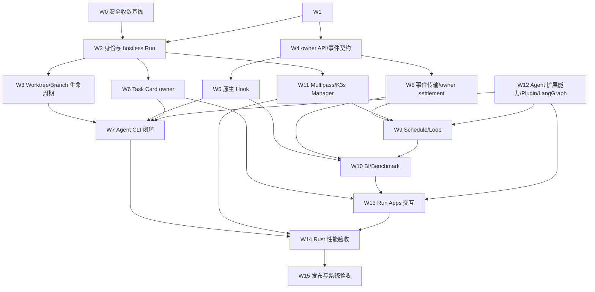

# WORKTREE-GROUP-NEXT-WBS-2026-10-18

> **渡口 Worktree-first 产品未完成设计与交付 WBS 更新稿**
>
> 基线：2026-10-18 JST 通过 `rtk git fetch origin main dev` 刷新 refs 后核对；`origin/dev=6f8d5b8f2d00b1515928c9a25e0762a45cf30e4e`，`origin/main=8dcb65f7cc5602d4f7c6b681c368d5097bc12a22`。`git rev-list --left-right --count origin/dev...origin/main` 为 `121 0`，当前 main 无 dev 未包含的领先提交。
> 对照：需求 v6.87、基本设计 v6.86、DD-WORKTREE-GROUP-001 v5.09、实施计划 v7.14 §6.140–§6.156、架构与交付方向 v1.14、`PHASE-9F4I-NATIVE-EVENT-REPORT` v0.2
> 状态：🟡 计划稿；未把远端文档审阅当成本地分支合并或生产验收

## 0. 目的与计划边界

本 WBS 将现有设计与已验证切片接到可交付的多 Agent Worktree 管理闭环。优先解决 Project 下 Run/Worktree 归属、并行 Agent 生命周期、任务卡内 CLI、安全合并与可控清理；任务管理、Canvas、Workflow/LangGraph、BI/Benchmark、Hooks 和插件均围绕同一 Run 授权与数据所有权协作。

固定产品树：

```text
Project
└─ Engineering Run
   └─ Worktree
      └─ Branch（该 Worktree 的本地 checkout 分支状态叶）
```

远端 SCM/宿主连接是可选 metadata，不改变树层级。点击 Worktree 后才打开该 Run 的 App tabs；Task Card 内打开 CLI；Canvas 与 Task Card 同级并通过 owner API / canonical EntityRef 交互。底栏 Chat 支持 WORKTREE / GLOBAL scope。Hooks 位于“高级设置 → Hooks”，作为可视化强约束设置，不是树节点。

本计划保持 fail-closed：源码、隔离数据库夹具、UI 或测试 fixture 单独存在，都不等于真实身份、目标数据库、provider、执行 runtime 或商业产品闭环已验收。

## 1. 未完成设计清单

| ID | 未完成设计/决策 | 当前文档证据 | 收口要求 |
|---|---|---|---|
| D-01 | Hostless Run 到 Worktree 的完整授权与绑定模型 | Run directory 已支持 hostless 源码切片；WLD-0 已新增 bind/reassign/detach API 与前向 migration，覆盖 Project/Run 授权、CAS、幂等、每 Worktree 锁、SCD2、Audit 和 Outbox。目标 DB/RLS/grants、认证写入、回滚、并发及历史归属对账仍未闭合 | 定义唯一 owner、绑定版本、迁移策略、Project/Run grants 与无宿主状态；旧 Branch grant 只用于 SCM 操作 |
| D-02 | 多 Agent Worktree 生命周期和安全收敛 | 有 Index、lock observer、部分 create/import/archive 条件式切片；生产 Host Runtime observer、drain、checkout 清理和 owner 信号未闭合 | 定义 Agent/terminal owner、锁、reservation、冲突、归档/删除、恢复、用户数据保全与 merge receipt 状态机 |
| D-03 | Run Apps 的 owner API 与事件契约 | Task、Canvas、Hook、BI 等各有局部 owner/Outbox/Inbox 切片；端到端 delivery、consumer projection 与应用拆分边界不齐 | 固化 API、存储过程/owner transaction、Outbox/Inbox、idempotency、版本、撤权、重放、失败和审计契约；禁止跨 owner 直接写表 |
| D-04 | Task Card 到安全 Agent CLI 的完整运行设计 | bounded list/create、审查/生命周期与恢复局部实现；真实 provisioner、OS sandbox、工具调用控制、独立验证和结果回写仍开放 | 设计并实现分配、启动、流输出、取消/恢复、预算、权限再验、证据、独立验证、结果回写与 PR/合并衔接 |
| D-05 | Schedule / Loop 的无人值守 admission 和恢复 | Rule API、run-as 身份与多段 admission contract 已形成切片；完整 worker、occurrence、执行和生产 consumers 未闭合 | 规则创建者固定为 run-as；每次触发/重试/恢复实时复验授权、profile、Hook、预算与基础设施；checkpoint、租约、取消、补偿均可审计 |
| D-06 | 原生 Hook 强制链与可视化运营 | Hook evaluator、策略存储/API、archive gate 和事件统计有局部实现 | 可视化编辑/预演/发布/回滚；Project→Worktree 继承与 Run 快照；合并、任务执行、Schedule、插件入口都经 Rust 原生 fail-closed 门；事件与 BI 联动 |
| D-07 | BI/Benchmark 的可信、完整、可恢复数据面 | 9F4E–9F4I 已提供 Inbox、最小投影、接收/查询/UI 与原生 event 授权基础 | BI 身份/transport adapter、Route-pin、sender、owner commit-before-ACK、accepted settlement、checkpoint、fan-out、聚合/Benchmark、保留/恢复与准确性验收 |
| D-08 | Multipass 管理的多 K3s 基础设施 owner | Contract、迁移、容量原语、部分 provider/观察切片存在；可信 resolver、全局容量、生产 consumer、Manager/provider/runtime 尚未闭合 | 版本化 profile 固定 cluster ID/generation；分别核算 Host 与 cluster 容量；Multipass 测试 inventory 最多 2 条记录（含 Stopped/Deleted）；Rust Manager 独占 adapter；VM/K3s 不替代 Agent sandbox |
| D-09 | Agent 扩展能力、插件热插拔与 LangGraph/App 隔离 | Agent、Memory、Skill、Context、Validation、Loop 的扩展方向与 App manifest/capability 已有设计；Rust 小核心、provider 固定、Run profile/version/digest、事件生命周期、可分支历史、上下文压缩、证据链与生产运行/撤权链未整体验收 | 定义可替换的版本化 Agent/Memory/Skill/Context/Validation/Loop contracts；Run 固定 profile/version/digest/预算；事件、可分支历史、压缩边界、权限、上下文来源与验证证据可追溯；插件使用隔离进程和 capability broker，安装/升级/回滚/卸载先停新准入再 drain；LangGraph resume 重新检查身份、scope、Hook 与 budget；一期可用受控 Rust CLI adapter，后续保留 Rust-native provider/core 路径，Star 始终控制授权、上下文、事件和独立验证 |
| D-10 | Rust 桌面低内存与并行服务等级 | 已有分页、懒加载、有界请求和部分数据上限；没有覆盖目标设备和并行规模的完整 RSS/延迟基线 | 明确队列/缓存/日志/IPC 上限与背压、公平调度、取消/drain；以空闲及 1/2/4/8/16 Agent 场景测 RSS、p95、队列等待、启动/取消和长时漂移；实测前性能阈值标 TBD-MEASURE |
| D-11 | 商业分发、升级和运行验收 | 开源商业使用边界与 Rust 服务替换方向已记录；完整 provider/安装包/SBOM/运维闭环未完成 | 核验完整发行依赖/SBOM/NOTICE、安装和升级路径、备份/恢复、数据库权限、两个测试 VM 上限与升级/回滚证据 |

## 2. WBS 与依赖顺序

优先级采用 P0（解除推进门）、P1（主链必需）、P2（产品闭环）、P3（强化与发布）。每项必须先有设计/验收条件，再标实现；不得以文档状态替代运行证据。

| WBS | 优先级 | 工作包与主要产物 | 依赖 | 当前状态 | 完成门 |
|---|---|---|---|---|---|
| W0 | P0 | **安全收敛基线**：复核 dev/head、main/dev 独有提交、合并来源、PR、全部 worktree owner/dirty/ignored；如 main 有领先提交，先按依赖顺序 cherry-pick 到 dev；再选择性收敛其他 lane；归档保留快照；只在安全完成后保留本地 main/dev | 无 | 远端比较已完成：main 无独有提交；本地 owner/Git 状态仍未核验 | main/dev 比较结果与独有提交清单已记录；有适用的 main 领先提交时先 cherry-pick 到 dev 并验证；目标 dev HEAD 未变且无活动 writer；每个来源有 diff/依赖/验证审阅；丢失内容核对完；只有已纳入或已归档保存的工作才清理；不 push/删除远端 refs |
| W1 | P1 | **设计基线对账**：需求、基本、详细设计、方向文档、实施计划建立逐条追踪矩阵；统一层级、名词、owner 和状态；历史冲突标为废止/历史记录 | 可基于已读取的远端 dev 文档并行开展；任何 dev 写入/代码集成仍依赖 W0 | 主架构方向已写；仍需全链路一致性核验 | Project→Run→Worktree→Branch、hostless Run、同级 Run Apps、Hook 设置位置、Task Card CLI、WORKTREE/GLOBAL、Multipass 与两实例上限在各活跃文档一致；未实现项保留开放状态 |
| W2 | P1 | **Project/Run 身份与 hostless 目录**：认证 session、membership/grant provisioning、可信来源写入、Run schema migration、应用 DB role/RLS 与历史数据 reconciliation | W1 | 源码/迁移候选与局部验证；真实身份/目标 DB 未验收 | 无远端宿主也可创建/授权/列出 Run；真实 actor 权限逐请求复验；越权/撤权 fail closed；迁移可重复且目标 role/RLS 有实证 |
| W3 | P1 | **Worktree/Branch 生命周期**：Run↔Worktree writer、可信 Host/Repository observation、branch 状态叶、lock/lease、create/import/archive/recovery/cleanup 与 merge receipt | W2 | 目录/observer/UI 局部切片；生产 Host Runtime、绑定和物理清理未闭合 | 每个 checkout 唯一有效 Run 归属；Branch 只由可信 observation 投影；过期/未知状态关闭写操作；取消/drain/锁/用户数据/恢复与合并清理均有审计和集成证据 |
| W4 | P1 | **跨 App owner 契约**：Task、Canvas、Workflow、Inbox、Hooks、BI、Plugins 的 API/存储过程/Outbox/Inbox schema 与 RunContext 版本化 | W1、W2 | 多个 owner 切片已存在；跨 owner 端到端未关闭 | 同一事务仅改本 owner 事实；跨 owner 使用幂等命令/事件；精确 actor、Project、Run、Worktree scope；重复、乱序、撤权和部分失败可恢复 |
| W5 | P1 | **原生 Hook 与策略 UI**：Advanced Settings → Hooks typed editor、策略继承/快照/发布/回滚、Rust evaluator 接入所有写入和执行门、BI evidence | W2、W3、W4 | evaluator、policy API、archive gate、source-only metrics 有局部实现 | 无代码配置可预演/解释；所有强制入口执行同一版本化 HookSet；缺失/过期/无法解释时拒绝；事件可追溯到 Worktree/Run/BI |
| W6 | P1 | **任务管理和 Task Card 生命周期**：Run owner list/create/transition/review、幂等回执、migration/grants、Canvas EntityRef 组合命令、事件发布 | W2、W4 | bounded API/UI 和 owner source 已有；目标 DB/RLS、dispatcher/consumer 未完成 | 真实 Run 读写、状态/audit/outbox 一致；Canvas 双向互动不绕过 owner；无 seed/mock 回退；撤权/并发/CAS/replay 有测试 |
| W7 | P1 | **Agent CLI 执行闭环**：卡内 CLI、Agent 自动分配、Runtime provisioner、隔离 sandbox、工具调用和文件 claim、流输出、取消/恢复、独立验证及结果回写 | W3、W5、W6、W8、W12 | CLI UI 明确禁用；只存在 admission/fence/helper 等源切片 | 从真实 Task Card 到授权 Agent、版本化能力 profile、受限执行、Hook 检查、budget admission、取消恢复、独立验证与结果 evidence 全链路通过；无任意 host shell 或未经授权 mount |
| W8 | P1 | **事件传输与 owner settlement**：BI/Task 原生 adapter、immutable route pin、sender、receiver Inbox、事务提交后 ACK、accepted/retry/dead-letter、recovery/checkpoint；保持 NATS 可替换 adapter | W4 | 9F4I 原生 event 授权基础完成；真实 BI network chain 未完成 | 接收 owner commit 前不 ACK；重放幂等、身份冲突不误确认、租约 fencing 有效；profile/identity/target DB grants/RLS/recovery 有实证；传输切换/回滚不改业务 owner 契约 |
| W9 | P1 | **Schedule / Loop Worker**：occurrence 生成、run-as 复验、规则 version/profile pin、Run admission、预算/容量预留、checkpoint、暂停/取消/补偿与结果确认 | W2、W5、W8、W11、W12 | Schedule API/owner contract 部分完成；无人值守执行链未闭合 | 每次 trigger/retry/resume 都实时授权并重新解析固定基础设施 binding；按固定的 Memory/Skill/Context/Validation/Loop capability profile 运行；撤权/容量未知/Hook 缺失则拒绝；重复副作用受幂等键和 owner receipt 控制 |
| W10 | P2 | **BI/Benchmark 产品闭环**：可信事件投影、消费 checkpoint、指标定义/版本/数据集、质量/性能分析、Benchmark evidence、留存/恢复 | W5、W8、W9 | 9F4E–9F4I 源码切片完成到 native event authorization；9F4J 之后的可信适配与 E2E 尚待开始/核实 | BI 只读 owner projection；显示完整性/新鲜度 unknown/partial/complete 的依据；Benchmark 可重放、可比较、不可篡改；并发/恢复/长期留存和目标 DB 通过 |
| W11 | P1 | **Multipass/K3s Infrastructure Manager**：trusted resolver/profile、跨租户物理 Host/cluster ledger、独立 reservations、delivery consumers、VM provider、K3s readiness、workspace bridge | W2、W4、W8 | 只读观察、容量原语和部分 schema/owner slices 已有；生产 manager/provider 未验收 | 只由 Rust Manager 调 Multipass；测试 inventory 总数不超过 2 且不自动 purge；Run 固定 cluster ID+generation；Host 与 cluster 双预约可对账；sandbox/权限/资源限制满足后才启动 agent |
| W12 | P1 | **Agent 扩展能力、插件热插拔与 Workflow/LangGraph**：Rust-native 小核心和可替换的 Memory/Skill/Context/Validation/Loop provider contracts、profile/version/digest 固定、一期受控 Rust CLI adapter、capability broker、隔离 worker、事件生命周期、可分支 history、上下文压缩、插件安装/升级/卸载/drain、图版本与 checkpoint | W4、W5、W8 | 设计有方向；生产 provider composition、权限与证据链尚未验收 | 每个 Run 固定兼容的能力 profile/version/digest 与资源预算；上下文来源/裁剪、skill 版本、Memory 读写、事件生命周期/分支历史/压缩、独立 Validation evidence、Loop stop reason 可审计；压缩不破坏审计/验证证据；provider 替换不变更授权/owner 契约；插件不能加载进主进程；热卸载先停止新准入再 drain；LangGraph resume 重新授权并复验 Hook、profile、budget；全链路可重放 |
| W13 | P2 | **跨 App 导航与交互**：Inbox、Task、Canvas、Workflow、BI/Benchmark、Plugins 同级 tabs；CLI 只从卡内启动；深链、错误态、无焦点/未绑定态统一 | W2、W3、W5、W6、W10、W12 | Task/BI 部分 UI；其余 Run Apps 与真实数据链路不完整 | 同 Run 切换 Worktree 不改变 App owner；跨 Run/Project/tenant 引用拒绝；直接深链重新授权；UI 无虚假连接器、mock 事实或过期 scope 闪现 |
| W14 | P2 | **Rust 桌面内存/并行验收**：缓存、虚拟化、日志、IPC、Tokio 队列、公平调度、背压、取消/drain、RSS 与 p95 benchmark | W3、W7、W11、W13 | 局部有界实现；整体基准/阈值缺失 | 设备、fixture、并行规模、采样方法可复现；完成空闲及 1/2/4/8/16 Agent 测量；按测量结果冻结预算，不以“低内存”主观宣称 |
| W15 | P3 | **商业发布与系统验收**：Windows 桌面打包、目标 DB 部署、身份/RLS、升级/回滚、故障恢复、SBOM/NOTICE、support diagnostics、跨 App E2E | W2–W14 | 未启动完整验收 | 一条可重复商业使用链覆盖创建 Project/Run→绑定 Worktree→分配 Agent→卡内 CLI→验证→合并/安全清理→BI 证据；部署、升级、备份恢复、权限和性能全部有可追溯证据 |

### 2.1 端到端未完成设计里程碑

以下 WLD 里程碑用于收拢分散的源码切片和设计要求；它们不另建平行 owner 或重复实现已完成的 API/UI。每个里程碑只有在运行身份、目标 DB、授权、恢复与独立验收证据满足时才关闭。

| ID / 依赖 | 未关闭的设计与实现边界 | 完成门 | 映射 WBS / 权威设计基线 |
|---|---|---|---|
| **WLD-0 Project/Run/Worktree canonical binding** / 无 | Hostless Run、导航与 Task Card 无 Worktree focus 已有局部设计/源码；Run↔Worktree attach/rebind/detach、过期/歧义 generation、统一 ACL 和目标库写入仍未闭环。 | Hostless Run 可创建/列出/打开；focus Worktree 必须属于同 Project/Run；跨域、stale/ambiguous binding、撤权均 fail closed；UI/REST/Task/CLI 读取同一绑定事实；目标 DB、grants、FORCE RLS、并发和 replay 验收通过。 | W1/W2/W3；requirements §50、§50.3.1；basic §16.2、§16.20；Group DD §3.1、§7.1；plan §6.144–§6.146 |
| **WLD-1 Safe Worktree lifecycle, merge and cleanup** / WLD-0 | 创建/导入/归档/恢复/重绑定/清理的设计已有；生产 owner command 原子复验、真实 provider 幂等副作用，以及 Agent/Run/PTY/进程 drain 与用户数据保护仍未验收。 | 对 stale version、重复/replay、provider timeout、活动 lease/file claim/PTY/process、dirty/untracked、retention lock 和 unknown state 做并发/恢复验证；不确定时禁止破坏性操作；成功操作产生 owner transaction audit/Outbox receipt 并支持 reconciliation；disposable checkout 与目标 DB/RLS 通过。 | W3/W5/W13；requirements §22.2、§22.6–§22.7、§50.3.1、§50.8D；Group DD §6、§8.6；basic §16.17 |
| **WLD-2 Run Task Card lifecycle + in-card CLI** / WLD-0；checkout teardown 另依赖 WLD-1 | Task owner、列表/创建、claim/lease、CLI identity、ticket/PTy 有局部切片；生产 session provisioner、独立 OS sandbox、工具控制、取消/drain、恢复、独立验证和结果回写未闭环。 | Task Card 绑定同 Run Worktree；实时复验 claimant/lease/Profile/HookSet/budget；仅 allowlisted argv/env 和 scoped cwd 在独立 sandbox 执行；有界 PTY 背压；撤权、取消、超时、重启、reattach、子进程 drain 幂等可审计；独立 validator 回写 criterion-linked evidence；依赖缺失时不可执行。 | W6/W7/W12/W13；requirements §50.4、§50.8AN–§50.8AO；basic §16.6、§16.20；Group DD §7.1、§8.5；plan §6.141、§6.144–§6.150 |
| **WLD-3 Schedule occurrence → Run owner saga / Engineering Loop** / WLD-0；共享 WLD-2 的执行身份和预算契约 | Rule API、固定 run-as、schema/lease/admission primitives 部分存在；生产 worker、每次 trigger/retry/resume 的现时授权复验、Run↔Schedule 双方 Inbox/Outbox saga、补偿/恢复未闭环。Loop controller 不等于持久 checkpoint 或执行器。 | occurrence 幂等地产生至多一个 non-executing Run；每次重试按不可变 `run_as_actor_id` 重验当前 ACL、profile、HookSet、Task、binding 与 quota；过期 fencing token 不可写入；DST/misfire/overlap/catch-up/deadline/queue-full 遵循固定策略；owner 各自提交并支持撤权/故障补偿；Loop 固定 acceptance snapshot、预算及 stall/oscillation stop reason。只有 WLD-4 readiness 回执后才允许进入执行态。 | W9/W12；requirements §50.8B、AC-LOOP-001–010；basic §16.16、§16.24–§16.27；Group DD §8.7、§8.10–§8.12；plan §6.77–§6.82、§6.109–§6.140 |
| **WLD-4 Multipass/K3s admission and readiness** / WLD-3 的 non-executing admission receipt | Binding/readiness contract、schema/grants/Inbox/admission 与容量台账 primitives 有局部实现；可信 resolver、owner consumers、受限 Manager/provider、release/reaper、readiness producer、Agent sandbox 和 workspace bridge 未形成生产闭环。 | Run 固定 cluster ID+generation；owner 事务分别幂等预留 Host 与精确 cluster 容量；核实 Manager receipt、owned guest、K3s API/node/CRI、独立 Runtime sandbox 和限路径 workspace bridge 都新鲜匹配；未知容量/身份、stale generation、撤权/取消时保持 non-executing 并可释放/恢复；测试 inventory 总数不超过 2（含 Stopped/Deleted），不自动 purge，无跨 owner 写事务。 | W11/W9/W14；requirements §50.8H、§50.8B/AC-LOOP-010；basic §16.27–§16.28、§16.30–§16.54、§16.61–§16.64；Group DD §8.12–§8.21；plan §6.89–§6.108、§6.134 |
| **WLD-5 Native Hook enforcement + visual policy operation** / WLD-1；Task/Schedule producers 分别依赖 WLD-2/WLD-3 契约 | Advanced Settings → Hooks、typed Builder、Rust evaluator 与部分 admission/archive producer 已有切片；生产身份/DB、全生命周期 producer、Runtime enforcement 和 BI linkage 未验收。 | 可视化编辑/继承/预演/diff/审批/回滚；Run 固定 HookSet digest/version；Rust 核心覆盖 Run、tool、validation/review 与破坏性 Worktree 命令；Plugin 不可覆盖强制规则；evaluator/audit 失败 fail closed；清理重验 ACL/version/lease/claim/drain/retention；目标身份/DB/RLS/runtime 与脱敏 BI 事件通过验收。 | W5/W7/W9/W13；requirements §50.8D；basic §16.17、§16.20；Group DD §8.6；plan §6.45–§6.53、§6.68 |
| **WLD-6 Durable App events, BI/Benchmark and release closure** / WLD-2/WLD-3/WLD-5 事件源；基础设施事实依赖 WLD-4 | Task delivery、BI Inbox/receiver/query/UI 和 native `event` authorization 有不同程度源码/隔离 DB 证据；生产 transport/identity、commit-before-ACK、每 consumer 独立 Inbox/projection、gap recovery、Benchmark、备份/WAL 和性能仍未闭环；9F4I 明确 ingress 与执行 fail closed。 | owner event 经认证有界 transport 到 receiver owner Inbox/projection 并 durable commit 后才 ACK；exact replay 稳定回执、冲突隔离；验证 crash、撤权、取消、stale lease、gap rebuild；BI/Benchmark 使用版本化 cohort/formula，覆盖/新鲜度未知时明确报告；目标 DB/RLS、生产身份、Rust 1.99、backup/WAL/PITR、队列/RSS/fairness/latency 与 requirements-to-runtime traceability 独立验收后，才解除对应 fail-closed 门。 | W8/W10/W14/W15；requirements §50.8A、§50.8B、§50.8D；basic §16.71–§16.75；Group DD §8.25–§8.26；plan §6.149–§6.156；9F4I report §2–§3 |

**WLD 依赖顺序**：WLD-0 → WLD-1 → WLD-2；冻结接口后 WLD-1 与 WLD-5 的部分策略配置工作可分隔离 worktree 并行。WLD-0 + WLD-2 → WLD-3 → WLD-4。WLD-2 + WLD-3 + WLD-5，并结合 WLD-4 的基础设施事实 → WLD-6 → 发布闭环。分散的 WBS 子项属于输入/实现，不代替这些端到端完成门。

## 3. 关键依赖图



## 4. 建议的下一步执行批次

### 批次 0：下一实施切片（建议 9F4J）

现有 dev 实施计划在 9F4I 之后明确要求 BI 原生 adapter 与 owner commit-before-ACK 真实联测。先完成可信事件链路；这不会启用 Schedule/Agent 执行，也不代表目标生产环境已验收。

1. 固定 BI transport adapter 的身份来源、tenant/provider/endpoint、active Profile revision/digest、event kind 授权和 immutable route pin。
2. 将 9F4I 的 native `event` 能力接到 BI sender/receiver composition；禁止用 admission-only request/result adapter 代替 Task event。
3. BI owner 在单一事务中写 Inbox、fact/conflict 与 durable receipt；只有事务提交后 transport 才 ACK。
4. 验证 exact replay、same identity/different wire conflict、错误 tenant/Run/Project、profile 撤销、lease 过期、consumer 重启，以及“提交后、ACK 前”崩溃恢复。
5. 在隔离目标 PostgreSQL 验证 migration、app role grants、RLS/FORCE RLS、WORM、并发和恢复；运行 Rust 1.99.0 owned-crate tests/fmt/Clippy，再做针对性端到端联测。
6. 输出阶段报告并同步需求、基本设计、BI/Transport 详细设计与本 WBS。缺少可信身份或目标 DB 时继续 fail closed，不将 fixture 通过写成生产验收。

#### Phase 9F4J 子工作包与退出门

| 子项 / owner | 交付与验收 | 设计/实施引用 | 未关闭边界 |
|---|---|---|---|
| **9F4J.1 BI Event native adapter** / Platform Messaging transport owner | 通过 Star authenticated gRPC wrapper 实现 bounded `PullOne` / `VerifyOrigin` / `AcknowledgeOne`；校验 tenant、sender/receiver、Event kind、log ID/generation、sequence、message/lease/attempt 与 exact wire digest；wire ≤16 KiB、protobuf frame ≤32 KiB、有限 deadline、不 prefetch；BI core 不依赖 transport crate。 | requirements §50.8AU、Task SRS AC-26、Task BD §6.7、Task DD §14.13.9、basic §16.76、plan §6.156 | 目标部署身份/证书轮换、生产 Profile loader/composition、目标 DB/grants 与完整 receiver 联测未完成；opt-in adapter 不代表 production ready。 |
| **9F4J.2 immutable route pin + current Profile verifier** / Task Delivery + Platform authorization owners | 首发前 pin provider/version/Profile revision+digest/endpoint、双方 identity、logical destination/log generation、schema 与 exact-wire SHA；retry 复用 pin 和 bytes。每次 receive/verify/ACK 从可信 mTLS session 验证 active Profile、tenant、direction、service identity、Event 授权与 destination generation；不信任 caller 身份或过期缓存。 | requirements §50.8AR、AC-RUN-OUTBOX-01、Task SRS AC-20、Task BD §§6.2/6.7、Task DD §14.13.9、basic §§16.70–16.72/§16.76、plan §§6.151/6.156 | route/wire source 尚未有目标 DB/网络 send 验证；禁止重定向、双发或 native↔JetStream fallback；revoke、profile drift、identity mismatch fail closed。 |
| **9F4J.3 trusted composition** / application composition owner（BI 与 Platform 联审） | 独立 composition 将 current-Profile verifier、BI Event adapter、`TaskEventReceiver`、BI Inbox writer、quarantine capability 接通；架构断言 `bi-owner-runtime` 不依赖 `platform-messaging-runtime`；Event scope/transport/delivery 独立，不复用 Admission Request/Result/Resolution。首期可由 app composition host 接线；HTTP BI query 路由不持有 worker/client。 | requirements §§50.8AS/50.8AU、Task SRS AC-23/AC-26、Task BD §§6.4/6.7、Task DD §§14.13.6/14.13.9、basic §§16.73/16.76、plan §§6.153/6.156 | 审计确认 `star-api-rest/Cargo.toml` 只有 `bi-owner-runtime`、未依赖 Platform transport；`main.rs` 只建立 `BI_DATABASE_URL` query store 并运行 Axum，没有 consumer lifecycle/shutdown drain；`GroupApiState` 只暴露 query port。需新增独立 composition module、隔离 BI write pool、current-Profile resolver、startup capability probe、ingest-only readiness 与有界 cancel/drain；真实 service identity 未验收。源码证据：`crates/star-api-rest/Cargo.toml:87-93`、`src/main.rs:32-93`、`src/group_api.rs:307-338,390-396`、`src/group_api/bi_analytics.rs:122-152`。 |
| **9F4J.4 owner commit-before-ACK network proof** / BI owner | 用真实 native gRPC+mTLS、Event client、`TaskEventReceiver`、`TaskEventInboxStore.commit_exact_wire` 与 disposable PostgreSQL 联测。pre-ACK latch 暂停 ACK；独立 DB observer 确认 Inbox receipt 与 fact 已提交、delivery 仍 leased/unacked 且无 ACK receipt；释放 latch 后出现 ACK receipt，Inbox/fact 各唯一一份。exact replay 返回同 receipt。 | requirements §50.8AS、Task SRS AC-23、Task BD §6.4、Task DD §14.13.6、basic §16.73、plan §6.153；建议将验收增量落在 plan §6.157 | BI Inbox 持久化 PostgreSQL 测试只证明 owner transaction/replay/conflict，不能替代 network commit-before-ACK。必须待 Event API 与 trusted composition 稳定后留真实 SQLx/PG commit、独立 observer 和 ACK receipt 证据。 |
| **9F4J.5 failure / exact replay / recovery** / BI + Platform owners | 注入 Inbox commit fault/unknown outcome、commit 后 ACK RPC failure/timeout、cancel、revoke、Profile/route/generation drift、redelivery 与 exact duplicate；未确认结果保持 source unacked/redeliverable；同 identity+wire 返回原 receipt 且仅一条 fact；identity/content conflict 不 ACK；poison 仅在 metadata-only quarantine receipt durable 且来源再次授权后 terminal disposition。 | requirements §50.8AS、Task SRS AC-23、Task BD §6.4、Task DD §14.13.6、basic §16.73、plan §6.153、DD-RUST-SERVER-REUSE §12 | disposable test 不代表进程重启/PITR、备份/WAL、生产 checkpoint 或运维恢复策略；未具备 crash/recovery、quarantine retention/capacity 与可信 terminal capability 时维持 fail closed；本切片不打开 accepted settlement、fan-out 或 execution。 |
| **9F4J.6 target PostgreSQL/RLS/grants** / Platform + BI（分别验收各自 DB/role） | 用 DDL owner、受限 Platform runtime、BI runtime、独立只读 observer 验证 migrations；BI runtime 仅调用固定 BI function，无直接表 DML/跨 owner 权限；Platform runtime 只调用 authenticated native wrappers；验证 FORCE RLS/WORM、PUBLIC execute revoke、固定 search_path/timeout、NOINHERIT/SET ROLE denial、tenant mismatch 与 rollback 负向情况，并区分 disposable grants 和 target grants。 | requirements §§50.8AS/50.8AU、Task BD §§6.3–6.4/6.7、Task DD §§14.13.5–14.13.6/14.13.9、data design 9F4I、plan §§6.153/6.156、9F4I report | Target database 与登录角色 membership/grants 尚未部署/审计；fixture role 不能冒充生产 role。迁移升级/回滚、owner boundary、RLS 负向和独立 commit/ACK observer 缺一不可。 |

**9F4J exit gate**：9F4J.1–9F4J.6 的适用 Rust 1.99.0 fmt/check/test/Clippy、真实 mTLS gRPC + disposable PostgreSQL commit-before-ACK latch，以及各 owner 最小权限/RLS/grants 负向断言都有可复核证据，才关闭本切片。生产身份/control plane/target grants、crash/PITR、durable checkpoint/恢复、quarantine retention/capacity、RSS/p95/p99/fairness、BI/Benchmark fan-out、accepted settlement 与 Schedule/Run execution 是独立门；本切片退出不得解除这些门，BI ingress 与执行继续 fail closed。建议的文档追踪增量为 9F4J 使用新验收 ID `AC-27`、Task BD §6.8、Task DD §14.13.10、basic §16.77、plan §6.157；先检查文档编号后再写入，保留 9F4I `AC-26` 历史不变。

### 批次 A：先恢复可安全集成的工作面

1. 恢复可读取 Orca owner/runtime 状态的执行路径；核对 dev checkout 当前 owner、HEAD、dirty/ignored、终端活动情况。
2. 比较 main 与 dev 的当前提交图，列出 main 独有的领先提交及依赖；本轮远端比较结果为 main `ahead_by=0`、落后 dev 121 个提交，因此当前无 main 内容需要 cherry-pick。
3. 若之后发现 main 有领先提交，先逐个审阅差异、依赖和验证，再按依赖顺序 cherry-pick 到 dev；在 cherry-pick 结果复核完成前，不 rebase 或 merge 其他 lane。
4. 在更新后的 dev 基线上重新生成分支/PR/worktree 清单；对其他未合并来源只审阅与本 WBS 兼容的提交，不整分支盲合。
5. 每个已完成候选先形成差异与验证摘要，再 rebase 到最新 dev 并串行 merge；逐项确认 dev 中没有遗漏后保存归档快照。
6. 保留 main 和 dev；只有已合并且可恢复的托管 worktree 才归档/清理。此批次未完成前不开始共享 dev 上的后续写入。

### 批次 B：锁定产品契约并拆分可并行实现

1. 将本 WBS 的 D-01–D-11 映射到 requirements §50、basic design §16、Group DD、Hook/Task/Schedule/Infrastructure/BI 详细设计及验收矩阵。
2. 纠正旧章节、历史摘要和产品文案中的层级/名词漂移；保留历史报告原状并注明历史基线，避免重写已签署事实。
3. 并行设计/实现可隔离的 W2（身份与 Run）、W5（Hook UI/执行门）、W8（可信 transport/BI adapter）、W11（Infrastructure Manager）；共享 API/DB 边界先由 W4 固定。
4. W3/W6 完成后串联 W7 的 Task Card CLI；W8/W11/W5 完成后再打开 W9 Schedule worker；W10 BI/Benchmark 在可信事件和 checkpoint 可验证后启动。

### 批次 C：可用闭环与发布门

1. 在受控环境完成真实认证、目标 PostgreSQL 迁移/grants/RLS、受限 Multipass/K3s provider 和独立 Agent sandbox 联测。
2. 用一条任务验证：Project→Run→Worktree→Branch → Run App → Task Card → Agent 分配/CLI 执行 → Native Hook → 取消/恢复 → 独立验证 → 结果回写 → merge receipt/安全清理 → BI/Benchmark evidence。
3. 进行重复投递、进程崩溃、撤权、过期 reservation、runtime unhealthy、Worktree 锁冲突、插件升级/卸载、数据库故障/恢复测试。
4. 对比需求、基本设计、详细设计、WBS、API/DB 与运行事实；只在所有所需环境证据齐全后关闭对应 phase。

### 批次 D：下一步可执行顺序与并行边界

| 顺序 | 工作 | 执行方式 | 前置/完成条件 |
|---|---|---|---|
| D0 | 恢复本地 Git/Orca 可观测性；更新 owner、HEAD、dirty/ignored、活动终端、分支与 PR 清单；对保留的未合并内容建可恢复归档 | 单一集成负责人串行；不动活动 checkout | RTK 与 Orca owner 查询可用；dev checkout 无活动 writer 且 HEAD 已记录。当前会话尚未满足此门 |
| D1 | 将本 WBS 与两条审阅线发现逐项对账，形成唯一可审阅版本；核准每项设计状态、文件来源、依赖、验收与 blocking status | 文档线可基于远端 dev 快照继续；不得在共享 dev 写入 | 远端文档章节和 WBS 每行一一对应；不将 source/fixture/UI 误标生产完成 |
| D2 | Phase 9F4J：先并行交付 9F4J.1 Event adapter 与 9F4J.6 BI Inbox 持久化/RLS 用例；再冻结 API 后串行完成 9F4J.2 current-Profile/route verifier、9F4J.3 app composition；真实身份和 disposable DB 就绪后执行 9F4J.4 commit-before-ACK 网络 latch，再完成 9F4J.5 故障/重放/恢复矩阵 | 两个现有隔离 lane 可先并行；adapter API 冻结与组合接线由单一 integrator 串行；DB persistence-only 证明不得替代网络证明 | 目标 DB 身份/grants/RLS 可用；receiver 事务提交后才 ACK；重复与身份冲突行为、lease fence、crash-after-commit-before-ACK 均有证据；ingest readiness/drain 独立；执行仍 fail closed |
| D3 | 补齐 hostless Run/Worktree binding、Worktree lifecycle 与 Task Card owner/CLI 前置设计 | Run/Worktree 与 Task owner 可并行设计；合并由 integrator 串行 | binding、Branch observation、Run grants 与 owner API 定版；Task 执行仅在 runtime/sandbox/Hook/验证门满足后开放 |
| D4 | 完成 Multipass/K3s owner reservations、精确 cluster generation、可信 Manager/provider/readiness、独立 sandbox 接入设计 | Infrastructure owner 和受限 provider adapter 可并行；VM 测试串行并受 inventory lock 限制 | 两条 Multipass inventory 记录上限持续有效；容量未知时拒绝；Host 与 cluster reservation 由各 owner 自己事务写入 |
| D5 | 完成原生 Hook 设置/执行链、插件隔离热插拔与 LangGraph 恢复授权设计 | Hook UI/策略 API 与 plugin manifest/runtime contract 可并行；执行门统一集成 | 高级设置 → Hooks 可视化；Rust 强制 Hook 不可绕过；撤权后拒绝新调用并 drain；恢复需重验 Run、profile、Hook 与预算 |
| D6 | BI/Benchmark、Rust 桌面 RSS/延迟、公平调度/背压、商业分发/SBOM 与系统发布验收 | 必须等可信事件链、执行链和基础设施状态源稳定后开始；可按测量/发行/恢复分离 | 有可复现设备与负载数据、owner-sourced BI 投影、backup/restore 证据、全发行闭包 SPDX/SBOM/NOTICE 与升级/回滚门 |
| D7 | 每轮先比较 main/dev；如 main 有领先内容则先 cherry-pick 到 dev，再把通过审阅和验证的文档/代码 lane rebase 到最新 dev 并逐项 merge；核对已合并与归档保留内容，清理已明确完成且无人使用的 lane | 单一集成负责人串行；不得全分支盲合 | main/dev 提交图和 cherry-pick 决策有记录；有领先提交时先完成 cherry-pick 并验证；每次 lane 集成前复核 lane HEAD 与 dev HEAD；owner/dirty/untracked/ignored 和验证门通过；无活动 owner 的证明可用；只保留 main/dev 的目标须在不丢失用户数据前提下完成 |

**执行更新（2026-10-19）**：WLD-0 API 与 requirements/basic/DD/WBS/阶段报告已合入本地 dev；首次 fast-forward 从 6f8d5b8f 到 cb0acdda 成功，无冲突。候选基于 dev 并已 rebase（无需改写提交）；最终 star-api-rest --all-targets check 通过，全目标测试 261 passed、0 failed、2 ignored。变更 Rust rustfmt、CGG、whitespace 检查通过。最新 origin/dev...origin/main=121 0，无 main-only 提交；本轮未 push。合并后将再提交一条 WBS/报告状态记录并 fast-forward 到 dev，随后核验最终 HEAD/clean。目标 PostgreSQL/RLS/grants/rollback/durable replay/concurrency/history reconciliation 未验收，执行保持关闭；下一阶段按 WLD-1 生命周期与安全清理 WBS 推进。

## 5. 验收与报告规则

- 每个 WBS 条目必须有：owner、输入/依赖、变更路径、迁移与授权影响、正/反向验收、Rust/frontend/DB/运行证据、文档回写和已知缺口。
- 生产身份、目标 DB/RLS、宿主 provider、Runtime sandbox、消息消费或实际执行不可用时，保持功能关闭；隔离 fixture 只证明 fixture 覆盖项。
- Rust 工具链以 1.99.0 为基线；所有 Rust 门使用 `-j 4`，明确区分 crate 级与 workspace 级、lib 与 all-targets。
- 测试阶段 Multipass inventory 不超过 2 条记录（Stopped/Deleted 也计入）；创建经过跨进程锁；达到上限或 inventory 不可核验时 fail closed，不自动 purge。
- 桌面资源预算必须由实测冻结。测量前标 `TBD-MEASURE`，不得把局部分页/缓存上限写成 RSS 达标。
- 每阶段对照需求、基本设计、详细设计与实际实现；实现更优时同步更新文档、验收标准、版本与修订履历。
- 用户产品文案只用中性能力名称；真实启用连接器可显示真实 provider 名。不得使用第三方产品名称做对标/仿制文案。
- 商业开源验收不得按行业、用途、席位、用量或付费档限制商业使用；对复制、链接、捆绑和分发义务逐项履行，并随完整发行闭包核验 SBOM/NOTICE。

## 6. 现状与阻塞

| 项目 | 现状 |
|---|---|
| 远端 dev 设计基线 | 2026-10-19 本轮 `git fetch origin dev main` 成功；确认 `origin/dev=6f8d5b8f...`、`origin/main=8dcb65f7...`；`origin/dev...origin/main` 为 `121 0`，`origin/dev..origin/main` 为空。main 当前没有需要先 cherry-pick 的领先提交；每次实际集成前仍须重查 |
| 本地 refs 与 checkout | `D:\Star` 仍在 `main@8dcb65f7...`；用户的 `AGENTS.md` 修改及两份未跟踪 WBS 原件均保留。Orca 的 `dev` checkout 上次只读状态为 clean、HEAD=`6f8d5b8f...`，但当前仍无法确认活动 writer。隔离候选 `codex/wbs-dev-integration` 已保存此前 9F4J.6 与 WBS 更新提交；WLD-0 API worktree 现有 `group_api.rs`、新 binding module、route test、forward migration 与 brief，Rust all-targets check、变更文件格式及 CGG 已通过，全目标测试仍在运行；worker 因用量上限退出，协调者负责最终审查和提交。其他 worktree 与其数据保持不动 |
| Orca runtime | 本轮 `rtk proxy orca worktree ps --json` 仍返回 `runtime_access_denied (EPERM)`。即使 dev checkout 的 Git 状态 clean，也无法确认 Orca 活动 writer/terminal owner；D0 仍未通过，不在该 checkout rebase、merge、fast-forward、删除或清理 |
| RTK 命令代理 | 本轮通过完整路径复核 `rtk 0.50.0`；`rtk init --show --codex` 显示 Global RTK.md、Codex global hook 和 Global AGENTS.md reference 均已配置。用户 PATH 已含 WinGet 安装目录，但当前任务的 PowerShell 子进程 `Get-Command rtk` 未解析，因此本轮继续用绝对路径；通用 `rtk init --show` 的 hook 状态检查不代表 Codex hook 缺失。cargo/rustfmt 也通过 rustup 输出的绝对工具链路径运行 |
| Rust 工具链 | `E:\DevCache\cargo\bin\rustup.exe toolchain list` 显示 `1.99.0-x86_64-pc-windows-msvc (active, default)`；Rust MSRV 工具链就绪 |
| WBS 集成状态 | 根 `main` 中的 `AGENTS.md` 与两份 WBS 原件保留未动；WBS 副本和执行闭环增量已复制到隔离候选，待 review/提交。WLD-0 API 与 9F4J.6 P2 修正均在隔离 lane 推进；未对共享 dev 写入 |
| 9F4J.6 BI Inbox persistence | 独立 review 的 P2 已由候选测试源修复：认证 `session_user` 不能 `SET ROLE star_bi_owner`，并验证 owner role 锁定属性；第二次只读独立复核 PASS。Rust 1.99.0 `cargo check -p bi-owner-runtime --all-targets -j 4`、`cargo test -p bi-owner-runtime --all-targets -j 4`（12 passed/0 failed/1 ignored）及变更文件 rustfmt PASS；ignored PostgreSQL test 未执行，专用 DB、target grants/RLS 与 network commit-before-ACK 仍无 live 证据，执行保持 fail-closed |
| 9F4J.1 与后续工作 | 候选包含原生 Event adapter commit `4ed8e6f8`，先前 worker 报告的 focused 验证尚未在本轮重跑；trusted app composition/current-profile verifier、9F4J.4/5 真实身份下的 mTLS commit-before-ACK 与恢复矩阵、D20 operator/recovery、Schedule/Run、Infrastructure Manager、BI/Benchmark 和桌面资源实测仍开放。不得据当前切片开放生产 ingress 或执行 |

## 7. 修订历史

| 版本 | 日期 | 修订人 | 内容 | 触发 |
|---|---|---|---|---|
| v0.1 | 2026-10-18 | Ulysses（一人公司 12 角色 per DEC-008）— Mavis 接手审核 | 基于远端 dev 设计版本与 9F4I 报告新增未完成设计清单、依赖式 WBS、建议批次、完成门和当前阻塞；不宣称本地合并或生产完成 | 用户要求列出未完成设计、更新 WBS 并安排下一步 |
| v0.2 | 2026-10-18 | Ulysses（一人公司 12 角色 per DEC-008）— Mavis 接手审核 | 更正远端 dev SHA 的证据范围；允许设计对账与本地 Git 集成分开推进；加入 9F4J 后端的可执行顺序、并行边界、owner/环境前置与重新集成门 | 两条并行 WBS 审阅线及最新 dev 实施计划对账 |
| v0.3 | 2026-10-18 | Ulysses（一人公司 12 角色 per DEC-008）— Mavis 接手审核 | 加入 main→dev 领先提交优先 cherry-pick 的门禁和当前 compare 结果；修正 Schedule 对 Infrastructure Manager 的依赖；允许设计对账独立于本地 Git 收敛推进 | 用户要求优先处理 main 领先内容；复核发现 W9 依赖不一致 |
| v0.4 | 2026-10-18 | Ulysses（一人公司 12 角色 per DEC-008）— Mavis 接手审核 | 加入 WLD-0–WLD-6 跨设计端到端验收里程碑；把 9F4J 拆为 6 个 owner 子项，补齐 route pin、commit-before-ACK、故障恢复、目标 DB/RLS 与明确退出门；把 Agent/Memory/Skill/Context/Validation/Loop、可分支历史、上下文压缩及 Rust-native 替换路径纳入 W12，完善 W7/W9 依赖；区分本切片与后续生产/性能/Benchmark 门 | 两条并行审阅线完成并提供可核验差异 |
| v0.5 | 2026-10-18 | Ulysses（一人公司 12 角色 per DEC-008）— Mavis 接手审核 | 更新本地 main/dev refs 与两条既有 lane 的 HEAD 证据；订正 RTK/源码检查状态；记录 WBS 尚未进入远端 dev；启动 9F4J.1 与 9F4J.6 两条隔离实施线及 trusted-composition 审计 | 重新读取当前 refs、worktree 元数据并开始按 WBS 并行实施 |
| v0.6 | 2026-10-18 | Ulysses（一人公司 12 角色 per DEC-008）— Mavis 接手审核 | 补入 trusted composition 源码审计：现有 BI 接线仅覆盖查询，生产 receiver composition、隔离写库、worker lifecycle/readiness/drain 仍缺；区分 9F4J.6 owner persistence 测试与 9F4J.4 网络 commit-before-ACK 证明；记录 9F4J.1 隔离 lane 有未审查代码、所有 Rust/Git 门尚未实跑 | Platform、BI 并行 lane 进展及 app composition 只读审计 |
| v0.7 | 2026-10-18 | Ulysses（一人公司 12 角色 per DEC-008）— Mavis 接手审核 | 明确 9F4J 执行顺序：adapter 与 BI persistence-only 可在已核实基线的隔离 worktree 并行；D0 继续阻止共享 dev 写入和 Git 收敛；API 冻结后串行完成 current-Profile verifier/composition，再做网络 commit-before-ACK 与恢复验证；每轮仍先 main/dev compare，main 若领先先 cherry-pick 并验证 | 并行实现进展、composition 审计及用户 main-first 集成要求 |
| v0.8 | 2026-10-18 | Ulysses（一人公司 12 角色 per DEC-008）— Mavis 接手审核 | 刷新远端 main/dev compare 证据并确认当前 main 无独有领先提交；将两个 9F4J lane 的实际文件、canonical Cypher hash 核验、PG 用例缺失及 worker 终止状态写入阻塞表，明确源码摘要通过不等于构建/测试通过，保留 worktree 不作清理 | 用户要求 main 领先内容先 cherry-pick；按当前托管 lane 文件与 worker 状态复核 WBS |
| v0.9 | 2026-10-18 | Ulysses（一人公司 12 角色 per DEC-008）— Mavis 接手审核 | 接手既有 `wbs-run-lifecycle` 隔离 lane，新增受限 BI runtime role 的 PostgreSQL persistence-only 用例；记录实际覆盖和未运行的格式/编译/数据库验证，继续区分它与网络 commit-before-ACK 验收 | 9F4J.6 原 worker 终止且 PostgreSQL 用例缺失；继续推进可独立完成的隔离工作 |
| v0.10 | 2026-10-18 | Ulysses（一人公司 12 角色 per DEC-008）— Mavis 接手审核 | 用本轮真实 RTK、Git fetch、worktree、Rustup 与 Orca 输出刷新状态；更正 RTK 已安装/当前进程 PATH 过期、main/dev `121 0`、dev checkout clean 但 Orca owner 查询 EPERM；记录 9F4J.6 已提交及测试门状态、9F4J.1 实际验证结果与未提交状态，并启动 WLD-0 与 9F4J.6 独立审计 | 用户要求恢复 RTK 并继续完整 WBS；本轮现状复核与并行工作启动 |
| v0.11 | 2026-10-19 | Ulysses（一人公司 12 角色 per DEC-008）— Mavis 接手审核 | 刷新远端 refs 并再次确认 main 无领先提交；记录 Orca EPERM 持续阻塞共享 dev；把 9F4J.6 P2 源码修复、独立复核、Rust check/test/fmt 结果和未运行的 DB 门更新到报告；将用户 WBS 原件复制到候选并记录 WLD-0 binding API lane 状态 | Codex 重启后继续推进，按最新工具输出更新实现与 WBS 状态 |
| v0.12 | 2026-10-19 | Ulysses（一人公司 12 角色 per DEC-008）— Mavis 接手审核 | 复核 RTK 0.50.0、用户 PATH 条目和 Codex global hook 配置；更正通用 `init --show` 与 Codex 专用集成状态的区别，并记录当前任务 PowerShell 仍以完整路径调用 RTK | 完成 RTK 安装/集成状态核验 |
| v0.13 | 2026-10-19 | Ulysses（一人公司 12 角色 per DEC-008）— Mavis 接手审核 | 将 WLD-0 API lane 从准备状态更新为源码实施中；记录独立 worktree 的当前文件状态和未完成验证，不把任务提前标记为完成 | 轮询 WLD-0 API lane 后发现开始修改 `group_api.rs` |
| v0.14 | 2026-10-19 | Ulysses（一人公司 12 角色 per DEC-008）— Mavis 接手审核 | 刷新 WLD-0 API 实施证据、hostless Run 与本地 Worktree repo 的区分、Rust check/rustfmt/CGG 状态及 worker 用量上限后由协调者接手的事实；全目标测试、PostgreSQL 验证和共享 dev 收敛仍开放 | worker 停止前已报告实现和测试，协调者复核当前 worktree 并接手最终验证 |
| v0.15 | 2026-10-19 | Ulysses（一人公司 12 角色 per DEC-008）— Mavis 接手审核 | 记录 Orca worktree 已由用户确认结束、dev checkout 清洁状态与 HEAD；更新 WLD-0 source/test/审查证据和 requirements/basic/DD 版本对账，明确目标 DB/RLS/并发门仍开放并安排 dev 集成复核 | 用户确认 Orca 工作已结束并要求先整合已完成结果 |
| v0.16 | 2026-10-19 | Ulysses（一人公司 12 角色 per DEC-008）— Mavis 接手审核 | 记录 API 与文档候选提交、rebase 基线、post-fix Rust 1.99.0 all-targets check/test 结果及两项 fixture-based ignored tests；共享 dev 尚待最终复核和 fast-forward | 候选 branch 整合回归完成 |
| v0.17 | 2026-10-19 | Ulysses（一人公司 12 角色 per DEC-008）— Mavis 接手审核 | 记录 WLD-0 与设计/WBS 在本地 dev 的首次 fast-forward（cb0acdda）和最终集成测试；注明未 push、目标数据库门仍开放及下一阶段 WLD-1 | 用户要求合并已完成结果到 dev，且确认 Orca worktree 无活动写入者 |
| v0.18 | 2026-10-20 | Ulysses（一人公司 12 角色 per DEC-008）— Mavis 接手审核 | 复核当前本地 main/dev ancestry、RTK PATH/proxy、Orca writer 状态、已合入分支和剩余 archive；将下一批明确为 WLD-1 provider/lifecycle 与 WLD-5 Hook session/authentication 两条隔离审阅线，并记录确切 source gaps | 用户确认 Orca 工作结束、要求安装 RTK 并继续 WBS |
| v0.19 | 2026-10-20 | Ulysses（一人公司 12 角色 per DEC-008）— Mavis 接手审核 | 合入 WLD-1/WLD-5 source-only 审计报告；将已完成审计与尚未具备可信 provider、宿主认证来源、目标数据库及运行时验收的实现门区分，并重排下一步工作 | 两份隔离审计报告已 rebase 并快进到 dev |
| v0.20 | 2026-10-20 | Ulysses（一人公司 12 角色 per DEC-008）— Mavis 接手审核 | 记录八条已合入 lane 的 worktree/branch 清理和 42 个 untracked/ignored 文件的外部 hash 校验归档；注明 Codex 归档接口仍返回 queued，需单独核对其附件登记状态 | 用户此前要求仅保留 main/dev 并归档后清理；清理前再次确认 Orca writer 已结束 |

## 8. Current execution state (2026-10-20)

This snapshot supersedes the older owner, RTK, local-ref and lane-status values above. Historical remote fetch results and earlier test reports retain their original dates and scopes.

| Area | Verified current state | Next gate |
|---|---|---|
| Local main/dev ordering | Local `main` is an ancestor of `dev`; there is no main-only commit to cherry-pick before this integration. This is a local-ref comparison, not a new remote fetch. | Recheck local refs before each integration; cherry-pick and validate any newly found main-only commit first. |
| Dev ownership | The pre-refresh `dev` checkout was clean at `1136a24c709e944a538d28a2feff7e72b2b29f4c`; WBS updates and audit reports have since been fast-forwarded as documentation-only commits. The user confirmed Orca work has ended, both audit agents completed, and no agent is writing to shared `dev`. | Preserve the branch/worktree audit and final clean/HEAD check for every fast-forward. |
| RTK | WinGet lists `rtk-ai.rtk` 0.50.0; the current PowerShell resolves the user-PATH executable, `rtk --version`, `rtk gain`, `rtk proxy --help`, and `rtk proxy git status` work. The “no hook installed” message is an optional auto-rewrite notice; manual proxy use is available. | Use `rtk proxy` for Git/Cargo/dispatcher commands. Do not run global hook setup unless a later task specifically needs automatic rewriting. |
| Source branches | Eight selected branches (six prior source/review lanes plus the two WLD audits) were verified as contained in local `dev` and removed with non-forced `git branch -d` after their worktrees were gone. Their commits remain reachable from `dev`. | Local `dev` remains the only integration branch; no remote refs were deleted. |
| Archive/cleanup | Eight linked lane worktrees are removed. A separate archive at `C:\Users\leo19\.codex\archives\star-worktrees-cleanup-20261020-95fbce6a` contains the identified untracked/ignored material; 42 files totaling 111,419,376 bytes were verified against source size and SHA-256 before source cleanup. Five earlier Codex archive requests and a new request still return `queued`; the app artifact listing continues to show some removed paths as active attachments even though `git worktree list` no longer lists them. | After this WBS update is fast-forwarded, retire the integration-candidate worktree/branch. Reconcile stale Codex attachment records separately; retain the external archive. Do not claim app-level archive completion from the Git cleanup alone. |
| WBS originals | The dirty `D:\Star` checkout remains untouched. Its WLD summary is superseded by the newer dev execution-closure WBS; its next-WBS source is older than the v0.17 copy already in dev. | Preserve the originals on main; use the newer dev documents as the integration baseline. |
| WLD-1 source gap | Source audit complete: [WLD1-LIFECYCLE-AUDIT-20261020.md](../reports/WLD1-LIFECYCLE-AUDIT-20261020.md). The router is mounted, but startup installs no `ProjectWorktreeLifecycleProvider`; no concrete implementation was found. Existing archive confirmation applies logical archive/retention projection behind readiness/lock/Hook checks but does not remove the Git checkout. | Resolve the canonical Project-to-Repository identity and trusted local-root registry, plus the creator/owner rule. Then implement a read-only PostgreSQL repository-list provider. Keep create/import unavailable until atomic idempotency, binding, Audit/Outbox, trusted host dispatch and recovery exist. Reuse the existing archive gate for future physical cleanup. |
| WLD-5 source gap | Source audit complete: [WLD5-HOOK-SESSION-AUDIT-20261020.md](../reports/WLD5-HOOK-SESSION-AUDIT-20261020.md). The Hooks UI is mounted and fails closed; the app root supplies no host session, the Group API provider is not mounted, and no in-repo client token issuer/provider was found. The Group client uses a token callback and omits cookies; the server proxy is the only observed cookie reader. | The embedding auth owner must provide the real session contract or explicitly choose a same-origin server-side BFF path. Then share the non-secret session generation across Run/Group clients, add Group 401 invalidation while keeping 403 scoped, and test expiry/revocation and stale-result clearing. No demo/seed credential path. |

### Next work sequence

1. **WLD-1 identity and provider slice:** resolve the authoritative Project-to-Repository relation, server-owned local repository-root source, and creator-versus-owner policy. Implement only repository listing through the trusted PostgreSQL provider after those facts are confirmed. Keep create/import disabled; subsequent write-side work needs the same-transaction operation/binding/Audit/Outbox record, idempotent recovery, host-side verification, and an independent archive cleanup dispatch.
2. **WLD-5 host authentication bridge:** identify the embedding host's actual session owner and select either its live token callback or an explicit same-origin BFF design. Wire shared generation/expiry semantics to Run and Group clients; invalidate Group state on 401/revocation, preserve scoped 403 handling, and verify that stale responses cannot repopulate policy state. If the host session contract is not available, keep Hooks read/write disabled and record that integration dependency.
3. **Independent product gates:** apply and verify target PostgreSQL migrations, runtime grants, FORCE RLS/cross-tenant tests, Linux Runtime build/session tests, durable Outbox delivery/restart recovery, and the constrained Multipass/K3s runtime path. Source audits and Windows checks do not close these gates.
4. Work on WLD-1 identity/provider and WLD-5 host-auth preparation may proceed in disjoint manifests/worktrees. Rebase each code slice onto current `dev`, review the precise diff, run the relevant focused gates, then integrate serially. Preserve fail-closed behavior whenever canonical identity, authorization, storage, runtime, or session evidence is unavailable.
5. Reconcile the stale Codex worktree attachment entries against the external archive and Git inventory. Keep the archive until the Codex UI either marks the worktrees archived or confirms that no recoverable task state remains attached.
