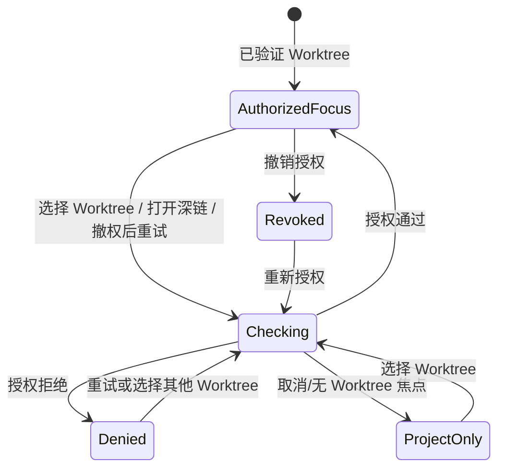

# W14 UI-1 流程原型复核（2026-10-26）

## 0. 目的与范围

复核 `docs/prototypes/w14-ui1-flow-20261026/index.html` 是否遵循 UI-0 冻结的 Project → Engineering Run → Worktree → Branch 层级，并如实呈现授权门、同级 Run Apps、任务卡 CLI 状态及聊天 scope。复核对象是静态交互原型，不是产品实现或运行验收。

## 1. 复核结果

| 检查项 | 结果 | 证据/说明 |
|---|---|---|
| 三种布局保持同一导航顺序 | 通过 | A 项目树、B Project Worktree Index、C 聚焦控制台共享 Project/Run/Worktree/Branch 语义；布局切换写入 `?variant=` |
| Worktree 焦点和授权门 | 通过（原型状态） | 切换 Worktree/深链先进入 checking；通过后才展示 Run tabs；denied/revoked 时隐藏 tabs 与旧 Branch 值 |
| Project Worktree Index | 通过（原型状态） | 作为 Project 范围入口展示，并注明真实列表须按当前用户权限过滤；打开行再次执行 Worktree 授权流程 |
| Task Cards / Canvas 同级与引用关系 | 通过（原型状态） | 二者位于 Run tabs；Canvas 节点打开 canonical Task Card，不复制任务事实 |
| 任务卡内 CLI | 通过（禁用态） | 不启动 Shell；明示 Runtime、sandbox、原生 Hook、预算、当前授权、取消/恢复、独立验证和结果回写门 |
| GLOBAL / WORKTREE 草稿隔离 | 通过（内存模型） | GLOBAL 单独保存；WORKTREE 草稿以 Worktree ID 分区，失焦/撤权自动切 GLOBAL |
| 窄屏与键盘基本结构 | 部分通过（源码审阅） | 页面有 980px/700px 响应式样式、原生 button/textarea、可读标签及 reduced-motion 规则；未用真实浏览器或辅助技术验证 |
| 数据、服务与性能真实性 | 未适用/未验证 | 任务、目录、状态均为原型场景；没有 API、持久化、Shell、生产连接、RSS/CPU/帧时间或并发测量 |

## 2. 发现与修正

源码复核发现五项状态风险并在原型中修正：

1. 撤权/重新选择期间仍可能显示上一个 Worktree 的 Branch；现在旧焦点内容隐藏，未验证时只显示“未验证/未加载”。
2. Worktree 草稿曾只按 WORKTREE/GLOBAL 区分；现在 WORKTREE 草稿还按 checkout ID 分区。
3. 点击另一 Worktree 曾直接进入授权完成态；现在切换、深链、重试都先进入 checking，可分别演示授权通过与拒绝。
4. 每次 scope 切换都会重建聊天输入框；草稿恢复赋值曾发生在重建之前。现在先重建，再按 GLOBAL 或当前 Worktree ID 恢复内存草稿。
5. WORKTREE scope 点击分支读取了 `render()` 内的局部授权状态；现在在点击处理器中按当前 state 重新计算授权门，未授权时不切换 scope。

## 3. 流程状态图

授权检查、拒绝和撤权状态不得展示 Worktree 专属 App 数据；Project 与 Run 导航仍作为上层导航存在。

## 4. 已知缺口

- 这是同一实现者对原型的源码复核，并非独立人员审查；将 UI-1 定为“原型已交付、同伴复核待补”。
- 未启动浏览器，未产出截图；交互路径、视觉层级、窄屏触控尺寸和屏幕阅读器输出没有实测。
- 变体仅供结构比较；没有用户选定方案，不能据此决定生产视觉或 Rust UI 框架。
- 真实 Project/Run/Worktree 列表、权限 API、授权撤销推送、持久草稿、冲突提示、虚拟化、后台订阅 drain 都未接入。
- Task Card CLI、Inbox、Workflow、BI/Benchmark、Plugin Apps 与发送消息均保持禁用或明确未连接。

## 5. 验证摘要

- 已完成定向源码/文案审阅；检查导航次序、操作入口、授权状态分支、scope 草稿键与禁用态。
- 未运行测试、构建、浏览器、服务端或性能基准。
- 文档与原型状态均未作为产品完成证明。

## 6. 后续门

1. 请用户比较 A/B/C 并选定或提出调整；同伴复核也应在 UI-2 冻结指标前补齐。
2. UI-2 确定目标 Windows 设备和真实 workload，测量当前 Tauri+React 路径的 RSS、CPU、渲染响应、数据规模与并发档位。
3. 在 UI-2/UI-3 中完成键盘、辅助技术、长目录/长文本、草稿撤权及授权竞态的运行验收。
4. UI-3 才能在相同数据/交互契约下比较 Rust-native 原型；UI-4 根据实测决定迁移或优化现有路径。

## 7. 审核责任

- 复核者：主任务 agent（同一实现者的静态复核）
- 独立复核：待补
- 结论：原型状态逻辑与冻结设计基本一致；UI-1 运行态/独立复核门未通过，不关闭 W14。
