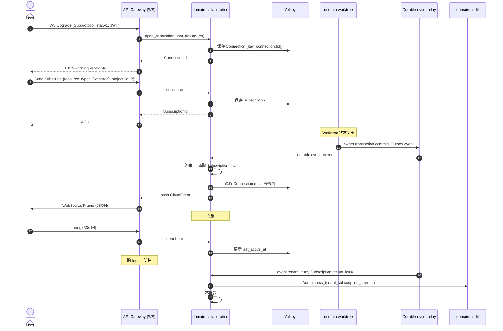

# domain-collaboration 实施 spec

> **状态**: Draft v0.9 (2026-10-24；push/conflict 与 owner-local schema 契约优先于下方旧接口/传输草稿)
> **上游依赖**:
> - 《Requirements》§15, REQ-RT-001~003, §50.8AW / AC-COLLAB-01–08
> - 《Basic Design》§2.1(表 24), §5.7, §16.78
> - 《Group Detailed Design》§8.27
> - 《API Design》§4 (WebSocket / Realtime 通道)
> - 《Data Design》§4.17 (`collaboration` schema)
> - 《Security Design》§3.1-3.4
> - Owner-local target schema：`docs/data-design/WLD-7-COLLABORATION-DATA-DESIGN.md` v0.1
> - 验收计划：`docs/test-design/TEST-DESIGN-WORKTREE-CANVAS-001.md` §4.8/§5.2/§6.2.5（计划，未运行）
> **下游交付**: Implementation team — Rust crate 路径 `crates/domain-collaboration/`
> **最后审稿**: 待 RFC 化时

---

## 1. 职责与边界

`domain-collaboration` 承载**协作(实时状态、Presence)**(§15,REQ-RT-001~003)。高频 Token Stream 可不入 SaaS(§15,REQ-RT-003),MVP 阶段复用 work-core 进程。

**属于本 crate 的**:
- Presence 实体(用户在线状态)
- RealtimeSubscription(WS 订阅管理)
- Realtime 推送事件路由

**不属于本 crate 的**:
- WebSocket 协议实现(由 API Gateway / work-core 提供,本 Module 提供事件路由)
- Comment 实体(`domain-comment` 拥有)
- Notification 发送(`domain-notification` 拥有)

## 2. 关键实体

引用 data-design §4.17 (`collaboration` schema):

**Presence**(实体,短期)
- 标识: `presence_id`, `tenant_id`, `user_id`
- 状态: `status`(Online / Away / Offline)
- 时间: `last_active_at`, `expires_at`(心跳 60s 过期)
- 范围: `resource_type`, `resource_id`(当前正在查看的资源)

**RealtimeSubscription**(实体,短期)
- 标识: `subscription_id`, `tenant_id`, `user_id`, `connection_id`
- 过滤: `filter: SubscriptionFilter`(resource_types, project_id, work_item_id, worktree_id, event_types)
- 状态: `resume_cursor` 是连接期不透明恢复提示；它不是授权、业务 ACK 或持久 subscription checkpoint。Durable owner stream 负责事实恢复，客户端只在 bootstrap/reconnect/gap 时提交 cursor
- 时间: `created_at`, `last_ping_at`

**RealtimeEventPayload**(值对象,CloudEvents 1.0)
- `event_id`, `source`, `type`, `subject`, `time`
- `tenant_id`, `resource_ref`, `stream_id`, `sequence`, `schema_version`, `owner_revision`, `correlation_id`, `data: typed bounded delta/metadata`

## 3. 关键不变量

| ID | 不变量 | 上游依据 |
|---|---|---|
| INV-CB-01 | 必带 tenant_id,跨 tenant 拒绝 | basic-design §6.1, REQ-SEC-001 |
| INV-CB-02 | WebSocket 单一连接 + 多 Subscription(每 Connection ≤ 100 Subscription) | api-design §4.2 |
| INV-CB-03 | Presence 60s 心跳过期(last_active_at + 60s < now → Offline) | basic-design §23.4 |
| INV-CB-04 | Realtime Event 必带 tenant_id 且 AuthorizationChecker 校验一致 | api-design §4.4, security-design §3.5 |
| INV-CB-05 | 高频 Token Stream 可不入 SaaS(REQ-RT-003) | basic-design §15 |
| INV-CB-06 | MVP 阶段不拆 `realtime-service`(§8.2,§13.1) | basic-design §13.1, §30.3 |
| INV-CB-07 | 已连接协作不依赖固定周期轮询；资源 owner commit + Outbox 是 push 触发源，cursor catch-up 只用于 bootstrap/reconnect/gap | requirements §50.8AW, basic-design §16.78 |
| INV-CB-08 | stale base 的重叠 patch 不覆盖；两方精确 draft revision 与 conflict 参与者同事务固定，双方重新授权后可读取差异 | requirements AC-COLLAB-02/03, Group DD §8.27 |
| INV-CB-09 | 慢连接队列有界；溢出必须标记 resync 并按 durable cursor 恢复，不得静默丢弃 owner event | requirements AC-COLLAB-05/06, Group DD §8.27 |

## 4. 接口签名

继承 api-design §4。

```rust
// crates/domain-collaboration/src/port.rs

pub trait CollaborationCommandPort {
    /// WebSocket 连接建立
    async fn open_connection(
        &self,
        cmd: OpenConnectionCommand,  // user_id, device_id, jwt
        actor: ActorContext,
    ) -> Result<ConnectionId, CollaborationError>;

    /// 订阅资源
    async fn subscribe(
        &self,
        cmd: SubscribeCommand,  // connection_id, filter
        actor: ActorContext,
    ) -> Result<SubscriptionId, CollaborationError>;

    /// 取消订阅
    async fn unsubscribe(
        &self,
        cmd: UnsubscribeCommand,
        actor: ActorContext,
    ) -> Result<(), CollaborationError>;

    /// 心跳
    async fn heartbeat(
        &self,
        connection_id: ConnectionId,
    ) -> Result<(), CollaborationError>;

    /// 关闭连接
    async fn close_connection(
        &self,
        connection_id: ConnectionId,
    ) -> Result<(), CollaborationError>;

    /// 更新 Presence
    async fn update_presence(
        &self,
        cmd: UpdatePresenceCommand,  // status, resource_type, resource_id
        actor: ActorContext,
    ) -> Result<(), CollaborationError>;
}

pub trait CollaborationQueryPort {
    /// 列出当前订阅
    async fn list_presence(&self, q: ListPresenceQuery, viewer: ActorContext) -> Result<Vec<Presence>, CollaborationError>;
}

/// Provider-neutral durable event route (owner Outbox → realtime subscription)
pub trait RealtimeEventRouter {
    async fn route(&self, event: DomainEvent) -> Result<usize /* delivery count */, CollaborationError>;
}
```

## 5. Domain Events

**本 Module 不发布业务 Domain Event**,仅作为**事件路由器**将各 Domain Event 推送给匹配的 WebSocket Subscription。

**订阅者**:
- Resource owner 的版本化事件经 provider-neutral durable relay 路由；transport subject/topic 仅由 adapter 映射，不构成业务契约。
- 服务端依据当前授权的 canonical resource scope 路由；客户端 filter 只能缩小订阅范围，不能扩大可见范围。

**发布**:
- `star.events.collaboration.connection.opened.v1`
- `star.events.collaboration.connection.closed.v1`

以上是版本化 event type 标识，不是 NATS subject 或 broker stream 名；连接生命周期事件不得携带 draft/conflict 正文。

## 6. 数据所有权

引用 data-design §4.17(`collaboration` schema):

- `collaboration.presence`(实体,短期,Valkey 缓存为主,PG 备份)
- `collaboration.subscription`(实体,短期,Valkey 为主)
- Durable business events, revisions, drafts and conflict facts remain in each canonical resource owner's tables/Outbox; Collaboration does not create duplicate Task/Canvas storage.
- Presence and subscriptions are short-lived Work facts. Conflict participant/read state remains with the canonical resource owner; Collaboration stores only bounded ephemeral routing state and aggregate delivery metrics, never a full event copy per subscriber.

**RLS 策略**:
- 全部启用 RLS,`USING (current_setting('app.current_tenant_id') = tenant_id)`

**索引策略**:
- `collaboration.presence(user_id, last_active_at DESC)` — 在线状态
- `collaboration.subscription(connection_id)` — Connection 订阅查询
- Owner stream cursor/consumer state — durable recovery position, not authorization or business receipt

## 7. 鉴权与授权

**Capability 意图**:
- `realtime:subscribe` 与 `presence:read` 表示命令意图；实际可见范围由当前 Project/Engineering Run/Worktree/resource capability 决定。
- 每次 subscribe、catch-up、presence/conflict read、draft write 与 resolve 均须重新核验 owner 授权；静态内置角色不得绕过 owner 授权。撤权后立即关闭订阅并拒绝恢复读取。

## 8. 错误码

| 错误码 | HTTP / WS | 触发条件 |
|---|---|---|
| `SEC-001/002/007` | 401/403/403 | 鉴权类 |
| `CB-001` | 1008 (WS Policy Violation) | WebSocket subprotocol 不支持 |
| `CB-002` | 429 | Subscription 超过 100/Connection |
| `CB-003` | 422 | Subscription filter 非法 |
| `CB-004` | 1008 | WebSocket ping 60s 内未回 pong |

## 9. 实施任务分解

| 任务 | 描述 | 依赖 | TBD-MEASURE | 估算 |
|---|---|---|---|---|
| T1 | Presence + Subscription + EventPayload 实体 | 无 | — | 60K tokens |
| T2 | `CollaborationCommandPort` 6 个方法 + 错误码 | T1 | — | 100K tokens |
| T3 | `CollaborationQueryPort` 1 个方法 | T1, T2 | — | 40K tokens |
| T4 | `RealtimeEventRouter` 1 个方法(订阅 + 路由) | T1 | api-design §4.4 | 150K tokens |
| T5 | WebSocket 协议支持(star.v1 subprotocol) | T4 | api-design §4.2 | 120K tokens |
| T6 | Subscription 过滤逻辑(filter 评估) | T4 | api-design §4.3 | 100K tokens |
| T7 | Presence 60s 心跳过期 | T1 | basic-design §23.4 | 50K tokens |
| T8 | Valkey 缓存 Presence / Subscription(主存储) | T1 | data-design §4.17 | 80K tokens |
| T9 | 单元测试 + 路由测试 + 心跳测试 | T1-T8 | security-design §3.5.4 | 120K tokens |
| T10 | 集成测试:WS Connect → Subscribe → Event 推送 | T9 | api-design §4 | 100K tokens |

**合计估算**: ~920K tokens ≈ 4 人·天(AI 协作模式)

## 10. 验收标准(AC)

```gherkin
Feature: 实时协作与 Presence

  Scenario: WebSocket 连接与订阅
    Given User U 认证
    When WS wss://api/v1/realtime/subscribe (Subprotocol: star.v1, Authorization: Bearer)
    Then 连接成功
    When Send Subscribe {resource_types: [worktree], project_id: P}
    Then SubscriptionId 返回
    And  后续 Worktree 状态变更推送

  Scenario: 单 Connection ≤ 100 Subscription
    Given WS Connection C
    When 第 101 个 Subscribe 发送
    Then 429 CB-002

  Scenario: 事件路由 — Cross-Tenant 拒绝
    Given Subscription 订阅 tenant_id=X
    When 事件 tenant_id=Y 发布
    Then 跨 tenant,不推送
    And  Audit 记录 cross_tenant_subscription_attempt

  Scenario: 心跳过期
    Given Presence P (last_active_at = 5 min ago)
    When UI 读取
    Then 标记 Offline(≥ 300s 区间)

  Scenario: 子协议不匹配
    Given WS Subprotocol: other.v1
    When 握手
    Then 1008 CB-001 (Policy Violation)
```

## 11. 风险与缓解

| Risk | 影响 | 缓解 | 引用 |
|---|---|---|---|
| Cross-Tenant 推送 | Critical | INV-CB-04 + AuthorizationChecker 强制 | security-design §3.5.1 |
| Subscription 风暴 | High | 100/Connection 限流 | api-design §4.2 |
| Presence 不准确 | Low | 60s 心跳 + Stale Display | basic-design §23.4 |
| 长连接扩展性 | Medium | MVP 复用 work-core,V1 评估拆 service | basic-design §13.1, §30.3 |

## 12. Open Issues

- J-CB-01: 高频 Token Stream(IDE autocomplete)是否走 SaaS?(§15,REQ-RT-003 由 Local Runtime 直接)
- J-CB-02: Presence 是否暴露给其他 User(可见名单)?(目前本人可见自己)
- J-CB-03: 已解决：不持久化 WebSocket Subscription 作为业务事实；断线恢复用客户端不透明 cursor + owner durable stream catch-up，恢复时重新授权；已过保留期则返回当前 snapshot 与显式 gap 标记
- J-CB-04: Realtime 事件是否压缩?(目前 JSON UTF-8)

## 附录 A:关键流程时序图 — WebSocket 订阅 + 事件推送



## 附录 B:边界清单

| 边界类型 | 本 Module 行为 |
|---|---|
| 上游依赖 | 版本化 owner event 契约 + provider-neutral durable relay；具体 broker/topic 由 adapter 管理 |
| 下游调用 | `domain-audit`(跨 tenant 推送尝试) |
| 跨域事务 | 无(异步事件路由) |
| RLS 强制 | 全部启用 RLS,Valkey Key 强制 tenant_id 前缀 |
| 13 类 tenant_id 对象 | 间接覆盖(本 Module 推送 13 类对象事件) |
| 14 状态 AgentSession 触发 | **直接**:AgentSession 状态变更通过本 Module 推送 |
| 17 状态 Worktree 触发 | **直接**:Worktree 状态变更通过本 Module 推送 |
| WorkItem 3 态 | **直接**:WorkItem 状态变更通过本 Module 推送 |

**接口稳定承诺**:Port trait 签名 + WebSocket subprotocol `star.v1` + 100/Connection 限流 + 4 条错误码在后续 RFC 阶段不会变更。

## 15. 与其他 domain 协作 (v0.16 协作细化新增)

per [basic-design v0.16 §3.2.9 22 domain contact face 表](../../basic-design.md) + [ADR-0039 §D26-D32 Worktree Orchestration 跨域协作](../../architecture/2026-08-26-upgrade/adr/0039-worktree-orchestration-cross-domain.md) + [spec/saga/01 v0.2 SagaCoordinationRole](../../architecture/2026-08-26-upgrade/spec/saga/01-saga-coordination-spec.md),本节定义 `collaboration` 与 22 domain 中 4 个 domain 的显式接触面。

| 源 Domain | 目标 Domain | 接触方式 | 接触点 |
|---|---|---|---|
| collaboration | work-item | Customer-Supplier | Realtime 状态推送 (per requirements §15) |
| collaboration | comment | Customer-Supplier | Realtime 推送 Comment / @mention |
| collaboration | star-sse | Shared Kernel | 通过 star-sse crate WebSocket 通道 (per star-sse/src/lib.rs) |

**接触面统计**: 3 条 (v0.16 新增,本 spec 由 `scripts/inter_collab_refine.py` 批量生成)

**dual-use 警告** (per AGENTS.md §5 v0.6 + Q1-D 拍板): 5 域 (player/economy/match/social/admin) 是 RGS 仓历史治理命名,Star 仓不建立业务子域↔DDD 映射。本 spec 协作基于 22 domain crate,不通过 5 域绑定推导。

## 13. v0.2 Push-based editing, draft preservation and conflict protocol

This section supersedes any v0.1 interpretation that a process-local broadcast channel or a transport-specific subscription is the durable collaboration contract. It also supersedes cursor polling as a live update mechanism. The live path is owner transaction (revision + Outbox + small commit notification) → bounded/coalesced wake-up → owner-local Outbox claim → provider-neutral durable event relay → authorized resource-scoped WebSocket fan-out. The transactional notification wakes an online relay; a single pending latch coalesces in-process bursts without silent queue overflow. If a relay/listener is offline, startup/reconnect first catches up from the durable cursor/backlog; individual failed publishes use bounded due-retry timers. Normal publication is wake-driven, not a periodic Outbox table scan. The wake-up is not a business fact; the committed owner Outbox is durable truth. Cursor catch-up is an on-demand recovery operation only for initial bootstrap, reconnect or an explicit gap signal.

**Implementation status:** the browser Group projection currently runs interval-based `CanvasOutboxPoller.pollOnce`; the BFF WebSocket and SSE surfaces are not yet a durable cross-instance relay. The live Group path therefore still polls and does not meet this specification. These existing paths are migration targets, and this specification defines target behavior rather than claiming production collaboration is already available.

### 13.1 Domain ownership

`domain-collaboration` owns connection/subscription/presence lifecycle, per-resource recipient routing and bounded delivery telemetry. It does not own WorkItem or Canvas document truth. Each resource owner (WorkItem, Canvas, or another Run App owner) owns its own revision, base-revision CAS, actor/device draft checkpoint, conflict and resolution facts, audit, unread conflict participant state and transactional Outbox. This keeps conflict detection atomic with the resource update and prevents a second document store.

### 13.2 Typed client and owner contract

| Operation | Request identity | Result |
|---|---|---|
| `Subscribe` | Authenticated session, canonical resource scope, opaque cursor | Authorized subscription; initial bootstrap returns a consistent snapshot/cursor or starts replay from the supplied cursor |
| `SaveDraft` | `resource_ref`, `base_revision`, `draft_id`, monotonic `draft_revision`, stable `operation_id`, schema version and bounded patch | Coalesces the owner draft head; on complete overlapping heads, the owner seals/pins exact proposals and returns the durable conflict ID without waiting for final Save |
| `ReadConflict` | `conflict_id` | Reauthorizes a conflict participant/resolver and returns bounded base/current/mine/theirs diffs; never sends conflict text in broad fan-out |
| `ResolveConflict` | `conflict_id`, latest `expected_revision`, resolution delta, idempotency key | Explicit CAS resolution fact; stale resolution preserves both drafts and creates/recomputes a successor conflict |
| `CatchUp` | `stream_id` plus opaque last-applied cursor | Bounded authorized replay after reconnect/gap; if retention expired, returns a current authorized snapshot plus explicit gap marker |

Actors, scope, recipients, stream sequence and current permission are derived by the server. Client-provided actor/time/path summaries are untrusted. Every save, read, resolve, subscribe and replay rechecks current Project/Run/Worktree/resource capability; revocation closes the subscription. Use owner-specific API adapters rather than a collaboration endpoint that writes tables owned by another domain.

### 13.3 Overlap and conflict behavior

Owner serializes revisions using its own CAS/revision fence. Draft checkpoint/seal and revision/resolve transactions use the same short per-resource fence for the critical section that checks committed revisions plus active-draft indexes and updates those indexes; this prevents a concurrent draft from appearing just after a revision transaction scanned for overlap. The fence is resource-local and is not held while network chunks arrive. Normal deltas coalesce into the mutable owner draft head and do not append immutable snapshots per keystroke. An explicit durability checkpoint may seal a snapshot. When complete, digest-verified heads overlap, the owner seals and pins their exact revisions inside the conflict transaction; no final Save is required. Further typing advances the head revision without changing pinned checkpoints. Disjoint structured fields/paths are deterministically rebased and committed. Free-form text uses a versioned, server-authoritative bounded OT log: safely transformable operations converge deterministically; overlapping replacements/deletions that cannot be transformed without changing intent become a conflict. Task lifecycle state changes use owner commands, and Canvas uses stable element/property IDs; relative transforms merge only when their operation type declares commutativity. Last-write-wins is forbidden. A conflict record pins base/current revisions, each participant's exact draft revision and content digest, overlap path set and state. A user-visible conflict is created only after both exact proposals are complete, digest-verified, sealed and readable; partial uploads remain author-private `sync_pending`/`local_only` draft state. A uniqueness rule over canonical resource identity plus the ordered pair of proposal identities ensures retries and concurrent detectors return one stable `conflict_id`. Further typing advances the mutable draft head and cannot overwrite content pinned by an unresolved conflict. Both participants can reauthorize and fetch the complete diff, while other viewers receive neither private draft nor conflict body.

If a client base falls outside the retained OT transform window, it keeps its local draft and reloads a consistent authorized snapshot; it must not guess a transform or overwrite unseen edits. Large conflict differences use bounded authorized pages with stable pinned proposal references.

Local draft persistence happens before network submission in bounded encrypted device storage. Desktop key material is protected by the OS secure store; the Web client uses a profile-scoped secure-storage adapter. If no protected key is available, retain the draft in memory, label it `local_only`, and do not claim it is durable. The client starts an event-triggered debounce only after a draft becomes dirty, sends coalesced deltas at most 250 ms apart while edits continue, performs no idle polling, and flushes on blur/save/navigation/close. Keep at most one write in flight per draft and coalesce newer input into one Project/profile-bounded pending delta; when byte/time budgets are reached, preserve the encrypted local draft and show `sync_pending`/delivery lag rather than growing an unbounded request queue. The patch limit is 16 KiB; local storage and server draft size/retention are bounded by Project policy. A server-unreachable draft is labeled `local_only`. Unresolved conflicts are retention-locked; resolved/discarded draft content expires only under the Project retention policy. Audit, metrics, Plugins and BI must not receive raw draft text by default.

### 13.4 Event identity and low-resource delivery

A durable owner event includes `event_id`, `stream_id`, monotonically increasing `sequence`, schema version, canonical resource/revision, actor and correlation/idempotency identity. Owner commit emits a transactional notification to wake a relay, and the in-process pending latch coalesces bursts. Listener/process unavailability is recovered by cursor/backlog catch-up on restart/reconnect; each failed event publish is scheduled by its bounded due-retry timer. There is no periodic client polling or Outbox scan in the normal path. Clients deduplicate at least-once delivery by event ID plus stream sequence. The event body is compact metadata/delta, not a repeated full document; conflict body is loaded by ID under fresh authorization.

One app window multiplexes up to 100 authorized resource subscriptions over one connection. The initial connection budget is 64 queued events or 128 KiB, whichever is reached first. A slow consumer receives `resync_required` where possible and is closed; it then catches up from its durable cursor. Never silently drop durable business events and continue from a later sequence. Presence and cursor events may be coalesced/throttled under short TTL because they are observed state, not business facts. Metrics track commit-to-client delay, Outbox lag, conflict count, draft recovery, replay gap, per-connection bytes and RSS without retaining unbounded event payloads.

For online participants with valid subscriptions and healthy network, both clients must display the same persistent unread `conflict_id` and fetch the first bounded page of the exact pinned base/current/mine/theirs diff at p99 ≤ 1 s from owner conflict transaction commit. The timer begins only after both proposals are sealed and readable; this is a delivery/readability SLO, not an upload deadline, polling cadence or conflict-detection window. An alert never points to a proposal still `receiving`. Transport ACK confirms receipt only and cannot mark a conflict read. A delivery timeout is observable and leaves both participant conflict states unread/replayable. Offline clients see the durable conflict after reconnect; no design promises delivery across a network partition, so persistence and later recovery are mandatory.

### 13.5 Acceptance gates

| ID | Gate |
|---|---|
| AC-COLLAB-01 | No fixed-interval client polling while connected and no periodic Outbox table scan in the normal publication path; owner commit emits a bounded wake-up, and committed Outbox facts route to authorized subscriptions for exactly that resource scope. |
| AC-COLLAB-02 | Concurrent disjoint edits merge without lost updates; overlapping edits preserve both drafts, create one recoverable conflict and require explicit CAS resolution. Draft checkpoint/seal and revision CAS share a per-resource fence; race tests prove no missed overlap. |
| AC-COLLAB-03 | The owner transaction pins both exact draft revisions; both conflict participants can recover their own draft and read base/current/mine/theirs after fresh authorization; unrelated principals cannot read private draft or conflict content. |
| AC-COLLAB-04 | A user-visible conflict requires both exact proposals to be complete, digest-verified, sealed and readable; both online participants display the same persistent unread `conflict_id` and fetch its first bounded diff page at p99 ≤ 1 s after conflict commit. Transport ACK does not mark it read. Offline, delayed ACK, process restart and cursor gap preserve/replay the conflict; the target is not an upload deadline, polling cadence or conflict window. |
| AC-COLLAB-05 | Two gateway instances, listener/owner restart, missed commit notification, duplicate/reordered delivery, cursor gap and permission revoke recover from durable owner events without lost drafts or duplicate business effect. |
| AC-COLLAB-06 | Load test proves one multiplexed connection, bounded patch/frame/queue/cache, at most one in-flight write and one coalesced pending delta per draft, coalesced presence, measured RSS/CPU and backpressure recovery at agreed concurrent editor/agent counts. |
| AC-COLLAB-07 | Draft/conflict owner tables meet W/T/M classification, tenant RLS, participant-only read authorization, audit and retention rules; target database grants, migration replay and backup recovery pass before production enablement. |
| AC-COLLAB-08 | Versioned bounded OT operations converge deterministically for transformable text edits; ambiguous overlap remains a recoverable conflict, while a stale client outside the transform window keeps its draft and reloads a consistent snapshot. |

The current code inventory is not a pass for these gates: `CollaborationWssHub` is process-local fan-out and reports dropped lagged frames; Worktree SSE has no durable business event fan-in; the Canvas cursor endpoint is a read seam, not a transport consumer ACK or live event delivery. Production status stays disabled until canonical owner draft/conflict APIs and cross-instance durable fan-out are verified.

### 13.6 Owner-local schema and test mapping

The schema in `docs/data-design/WLD-7-COLLABORATION-DATA-DESIGN.md` is the logical target for each canonical WorkItem/Canvas owner, not a new Collaboration-owned content store. Draft heads/checkpoints are W with explicit retention; conflict, participant visibility/view receipts, resolution, Audit and Outbox are owner-local T facts. Concrete owner migrations, Data Inventory rows, grants, RLS and target PostgreSQL evidence remain open. The planned double-actor, two-gateway and recovery coverage is in `docs/test-design/TEST-DESIGN-WORKTREE-CANVAS-001.md`; its new cases are not implemented or executed. The current client read/poll and process-local gateway paths remain the implementation baseline until replaced and measured.

Revision v0.4 · 2026-10-24 · Mavis review: reconciled legacy NATS/role/subscription wording with provider-neutral owner events, current resource authorization, cursor-only recovery and the v0.2 push/conflict acceptance gates.
Revision v0.5 · 2026-10-24 · Mavis review: promoted the resource-scoped push/conflict contract over older transport drafts and recorded that the live Group path still uses interval polling.
Revision v0.6 · 2026-10-24 · Mavis review: require both sealed, digest-verified readable proposals before conflict visibility; extend the one-second p99 objective through first bounded diff-page read; specify deterministic bounded OT, stale-base recovery and transactional-notification/wake-latch relay recovery; synchronize requirements v7.04, basic design v7.07 and Group DD v5.29. Implementation remains open.
Revision v0.7 · 2026-10-24 · Mavis review: add the owner-local W/T/M target record map, retention/RLS/grant and target-migration acceptance boundary; specify coalesced mutable draft heads, one in-flight write plus one bounded pending delta per draft, and automatic sealing/pinning on overlap without requiring final Save; link the planned two-actor/two-gateway E2E and performance evidence; synchronize requirements v7.05, basic design v7.08, Group DD v5.30, data design v0.1 and WBS v0.32. No migration or runtime push implementation is claimed.

Revision v0.8 · 2026-10-24 · Mavis review: correct the Basic Design collaboration cross-reference to unique §16.78; retain §16.56 for the existing Schedule D5 section. No change to runtime status; WLD-7 remains open.
Revision v0.9 · 2026-10-24 · Mavis review: align INV-CB-07 with the unique current Basic Design section §16.78; keep §16.56 reserved for Schedule D5. Runtime remains polling-based and WLD-7 remains open.
